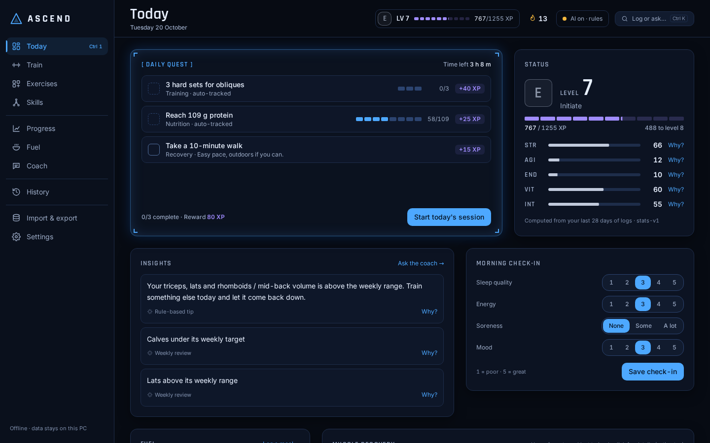
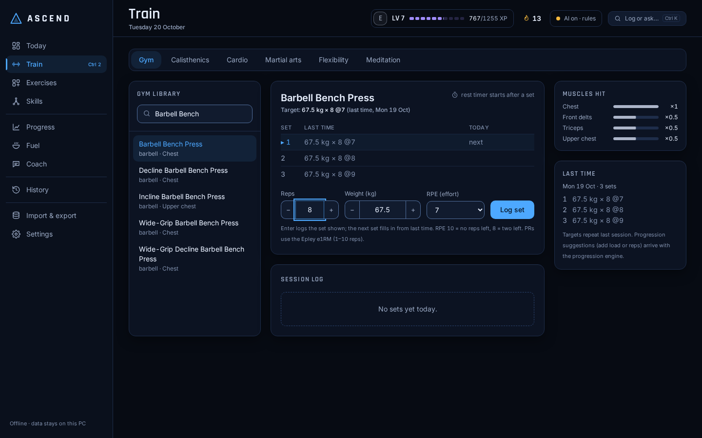
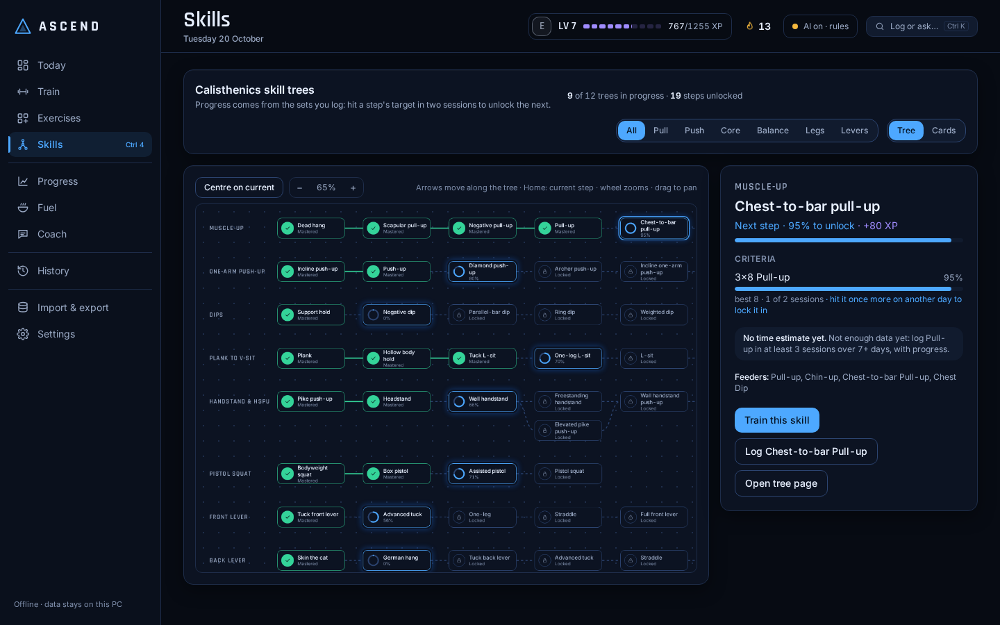

# ASCEND

**An offline Windows desktop fitness RPG.** Log workouts and Indian meals, earn XP, clear daily
quests, keep a streak and rank up from **E to S**, while a muscle map shows which muscles are
under-trained, recovering or overreached. Everything runs and is stored on your own PC; an
optional local AI coach (Ollama + `qwen3:4b`) explains your numbers, and the app works fully
without it.



| Train: three-pane logger | Skills: tree canvas |
|---|---|
|  |  |

> Screens use demo data from `app.devtools.seed_demo`. The v0.1 MVP screens are kept in
> [docs/screenshots](docs/screenshots/).

## The v5 interface

| What | How it works |
|---|---|
| **Today ("Hunter HQ")** | The daily quest as a System window with time left, a status panel (STR, AGI, END, VIT, INT) where every number has a "Why?", up to three insights, check-in, fuel and the muscle map on a 12-column grid. |
| **Train** | Keyboard-first logger: last session's sets in grey next to today's, the next set pre-filled from last time (Enter logs it), a rest bar (Space pauses), muscles hit and the skills the exercise feeds. |
| **Skills** | A zoomable, pannable tree canvas per family; arrow keys move along the edges; a drawer shows the criteria, the estimate (only with enough data) and "Train this skill". |
| **Ctrl+K** | Command bar: `bench 80x5 @8`, `log 3x8 pull-up`, `plank 45s`, `weight 81.4`, `add 2 eggs`, `train front lever`, a page name, or any question for the Coach. Rule-based, no model. |
| **Awakening** | Five-step first run with an equipment checklist (respected by quests and skill suggestions) and a baseline test logged as a real session. |
| **Streaks** | Freezes cover missed days, and a missed day never removes XP, levels, ranks or skills; the next quest adds a short Comeback item instead. |
| **Accessibility and motion** | WCAG AA colours in both themes (unit-tested), labelled controls, axe-clean screens, Reduce motion honoured everywhere, optional sound off by default. |

Shortcuts: **Ctrl+K** command bar · **Ctrl+1…0** pages · **Enter** log the set shown ·
**Space** pause rest · arrows on the skill canvas.

## The v6 intelligence layer

Two deterministic engines, pure Python on the CPU. The local model is optional and only ever
phrases what the engines computed.

| What | How it works |
|---|---|
| **Recovery (`recovery-v2`)** | Per-muscle readiness for all 19 regions from each set's dose (muscle weight × effort from reps in reserve × volume; holds by seconds), decayed by the muscle's half-life × your personal factor, adjusted by today's check-in. Drives the muscle map, quests and the weekly review. [ADR-0014](docs/architecture/adr/0014-recovery-engine-v2.md) |
| **Personal recovery factors** | One factor per muscle group, fitted after every workout from how your performance follows fatigue. Starts at the population value, moves only with evidence, shown with a 90 % interval and as **"you vs population"** on the muscle drill-down. |
| **Progression (`prog-v1`)** | The logger's **suggestion card** (Use it / Keep mine / Why?): double progression in your rep zone, equipment-aware increments (never more than 10 % at once), RPE autoregulation, e1RM tracking, stall detection with a 10 % reset, hold progressions, and skill-tree criteria for calisthenics. No increase while the muscles are under 40 % recovered. [ADR-0015](docs/architecture/adr/0015-progression-engine-prog-v1.md) |
| **"Why?" everywhere** | Every target and readiness shows its formula and inputs. With AI on, `qwen3:4b` may phrase one sentence, shown only if every number passes the coach guard; otherwise the template sentence. [ADR-0016](docs/architecture/adr/0016-explanations-and-system-voice.md) |
| **The System speaks, rarely** | Three notices, each shown once: Deload advised, Target raised, Muscle recovered. |
| **Evaluation** | A seeded synthetic-user simulator with baselines, in [docs/ai/evaluation.md](docs/ai/evaluation.md) ([ADR-0017](docs/architecture/adr/0017-evaluation-synthetic-users.md)). On synthetic users, prog-v1 targets were hit within 1 rep on 93.1 % of exposures (linear +2.5 kg with resets: 71.8 %) and too hard on 2.7 % (22.4 %); recovery-v2 readiness correlates with the simulated truth at Pearson r 0.907-0.946 (fixed 48 h rule: 0.520-0.579). |

**Honest limitations of v6**

- **Synthetic users only.** Both engines were evaluated on simulated users, not real people.
- **Recovery r ≈ 0.9 is partly circular.** It is measured against the simulator's own ground truth, which uses the same model family as the engine. It shows the estimation works under those assumptions, not that people recover this way.
- **Stall detection is weak:** precision 0.113, recall 0.62 on synthetic stalls. That is why a stall alone never triggers a deload.
- **Real local-model phrasing is unverified.** No Ollama was available on the build machine; the guard is tested with a stub model. Without a model the app shows template text and is fully functional.
- Latency was measured on the 4-CPU Linux build machine (finishing a workout: p50 394.2 ms), not on the target Windows laptop.

## v7: diet engines and the new layouts

Every screen now uses one 12-column layout with consistent loading, error and empty states,
and motion that respects Reduce motion. Two more deterministic engines feed Fuel and Progress, and Train can follow a workout program.

| What | How it works |
|---|---|
| **Adaptive TDEE (`tdee-v1`)** | A two-state Kalman filter on trend weight and expenditure, fed by your weigh-ins and logged meals. It starts from Mifflin-St Jeor with a wide range and narrows as data comes in. Missing days widen the range instead of breaking it. The weekly calorie target moves only on Mondays, only after a week with 6 logged days and 4 weigh-ins, and by at most 150 kcal. Fuel shows the range, the target, completeness and the reason. [ADR-0018](docs/architecture/adr/0018-adaptive-tdee-kalman.md) |
| **Weekly insights (`insights-v1`)** | Six fixed rules over the last 7 complete days: intake vs target, protein, weekend vs weekday, weight trend vs goal, adaptive vs formula, and logging gaps. Progress shows up to three findings, each with a "Why?", plus the list of rules that were checked. [ADR-0019](docs/architecture/adr/0019-weekly-diet-insights.md) |
| **Workout programs (`programs-v1`)** | Four built-in programs: full body 3 days, upper/lower 4 days, push/pull/legs 6 days, and home full body 3 days. The Program card on Train shows the next session with each exercise's target from your progression and the sets you have done today. The plan reads your log: a finished workout that covers half of a program day counts as that day, so a missed day shifts the plan instead of skipping a session. [ADR-0020](docs/architecture/adr/0020-workout-programs.md) |
| **Evaluation** | Synthetic users, seed 2026 ([docs/ai/evaluation.md §5](docs/ai/evaluation.md)). Median TDEE error at day 56 is 82.8 kcal (formula: 194.7), and the 14-day weight prediction from day 56 is 50.3 % more accurate than the formula's. The intake, protein and weekend insights have precision 0.935-1.0. tdee-v1 takes 3.08 ms on a one-year history. |

**Honest limitations of v7**

- **Slow to learn.** Only 57% of synthetic users are within 150 kcal of their true expenditure on day 28. The first two weeks are no better than the formula, which is why the target stays on the formula until the estimate settles.
- **Under-logging is absorbed.** If meals are under-logged, "you burn" is the expenditure that matches what was logged. The target still works in logged calories.
- **The trend insight is a hint:** precision 0.397, recall 0.408 on synthetic weeks.
- **Programs are a fixed catalog.** You cannot edit them or build your own yet. The progression engine uses each exercise's own rep zone, so a target can sit outside the program's rep range.
- Synthetic users only, as for v6.

## What's in the MVP (v0.1.0)

| Feature | Where |
|---|---|
| Onboarding: age, sex, height, weight, goal, activity → BMR/TDEE (Mifflin-St Jeor), shown as an **estimate** | `progress`, `nutrition/tdee.py` |
| Workout logger: 41 seeded exercises with primary/secondary muscle weights, sets with kg / reps / RPE, **PR detection** (Epley e1RM), rest timer | `workouts` |
| Gamification: XP per set and session, level curve `100 × L^1.3`, ranks E→S, rule-generated **daily quest**, streak with **freezes**; all formulas versioned | `gamification` |
| Muscle recovery: per-muscle effective sets with recovery decay → under / optimal / recovering / over (replaced by recovery-v2 in v6) | `progress/muscle_load.py` |
| Today (was Dashboard): three rings (quest tasks, kcal eaten, kcal burned), today's quest, XP bar, front/back muscle map | `apps/desktop/src/pages/Dashboard.tsx` |
| Diet log: 31 approximate Indian foods (idli, dosa, sambar, chutneys, rice, chapati, dal, curd...) with katori/piece portions, daily totals | `nutrition` |
| Coach: rule-based tips always; local Ollama `qwen3:4b` if running; **AI on/off toggle** | `coach` |
| History by day (workouts + meals) and export to **JSON / CSV** | `progress/history.py` |
| **Calisthenics skill trees** (12 trees, unlock criteria from logged sets, estimates only with enough data) | `skills`, `pages/Skills.tsx` |
| **Exercise gallery**: 873 free-exercise-db exercises + calisthenics progressions, timed holds, search and filters | `workouts/library.py`, `pages/Library.tsx` |
| **Add your own exercise**: rules → local AI → optional online research (wger.de, Wikipedia), every field with its source and confidence, a research report to confirm, a local lookup log | `workouts/custom.py`, ADR-0013 |

## Architecture

```
┌──────────────── Electron app (apps/desktop) ────────────────┐
│ Renderer: React + TypeScript + Vite + Tailwind (sandboxed)   │
│        │ window.ascend.request()  (typed, contextBridge)     │
│ Preload ──IPC──► Main: validates, adds token, proxies        │
└────────────────────────┬─────────────────────────────────────┘
                         │ HTTP 127.0.0.1:<random port>, Bearer <per-launch token>
┌────────────────────────▼──────── Sidecar (services/sidecar) ─┐
│ FastAPI modular monolith                                      │
│  workouts · nutrition · gamification · progress · coach       │
│  in-process event bus: SetLogged → muscle load + XP + quests  │
│ SQLite (WAL) + Alembic migrations    optional ─► Ollama :11434│
└───────────────────────────────────────────────────────────────┘
```

- Electron main picks a free port, generates a random token, spawns the sidecar (`uv run` in
  dev, the PyInstaller exe when installed), passes the token on **stdin**, polls `/health`,
  and restarts it with backoff if it crashes.
- The renderer never sees the token and has no Node access.
- Engines are pure functions; the coach only explains their output.

Details: [services/sidecar/README.md](services/sidecar/README.md),
[apps/desktop/README.md](apps/desktop/README.md), and the full project docs in [docs/](docs/README.md).

## Repository layout

```
apps/desktop/        Electron + React app
services/sidecar/    FastAPI engine, SQLite, Alembic, tests, PyInstaller spec
packages/shared/     TypeScript types: API + typed IPC contract
ml/                  food-classifier placeholder (DVC + MLflow stubs)
docker/              Dockerfile + compose for sidecar dev/tests
docs/                project docs: architecture, ADRs, contracts, team plan
scripts/             Windows PowerShell helpers
.github/             CI, Windows installer workflow, CODEOWNERS
```

## Quick start (Windows 11)

You need **Git**, **Node.js 20+** (22 LTS recommended; newer works with npm) and **uv**.
The sidecar uses **Python 3.12**; uv installs it *next to* your existing Python 3.14 and never
touches it.

```powershell
# 1. uv (Python version + package manager), once
powershell -ExecutionPolicy ByPass -c "irm https://astral.sh/uv/install.ps1 | iex"
uv python install 3.12

# 2. get the code
git clone https://github.com/<you>/ascend.git      # or unzip ASCEND_repo.zip / clone the bundle
cd ascend

# 3. install everything (or run: powershell -ExecutionPolicy Bypass -File scripts\setup.ps1)
cd services\sidecar; uv sync; uv run alembic upgrade head; cd ..\..
npm install

# 4. run the desktop app (Electron starts the sidecar for you)
npm run dev:electron -w apps/desktop
```

Optional AI coach:

```powershell
# install Ollama from https://ollama.com, then:
ollama pull qwen3:4b        # ~2.5 GB; fits a 4 GB GPU
```

**Tuning for 4 GB GPUs (e.g. RTX 3050 Laptop).** With default settings `ollama ps` showed `qwen3:4b`
at 3.5 GB split 34%/66% CPU/GPU and 8.3 tokens/s. These three settings brought it to 21.3 tokens/s on
the same laptop (measured with `ollama run qwen3:4b --verbose`, one prompt each, Oct 2026):

```powershell
setx OLLAMA_FLASH_ATTENTION 1
setx OLLAMA_KV_CACHE_TYPE q8_0
setx OLLAMA_CONTEXT_LENGTH 2048
# then quit Ollama from the tray and start it again
```

Toggle **AI coach** in the top bar. With it off (or Ollama not running) the coach gives
rule-based tips; nothing else changes.

### Other ways to run

```powershell
# UI in a browser (fast reload), two terminals:
cd services\sidecar; uv run python -m app --dev      # API + docs: http://127.0.0.1:8765/docs
npm run dev -w apps/desktop                          # app: http://localhost:5173

# demo data (wipes your local data first!)
cd services\sidecar; uv run python -m app.devtools.seed_demo --wipe
```

Your data (one SQLite file, `ascend.db`) lives in `%APPDATA%\ASCEND\data`, whether you run the
installed app, the dev Electron app or the sidecar on its own.

### Common commands

`make help` lists them (Git Bash / WSL). Highlights:

| | |
|---|---|
| `make test` | pytest + vitest |
| `make lint typecheck` | ruff, eslint, mypy, tsc |
| `make build-sidecar` | PyInstaller → `services/sidecar/dist/ascend-sidecar/` |
| `make dist-win` | Windows installer → `apps/desktop/release/` (run on Windows) |
| `make docker-test` | lint + tests inside Docker |

## CI/CD

- **`.github/workflows/ci.yml`** (every push/PR): ruff, mypy, pytest + coverage, Alembic upgrade
  on a fresh DB; eslint, tsc, vitest, Vite build; PyInstaller build + smoke test of the binary;
  tests inside the Docker image.
- **`.github/workflows/release.yml`** (tags `v*` or manual): Windows matrix job that builds the
  sidecar exe with PyInstaller and the NSIS installer with electron-builder, uploaded as an
  artifact. **Not yet run on real Windows**; expect small fixes on its first run.

## Status: what is verified

Verified on Linux (CI-equivalent):

- 533 sidecar tests pass (engine unit tests, hypothesis property tests for the v6 and v7 engines, API tests with `TestClient`); ruff and mypy clean (105 source files).
- Alembic migrations apply to a fresh SQLite database; WAL mode confirmed via `/health`.
- tsc (renderer, Electron, shared), eslint and 294 vitest tests (47 files) pass; `vite build` succeeds.
- The contract drift check passes (79 implemented operations match 9 contracts).
- The renderer was driven end to end against the running sidecar in headless Chromium
  (onboarding data, logging sets with a PR, adding a meal, quest check-off, coach, history).
- The PyInstaller sidecar binary builds, migrates and answers `/health` (Linux build).
- The Docker test image builds and its tests pass.
- Electron (Linux, under a virtual display): the app window opens, spawns the sidecar with the
  stdin token, waits for `/health`, onboarding and the dashboard work over the IPC bridge, the
  renderer has no Node access, and the sidecar exits when the app closes.

Not yet verified:

- Electron on real Windows (paths, `uv` on PATH, window behaviour) has not been run.
- The Windows installer (electron-builder + PyInstaller `.exe`) has not been built.
- The Ollama path (coach, custom-exercise classifier and the v6 "Why?" phrasing) is tested with a
  mocked server only; `qwen3:4b` answers are untested.
- The v6 and v7 engines are evaluated on synthetic users only (docs/ai/evaluation.md); no real-user
  validation exists yet. programs-v1's "half of a day's exercises" matching has not been checked
  against real training logs.
- Online research is tested against mocked wger.de and Wikipedia APIs. The live APIs were checked
  by hand on 2026-10-20 from the dev machine: "pallof press" and "nordic curl" were found on wger
  (via the Title Case variant), "Deadlift" got a Wikipedia summary only, "zercher squat" and
  "spoto press" found nothing. wger's name filter is exact and case-sensitive and its search
  endpoint answers 404.

## Push to a new GitHub repo

1. On GitHub: **New repository** → name it `ascend` → leave "Add a README" **unchecked** → Create.
2. Then, in this folder:

```powershell
git remote add origin https://github.com/Lucifer-Newstar/ascend.git
git branch -M main
git push -u origin main
```

If you received `ASCEND.bundle` instead of the folder: `git clone ASCEND.bundle ascend`, then
`git remote remove origin` before step 2.

## Team

| | Role | Owns |
|---|---|---|
| Navin ([@Lucifer-Newstar](https://github.com/Lucifer-Newstar)) | Lead · MLOps | architecture, releases, `ml/` |
| Gokul ([@Gokul143-J](https://github.com/Gokul143-J)) | DevOps | CI/CD, Docker, packaging |
| Jegatheesan ([@jegatheesank](https://github.com/jegatheesank)) | Backend | sidecar, engines, database |
| Dhanush ([@dhanush-07-byte](https://github.com/dhanush-07-byte)) | Frontend | Electron + React UI, muscle map |

See [CONTRIBUTING.md](CONTRIBUTING.md) for branches, commit style and PR rules.

## Credits and licences

- Muscle map artwork: [react-muscle-highlighter](https://github.com/soroojshehryar/react-muscle-highlighter)
  1.2.0, **MIT licence**, © 2024 My Muscle Contributors.
- Fonts: Inter and Rajdhani (SIL Open Font License), bundled via `@fontsource`.
- Food values: approximate, rounded home-style figures in the style of IFCT 2017 (NIN) and the
  Indian Nutrient Databank (INDB). Not a substitute for a dietitian.
- Formulas: Mifflin-St Jeor (BMR), Epley (e1RM), MET method (calorie burn) are standard
  estimation formulas; results are estimates.
- Exercise library and thumbnails: [free-exercise-db](https://github.com/yuhonas/free-exercise-db)
  (yuhonas), **Unlicense** (public domain).
- Skill-tree progressions follow the r/bodyweightfitness Recommended Routine and wiki, Steven Low's
  *Overcoming Gravity* (2nd ed.) and GMB Fitness tutorials. The thresholds are ASCEND's own choices
  (see `docs/architecture/skill-trees.md`).
- Optional online research: [wger](https://wger.de) exercise data (CC-BY-SA 4.0) and
  [Wikipedia](https://en.wikipedia.org) summaries (CC BY-SA 4.0), only when you turn it on or allow a
  single lookup; results are credited on the exercise with a link and licence.

Parts of this codebase were written with AI assistance.

## Licence

[MIT](LICENSE) © 2026 The ASCEND team.
