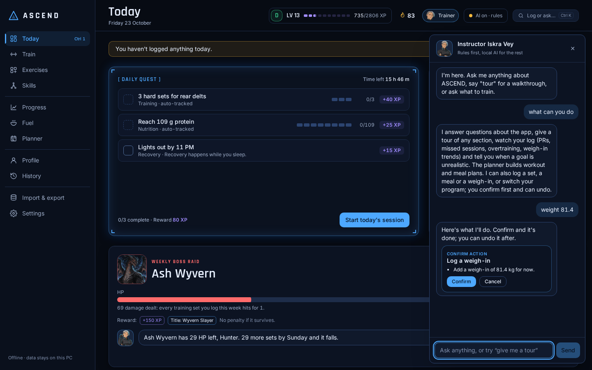
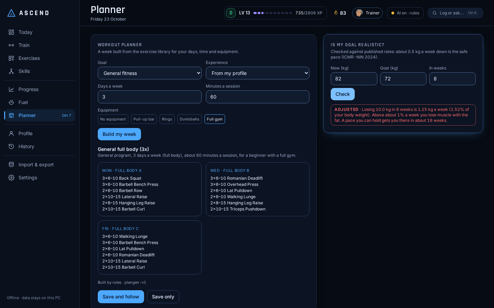
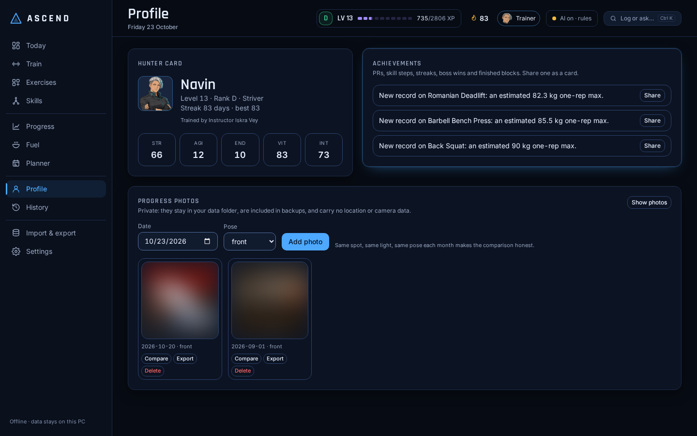
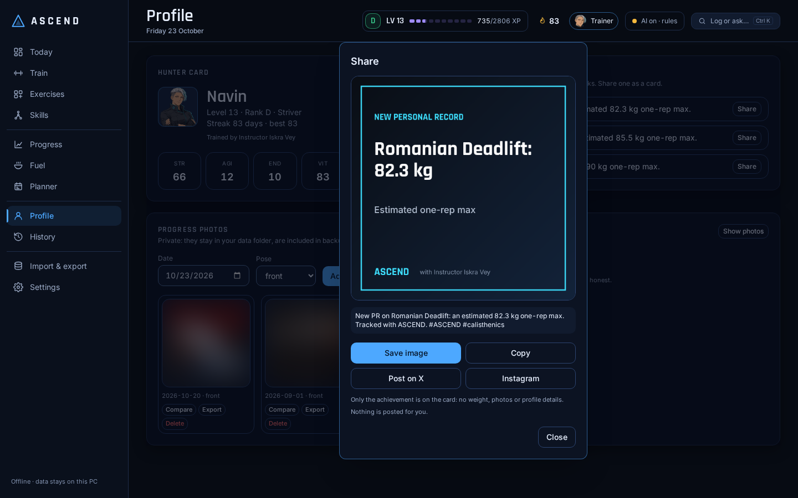

# ASCEND

[](https://github.com/Lucifer-Newstar/Ascend-/actions/workflows/ci.yml)
[](https://github.com/Lucifer-Newstar/Ascend-/actions/workflows/ml.yml)
[](https://github.com/Lucifer-Newstar/Ascend-/actions/workflows/release.yml)
[](https://github.com/Lucifer-Newstar/Ascend-/releases/latest)
[](LICENSE)

**An offline Windows desktop fitness RPG.** Log workouts and Indian meals, earn XP, clear daily
quests, keep a streak and rank up from **E to S**, while a muscle map shows which muscles are
under-trained, recovering or overreached. A trainer you pick watches your log, answers questions
and proposes changes that run only when you confirm them. Everything runs and is stored on your
own PC; an optional local AI (Ollama + `qwen3:4b`) words the trainer's answers, and the app works
fully without it.

ASCEND is our final-year project: an Electron + React desktop app, a FastAPI + SQLite engine
that runs beside it, deterministic training and diet engines, and an MLOps pipeline.


| Train: three-pane logger | Skills: tree canvas |
|---|---|
|  |  |
| **Trainer chat: a proposed action waits for Confirm (1.1)** | **Planner: a week, the checks and a goal check (1.1)** |
|  |  |
| **Profile: Hunter card, achievements, blurred photos (1.1)** | **Share card: drawn locally, posted by you (1.1)** |
|  |  |

> Screens use demo data from `app.devtools.seed_demo`. The v0.1 MVP screens are kept in
> [docs/screenshots](docs/screenshots/).

**Contents:** [Download](#download-and-install) · [Features](#features) ·
[Limitations](#honest-limitations) · [Architecture](#architecture) · [Tech stack](#tech-stack) ·
[Developer quick start](#developer-quick-start) · [Testing and CI](#testing-and-ci) ·
[Docs](#documentation) · [Team](#team) · [Credits](#credits-and-licences)

## Download and install

1. Open the [latest release](https://github.com/Lucifer-Newstar/Ascend-/releases/latest) and download **`ASCEND-Setup-<version>.exe`**
   (for 1.3.0: `ASCEND-Setup-1.3.0.exe`). `SHA256SUMS.txt` next to it lets you check the download.
2. Run it. The installer is **not code-signed yet**, so Windows SmartScreen shows "Windows protected
   your PC": click **More info → Run anyway**.
3. Pick a folder (default: `%LOCALAPPDATA%\Programs\ASCEND`, no admin rights needed) and finish.
   ASCEND starts with the System intro and a three-step setup (your body, your goal, your kit),
   then an optional baseline test and a short tour.

**System requirements:** Windows 10 or 11, 64-bit (x64). Nothing else: the engine ships inside the
installer. For the optional AI coach, install [Ollama](https://ollama.com) and run
`ollama pull qwen3:4b` (about 2.5 GB; fits a 4 GB GPU, see [AI coach](#optional-ai-coach)).

**Your data** is one SQLite file in `%APPDATA%\ASCEND\data`. It stays on your PC, is kept when you
uninstall, and a reinstall picks it up again. The app also writes a daily automatic backup.

Check a download in PowerShell (compare with the line for the file in `SHA256SUMS.txt`):

```powershell
Get-FileHash .\ASCEND-Setup-1.3.0.exe -Algorithm SHA256
```

Release notes for each version: [GitHub Releases](https://github.com/Lucifer-Newstar/Ascend-/releases) and [docs/releases](docs/releases/);
the full history is in [CHANGELOG.md](CHANGELOG.md).

## Features

### Screens and interaction

| What | How it works |
|---|---|
| **Today ("Hunter HQ")** | The daily quest as a System window with time left, a status panel (STR, AGI, END, VIT, INT) where every number has a "Why?", up to three insights spoken by the trainer, Instructor Iskra Vey (switchable to a plain mode), the weekly boss raid ([ADR-0022](docs/architecture/adr/0022-weekly-boss-raid.md)), Quick log, check-in, fuel and the muscle map on a 12-column grid. |
| **Train** | Keyboard-first logger: last session's sets in grey next to today's, the next set pre-filled from last time (Enter logs it), a rest bar (Space pauses), muscles hit and the skills the exercise feeds. |
| **Skills** | A zoomable, pannable tree canvas per family; arrow keys move along the edges; a drawer shows the criteria, the estimate (only with enough data) and "Train this skill". |
| **Ctrl+K** | Command bar: `bench 80x5 @8`, `log 3x8 pull-up`, `plank 45s`, `weight 81.4`, `add 2 eggs`, `train front lever`, a page name, or any question for your trainer. Data-changing commands are the allowlisted actions in [`command-vectors.json`](packages/shared/src/command-vectors.json). Rule-based, no model. |
| **Awakening** | The first run: profile, an equipment checklist (respected by quests and skill suggestions), a baseline test logged as a real session, and your trainer, then straight into a five-step app tour. |
| **Streaks** | Training days keep the streak, planned rest days are neutral and a missed day with a reason counts as rest (1.3); a missed day never removes XP, levels, ranks or skills. |
| **Accessibility and motion** | WCAG AA colours in both themes (unit-tested), labelled controls, axe-clean screens, Reduce motion honoured everywhere, optional sound off by default. |

Shortcuts: **Ctrl+K** command bar · **Ctrl+1…0** pages (Profile has none) · **Enter** log the set shown ·
**Space** pause rest · arrows on the skill canvas.

### On main, not released yet (after 1.3.0)

Merged after the 1.3.0 tag (plus the knowledge gap fill on `feat/kb-gap-fill`). Not in an
installer yet; [CHANGELOG.md](CHANGELOG.md) lists them under Unreleased.

| What | How it works |
|---|---|
| **Your training week** (`schedule-v1`) | Pick your training days and a usual time in Settings > Trainer; the other days are planned rest. The Planner shows this week planned vs done, Today offers a **10-minute version** of the session, the lock screen opens on today's workout, and a tray icon and start with Windows are opt-in. See [docs/architecture/habit-engine.md](docs/architecture/habit-engine.md). |
| **The trainer builds your plan from chat** | Kit, goals and limits said in chat ("I have an 8kg dumbbell", "I want to train muay thai") become a card that rebuilds your week and food targets, with undo; **Build my plan** on the Chat page asks six questions. Rule-based. See [docs/ai/plan-builder.md](docs/ai/plan-builder.md). |
| **Coaching team** | Your main trainer runs the chat and hands a question to the specialist for its area (Idris gym, Dario calisthenics, Kai cardio and martial arts, Tara mobility and recovery, Vera nutrition), who answers under their own name. Switch it off in Settings > Trainer. See [docs/ai/coaching-team.md](docs/ai/coaching-team.md). |
| **Rewards** | A trophy shelf on Profile, six cosmetics for weekly to seasonal clears, a full-screen unlock scene and an Unlocks page with replay. Cosmetic only. See [docs/architecture/rewards.md](docs/architecture/rewards.md). |
| **Intent router** (`ascend-intent` 1.1.0) | TF-IDF n-grams + logistic regression, shipped as a small weights file and run by a standard-library runtime in the sidecar. It only decides messages the chat rules are unsure about; out-of-scope messages keep the rules' answer. 0.738 accuracy on 160 real questions (hand-labelled). See [ml/intent/MODEL_CARD.md](ml/intent/MODEL_CARD.md). |
| **Cited knowledge answers** (`kb-v1.4`) | 1,779 passages (exercise steps, the 2018 Physical Activity Guidelines, the app's food table, team notes, library steps, USDA values) searched by BM25 in the sidecar; the source is shown under the answer, and "no note" when nothing passes the gate. See [ml/knowledge/KB_CARD.md](ml/knowledge/KB_CARD.md). |
| **Scan meal (hidden)** | The code is in: an ONNX Runtime food model on the CPU suggests three foods for you to confirm and never logs by itself. Fuel shows **Scan meal** only when a model that passed the gate on the team's own photos is in the data folder. **No food model is trained yet**, so it stays hidden. See [ml/food/README.md](ml/food/README.md). |
| **Knowledge gap fill** (`feat/kb-gap-fill`) | 63 new library moves (strikes and defence drills, yoga poses, breathing and meditation, intervals, knee push-ups...) and steps for 20 entries that had none; 15 South Indian dishes in the food table; `ml/labels.json` lists 50 dishes + `not_food`, and all 59 class names of the team's Roboflow export are mapped. See [ml/knowledge/GAP_ANALYSIS.md](ml/knowledge/GAP_ANALYSIS.md). |

### New in 1.3

| What | How it works |
|---|---|
| **Trainer edits from chat** | `actions-parse-v2`: "change my goal to bulk", "add a bench", "rest 90 s on squats", "train 4 days a week" or "switch me to upper lower" become a card you confirm, cancel or undo (also by typing). Rule-based, so it works with the AI off. See [docs/ai/trainer-actions.md](docs/ai/trainer-actions.md). |
| **Chat page** | The big trainer portrait and the same conversation as the drawer; Tara and Idris join the roster. Specialties are labels only. |
| **Kinder streaks** | Training days keep the streak; planned rest days are neutral; a missed day with a reason counts as rest; +25 XP welcome back once a week. See [docs/architecture/streaks-and-near-goals.md](docs/architecture/streaks-and-near-goals.md). |
| **Near goals** | Today shows lifetime sessions and the next milestone, E1-E3 style sub-ranks, best streak and weeks in a row. Streak unlocks became 10/25/50-session unlocks. |
| **Calm reminders** | Two a day at most, none on rest days, no loss words; evening, photo and weigh-in nudges are opt-in. |

### New in 1.1

| What | How it works |
|---|---|
| **Trainer and chat** | Pick one of four trainers. The chat (top bar) answers app questions from help notes (`trainer-kb-v1`), routes by rules before any AI call (`trainer-intents-v1`), checks goals, starts a tour of any page and says why it posted something. The Coach page is retired; its weekly review and deload cards are on Progress. |
| **Content selector** | `player-state-v1` reads your level, category balance, readiness, consistency, diet adherence and weigh-in trend; `select-v1` picks what the trainer brings up from a data catalog with cooldowns and a cap of 3 posts a day. Never a hard item on a low-readiness day, never an eat-less item under 18. |
| **Personalization** | `personalize-v1` and `quest-v3`: the daily quest's sets follow your level and readiness, and its nutrition item targets your own gap. `/selector/personalization` shows the reasons. |
| **Actions with a confirm** | `actions-v1`: the chat, Ctrl+K or the local AI can propose a log entry, a program switch or an erase; it runs after Confirm on a card (erase needs the word typed), is audited, and can be undone where possible. |
| **Planner** | Build a training week (`plangen-v1`), a day of Indian meals (`dietgen-v1`) and check a goal (`goalcheck-v2`, ICMR-NIN 2024). Save, follow or delete. No deficit under 18; **Hide calories** hides kcal. |
| **Profile and photos** | Hunter card, achievements and private progress photos: stripped of EXIF/GPS, blurred until revealed, compared side by side, backed up. No AI judges your photos (removed in 1.3). |
| **Share cards** | `share-v1` text, drawn on your PC with no weight, photos or profile details: save, copy, X's own composer (an allowlisted link) or Instagram (save + copy caption). |
| **Skills** | 17 built-in trees (five new) plus your own custom trees from library exercises; custom trees pay no XP. |

### Training and recovery engines

Deterministic engines, pure Python on the CPU. The local model is optional and only ever phrases
what the engines computed.

| What | How it works |
|---|---|
| **Recovery (`recovery-v2`)** | Per-muscle readiness for all 54 muscles and heads (taxonomy v2, [ADR-0021](docs/architecture/adr/0021-detailed-muscle-taxonomy.md)) from each set's dose (muscle weight × effort from reps in reserve × volume; holds by seconds), decayed by the muscle's half-life × your personal factor, adjusted by today's check-in. Drives the muscle map, quests and the weekly review. [ADR-0014](docs/architecture/adr/0014-recovery-engine-v2.md) |
| **Personal recovery factors** | One factor per muscle group, fitted after every workout from how your performance follows fatigue. Starts at the population value, moves only with evidence, shown with a 90 % interval and as **"you vs population"** on the muscle drill-down. |
| **Progression (`prog-v1`)** | The logger's **suggestion card** (Use it / Keep mine / Why?): double progression in your rep zone, equipment-aware increments (never more than 10 % at once), RPE autoregulation, e1RM tracking, stall detection with a 10 % reset, hold progressions, and skill-tree criteria for calisthenics. No increase while the muscles are under 40 % recovered. [ADR-0015](docs/architecture/adr/0015-progression-engine-prog-v1.md) |
| **"Why?" everywhere** | Every target and readiness shows its formula and inputs. With AI on, `qwen3:4b` may phrase one sentence, shown only if every number passes the coach guard; otherwise the template sentence. [ADR-0016](docs/architecture/adr/0016-explanations-and-system-voice.md) |
| **The System speaks, rarely** | Three notices, each shown once: Deload advised, Target raised, Muscle recovered. |
| **Evaluation** | A seeded synthetic-user simulator with baselines, in [docs/ai/evaluation.md](docs/ai/evaluation.md) ([ADR-0017](docs/architecture/adr/0017-evaluation-synthetic-users.md)). On synthetic users, prog-v1 targets were hit within 1 rep on 93.1 % of exposures (linear +2.5 kg with resets: 71.8 %) and too hard on 2.7 % (22.4 %); recovery-v2 readiness correlates with the simulated truth at Pearson r 0.842-0.926 on the 54-muscle taxonomy (fixed 48 h rule: 0.552-0.579). |

### Diet engines and workout programs

| What | How it works |
|---|---|
| **Adaptive TDEE (`tdee-v1`)** | A two-state Kalman filter on trend weight and expenditure, fed by your weigh-ins and logged meals. It starts from Mifflin-St Jeor with a wide range and narrows as data comes in. Missing days widen the range instead of breaking it. The weekly calorie target moves only on Mondays, only after a week with 6 logged days and 4 weigh-ins, and by at most 150 kcal. Fuel shows the range, the target, completeness and the reason. [ADR-0018](docs/architecture/adr/0018-adaptive-tdee-kalman.md) |
| **Weekly insights (`insights-v1`)** | Six fixed rules over the last 7 complete days: intake vs target, protein, weekend vs weekday, weight trend vs goal, adaptive vs formula, and logging gaps. Progress shows up to three findings, each with a "Why?", plus the list of rules that were checked. [ADR-0019](docs/architecture/adr/0019-weekly-diet-insights.md) |
| **Workout programs (`programs-v1`)** | Four built-in programs: full body 3 days, upper/lower 4 days, push/pull/legs 6 days, and home full body 3 days. The Program card on Train shows the next session with each exercise's target from your progression and the sets you have done today. The plan reads your log: a finished workout that covers half of a program day counts as that day, so a missed day shifts the plan instead of skipping a session. [ADR-0020](docs/architecture/adr/0020-workout-programs.md) |
| **Evaluation** | Synthetic users, seed 2026 ([docs/ai/evaluation.md §5](docs/ai/evaluation.md)). Median TDEE error at day 56 is 82.8 kcal (formula: 194.7), and the 14-day weight prediction from day 56 is 50.3 % more accurate than the formula's. The intake, protein and weekend insights have precision 0.935-1.0. tdee-v1 takes 3.08 ms on a one-year history. |

### Game layer, trainer and safety nets

| What | How it works |
|---|---|
| **XP, ranks, quests, streaks** | XP per set and session on a `100 × L^1.3` level curve, ranks E→S, a rule-generated daily quest, streak freezes; every formula is versioned. A missed day never removes XP, levels, ranks or skills. |
| **Weekly boss raid (`boss-v1`)** | Each Monday a boss with HP sized to a week of your training; every set deals 1 damage. Beat it by Sunday for +150 XP and a title on your Hunter profile; if it survives, nothing is lost. [ADR-0022](docs/architecture/adr/0022-weekly-boss-raid.md) |
| **Trainers** | Instructor Iskra Vey and three more original trainers speak your insights on Today and in the chat, with portraits per mood. They only wrap the engine's own sentence, so the numbers never change. A switch turns them into the plain System style. |
| **Detailed muscle map** | 54 muscles and heads, front, back and a deep layer, in ASCEND's own artwork. Every exercise is mapped to heads by `muscle-map-v1`. [ADR-0021](docs/architecture/adr/0021-detailed-muscle-taxonomy.md) |
| **Quick log and honest numbers** | Log a set, meal or weigh-in from Today; "rough · based on N" badges on numbers with too little data; Settings → Today's numbers lists the engine, version and data behind every number. |
| **Backups, import and export** | One automatic `.ascendbak` snapshot per day (newest 14 kept), backups before updates and restores, restore with a database check; export to JSON or CSV and re-import. |
| **Exercise library** | 1,024 exercises on a fresh database at migration `0035`: 814 from free-exercise-db and 210 of ASCEND's own (calisthenics progressions, timed holds, everyday and gap-fill moves), each with a photo or a designed tile; add your own exercise with rules, the local AI or an optional online lookup (wger.de, Wikipedia), each field with its source. |
| **Indian food log** | 203 approximate Indian foods on a fresh database (idli, dosa, sambar, chapati, dal, curd, poriyal, kozhukattai, biryanis...) with katori and piece portions, daily totals and the adaptive calorie target. Food is logged by search; **Scan meal** stays hidden until a trained food model is installed, and none is trained yet (see [ml/food/README.md](ml/food/README.md)). |

### What was in the MVP (v0.1.0)

| Feature | Where |
|---|---|
| Onboarding: age, sex, height, weight, goal, activity → BMR/TDEE (Mifflin-St Jeor), shown as an **estimate** | `progress`, `nutrition/tdee.py` |
| Workout logger: 41 seeded exercises with primary/secondary muscle weights, sets with kg / reps / RPE, **PR detection** (Epley e1RM), rest timer | `workouts` |
| Gamification: XP per set and session, level curve `100 × L^1.3`, ranks E→S, rule-generated **daily quest**, streak with **freezes**; all formulas versioned | `gamification` |
| Muscle recovery: per-muscle effective sets with recovery decay → under / optimal / recovering / over (replaced by recovery-v2 in v6) | `progress/muscle_load.py` |
| Today (was Dashboard): three rings (quest tasks, kcal eaten, kcal burned), today's quest, XP bar, front/back muscle map with a deep layer | `apps/desktop/src/pages/Dashboard.tsx` |
| Diet log: 31 approximate Indian foods (idli, dosa, sambar, chutneys, rice, chapati, dal, curd...) with katori/piece portions, daily totals | `nutrition` |
| Coach: rule-based tips always; local Ollama `qwen3:4b` if running; **AI on/off toggle** | `coach` |
| History by day (workouts + meals) and export to **JSON / CSV** | `progress/history.py` |
| **Calisthenics skill trees** (12 trees then, 17 plus custom trees since 1.1; unlock criteria from logged sets, estimates only with enough data) | `skills`, `pages/Skills.tsx` |
| **Exercise gallery**: 873 free-exercise-db exercises + calisthenics progressions, timed holds, search and filters; every card has a photo or a designed tile | `workouts/library.py`, `pages/Library.tsx` |
| **Add your own exercise**: rules → local AI → optional online research (wger.de, Wikipedia), every field with its source and confidence, a research report to confirm, a local lookup log | `workouts/custom.py`, ADR-0013 |

## Honest limitations

- **Evaluated on simulated users, not real people.** Every accuracy figure above comes from a seeded
  synthetic-user simulator ([docs/ai/evaluation.md](docs/ai/evaluation.md)). No real-user study
  exists yet. programs-v1's "half of a day's exercises" matching has not been checked against
  real training logs.
- **Recovery r ≈ 0.9 is partly circular.** It is measured against the simulator's own ground truth,
  which uses the same model family as the engine. It shows the estimation works under those
  assumptions, not that people recover this way.
- **Stall detection is weak:** precision 0.113, recall 0.62 on synthetic stalls. That is why a stall
  alone never triggers a deload.
- **The adaptive TDEE is slow to learn.** Only 57% of synthetic users are within 150 kcal of their
  true expenditure on day 28; the target stays on the formula until the estimate settles. If meals
  are under-logged, "you burn" matches what was logged.
- **The weight-trend insight is a hint:** precision 0.397, recall 0.408 on synthetic weeks.
- **Built-in programs are a fixed catalog.** The Planner builds new programs from rules, but you
  cannot edit an exercise inside a saved program yet; build a new one instead.
- **Backups are unencrypted.** They include progress photos unless you untick **Include progress
  photos** (Settings > Data & backups). Keep `%APPDATA%\ASCEND` private and copy backups to another
  drive yourself (encryption is planned, not in 1.3.0).
- **The trainer's own posts follow fixed rules.** The selector's thresholds were set by hand and
  checked on synthetic users only.
- **Instagram has no desktop posting route.** The app saves the image and copies the caption.
- **No food model is trained yet.** The Scan meal code ships but stays hidden until a model
  passes the gate on the team's own photos (at least 10 per dish). The food pipeline in
  [ml/](ml/README.md) has only run on synthetic smoke data (generated shapes, not food photos);
  the export's licence still has to be recorded in [ml/SOURCES.md](ml/SOURCES.md).
- **The intent router and knowledge base are checked on small hand-judged sets.** 160 real
  questions for the intent router and 80 for retrieval, each judged by one person; the v1.4
  retrieval numbers are not double-checked. About a third of real forum questions get a
  relevant first passage. The team notes are not reviewed by a medical professional.
- **Tamil food names are unreviewed.** Every Tamil name in `ml/labels.json` has
  `ta_reviewed: false`.
- **The local-model path is tested with a mocked Ollama.** Real `qwen3:4b` phrasing is not covered
  by tests; anything it writes is shown only if the coach's number guard passes. Without a model the
  app shows template text and is fully functional.
- **Unsigned installer.** SmartScreen warns until the project has a code-signing certificate.
- Food values are approximate home-style figures, and BMR, e1RM and calorie burn are standard
  estimation formulas. ASCEND is not medical or dietary advice.
- Latency was measured on the 4-CPU Linux build machine (finishing a workout: p50 394.2 ms), not on
  the target Windows laptop.

## Architecture

```
┌──────────────── Electron app (apps/desktop) ────────────────┐
│ Renderer: React + TypeScript + Vite + Tailwind (sandboxed)   │
│        │ window.ascend.request()  (typed, contextBridge)     │
│ Preload ──IPC──► Main: validates, adds token, proxies        │
└────────────────────────┬─────────────────────────────────────┘
                         │ HTTP 127.0.0.1:<random port>, Bearer <per-launch token>
┌────────────────────────▼──────── Sidecar (services/sidecar) ─┐
│ FastAPI modular monolith                                      │
│  workouts · nutrition · trainer · actions · ml · 13 more      │
│  in-process event bus: SetLogged → muscle load + XP + quests  │
│ SQLite (WAL) + Alembic migrations    optional ─► Ollama :11434│
└───────────────────────────────────────────────────────────────┘
```

- Electron main picks a free port, generates a random token, spawns the sidecar (`uv run` in
  dev, the PyInstaller exe when installed), passes the token on **stdin**, polls `/health`,
  and restarts it with backoff if it crashes.
- The renderer never sees the token and has no Node access.
- Engines are pure functions; the coach only explains their output.
- The sidecar's 18 modules (`services/sidecar/app/modules/`): `actions`, `ai`, `coach`,
  `gamification`, `intelligence`, `io`, `ml`, `nutrition`, `photos`, `planbuilder`, `planner`,
  `progress`, `schedule`, `selector`, `share`, `skills`, `trainer`, `workouts`. `ml` loads the
  bundled intent model and knowledge base and, when one is installed, the food model.

Details: [services/sidecar/README.md](services/sidecar/README.md),
[apps/desktop/README.md](apps/desktop/README.md), and the full project docs in [docs/](docs/README.md).

## Tech stack

| Part | Stack |
|---|---|
| Desktop | Electron 45 (sandboxed renderer, context isolation, fuses set at pack time), React 19, TypeScript 6.0, Vite 8, Tailwind CSS 4 |
| Engine (sidecar) | Python 3.12, FastAPI, Uvicorn, Pydantic 2, SQLAlchemy 2 + Alembic, SQLite (WAL), httpx |
| Local AI (optional) | Ollama on `127.0.0.1:11434` with `qwen3:4b`; output passes a number guard |
| Packaging | PyInstaller (sidecar exe) + electron-builder NSIS installer, built on GitHub Actions |
| Tests and quality | pytest + Hypothesis, Vitest + Testing Library + jsdom, axe-core, ruff, mypy, ESLint, commitlint |
| ML pipeline | Intent router: scikit-learn (TF-IDF + logistic regression), exported to a standard-library runtime. Knowledge base: BM25 over cited passages. Food photo: PyTorch (MobileNetV3-Small), ONNX export with a parity gate, ONNX Runtime in the sidecar. DVC, MLflow |
| DevOps | GitHub Actions (CI on Ubuntu and Windows, ML, Windows installer + release), Docker for sidecar tests |

Versions and the reasons for each choice: [docs/development/tech-stack.md](docs/development/tech-stack.md).

## Repository layout

```
apps/desktop/        Electron + React app
services/sidecar/    FastAPI engine, SQLite, Alembic, tests, PyInstaller spec
packages/shared/     TypeScript types: API + typed IPC contract
ml/                  intent router, knowledge base and food-photo pipelines (DVC + MLflow)
docker/              Dockerfile + compose for sidecar dev/tests
docs/                project docs: architecture, ADRs, contracts, team plan, releases
scripts/             PowerShell setup helper, contract drift and link checks, map generator
.github/             CI, ML and Windows installer workflows, issue templates, CODEOWNERS
```

## Developer quick start

You need **Git**, **Node.js 22.22.2 or newer** (22 LTS; newer works with npm) and **uv**.
The sidecar uses **Python 3.12**; uv installs it *next to* any existing Python (3.14 is fine) and
never touches it.

```powershell
# 1. uv (Python version + package manager), once
powershell -ExecutionPolicy ByPass -c "irm https://astral.sh/uv/install.ps1 | iex"
uv python install 3.12

# 2. get the code
git clone https://github.com/Lucifer-Newstar/Ascend-.git ascend
cd ascend

# 3. install everything (or run: powershell -ExecutionPolicy Bypass -File scripts\setup.ps1)
cd services\sidecar; uv sync; uv run alembic upgrade head; cd ..\..
npm install

# 4. run the desktop app (Electron starts the sidecar for you)
npm run dev:electron -w apps/desktop
```

**If `npm run dev:electron` says "Electron failed to install correctly"** (seen on Windows with Node 26:
the download finishes but the unzip step silently fails), unzip it yourself from the repo root:

```powershell
$zip = Get-ChildItem "$env:LOCALAPPDATA\electron\Cache" -Recurse -Filter "electron-v*-win32-x64.zip" | Select-Object -First 1
Expand-Archive $zip.FullName -DestinationPath node_modules\electron\dist -Force
Set-Content node_modules\electron\path.txt "electron.exe" -NoNewline
```

### Optional AI coach

```powershell
# install Ollama from https://ollama.com, then:
ollama pull qwen3:4b        # ~2.5 GB; fits a 4 GB GPU
```

**Tuning for 4 GB GPUs (e.g. RTX 3050 Laptop).** With default settings `ollama ps` showed `qwen3:4b`
at 3.5 GB split 34%/66% CPU/GPU and 8.3 tokens/s. These three settings brought it to 21.3 tokens/s on
the same laptop (measured with `ollama run qwen3:4b --verbose`, one prompt each, Oct 2026):

```powershell
setx OLLAMA_FLASH_ATTENTION 1
setx OLLAMA_KV_CACHE_TYPE q8_0
setx OLLAMA_CONTEXT_LENGTH 2048
# then quit Ollama from the tray and start it again
```

**The AI is optional, in tiers.** Without Ollama (or on a PC that can't run a model) the whole
app works in rule-based mode: the trainer chat answers greetings, app questions and tours from
its own notes, plans, goal checks and the trainer's edit cards use rules, and only free-form
wording is off. **Settings > AI setup** shows whether Ollama is installed and running, the models
you have pulled, your RAM and (NVIDIA) VRAM, and recommends a model: `qwen3:4b` with 4 GB of
VRAM, `qwen3:1.7b` with 2 GB (or 16 GB of RAM), `qwen3:0.6b` otherwise. It has a test button
and, after three failed or timed-out answers, offers a smaller model or rule-based mode. When
a rule-based answer stands in for the model's, the reply says why (switched off, not running,
timed out, model error, or the reply failed the safety check).

### Optional: the ML pipelines

Only needed to rebuild a model; the app runs without any of this. The intent model and the
knowledge base already ship in `services/sidecar/app/modules/ml/assets/`.

```powershell
cd ml
uv venv --python 3.12 .venv
.\.venv\Scripts\Activate.ps1
uv pip install --index-strategy unsafe-best-match -r requirements.txt
python -m pytest                     # ML tests, CPU only
# food model on an NVIDIA GPU: torch 2.14.1 has no cu128 wheel, use the cu126 build
uv pip install --reinstall torch==2.14.1 torchvision==0.29.1 --index-url https://download.pytorch.org/whl/cu126
python -c "import torch; print('CUDA', torch.cuda.is_available())"
```

The intent router and knowledge base rebuild on a CPU (`dvc repro intent_evaluate kb_evaluate`).
The food model's data, own-photo rules and the full Windows GPU run are in
[ml/food/README.md](ml/food/README.md); the overview is [ml/README.md](ml/README.md).

### Other ways to run

```powershell
# UI in a browser (fast reload), two terminals:
cd services\sidecar; uv run python -m app --dev      # API + docs: http://127.0.0.1:8765/docs
npm run dev -w apps/desktop                          # app: http://localhost:5173

# demo data (wipes the dev data folder first; refuses the installed app's folder)
cd services\sidecar; uv run python -m app.devtools.seed_demo --wipe
```

The installed app keeps your data (one SQLite file, `ascend.db`) in `%APPDATA%\ASCEND\data`.
Development runs (the sidecar on its own, `make seed`, and the unpackaged Electron app) use
`%APPDATA%\ASCEND-dev\data` instead, so demo data never lands in the installed app. To wipe the
installed app's data, use **Settings > Start fresh** (it backs up first).

Full setup, including Docker, MLflow and troubleshooting: [docs/development/local-setup.md](docs/development/local-setup.md).

## Testing and CI

`make help` lists the developer commands (Git Bash / WSL); each is a plain command you can also
paste into PowerShell.

| | |
|---|---|
| `make check` | everything CI runs: lint, types, tests, migrations, contract drift, Markdown links, build |
| `make test` | pytest + vitest |
| `make lint typecheck` | ruff, eslint, mypy, tsc |
| `make build-sidecar` | PyInstaller → `services/sidecar/dist/ascend-sidecar/` |
| `make dist-win` | Windows installer → `apps/desktop/release/` (run on Windows) |
| `make docker-test` | lint + tests inside Docker |

Workflows in [.github/workflows](.github/workflows/):

- **`ci.yml`** (every push and PR, plus nightly): commit-message lint and a Markdown link check;
  ruff, mypy, pytest with coverage, Alembic on a fresh database and the contract drift check on
  Ubuntu and Windows; eslint, tsc, vitest and the Vite build on Ubuntu and Windows; the PyInstaller
  sidecar build with a smoke test; the Docker test image.
- **`ml.yml`**: ML lint and tests, the `labels.json` → food table check, and a smoke `dvc repro gate`
  of the food pipeline on synthetic data that asserts the smoke model never passes the gate; nightly
  (and on demand) it rebuilds the intent model and the knowledge base.
- **`release.yml`** (pushes to `main` that touch the app, version tags `v*`, or manual): on
  `windows-latest`, builds and smoke-tests the sidecar exe, builds the NSIS installer and checks that
  all Electron fuses are set. On a version tag it publishes the installer, `SHA256SUMS.txt` and the
  notes from `docs/releases/<tag>.md` as a GitHub Release.

How a release is cut: [docs/operations/release-process.md](docs/operations/release-process.md).

### Verified for 1.3.0

On Linux, on the `feat/v13-quick-wins` branch (stacked on `feat/v13-trainer-actions` and
`feat/v13-fixes`) before the merge:

- 1101 sidecar tests pass (engine unit tests, Hypothesis property tests, API tests with
  `TestClient`, and the rules suite in `tests/rules/`); ruff and mypy are clean (171 source files).
- Alembic migrations apply to a fresh SQLite database (`0032`), downgrade to base and apply again.
- tsc (renderer, Electron, shared), eslint (0 errors) and 554 vitest tests (80 files) pass;
  `vite build` succeeds (main chunk 339 kB, 103 kB gzip).
- The contract drift check passes (135 implemented operations match 16 contracts).
- `scripts/check_rules.py` finds no phone numbers, secrets or credit lines; the trainer chat battery
  (343 messages, AI off) gives 251 pass, 1 fail and 91 to read by hand.
- The ML pipeline is unchanged since 1.1.0.

The Windows installer is built by `release.yml` on `windows-latest` once the branch is merged.

Not covered by automation: the installed app's screens on a real Windows PC (check by hand before tagging), real
`qwen3:4b` answers, and the live wger.de and Wikipedia APIs (tests use mocks; the live APIs were
checked by hand on 2026-10-20).

### Checked on `feat/kb-gap-fill` (not released yet)

On Linux on 2026-10-27, with the code at the gap-fill tip (the doc commits after it change no
code):

- 1200 sidecar tests pass; ruff and mypy are clean (195 source files).
- Alembic applies to a fresh database (`0035`), downgrades to base and applies again.
- tsc, eslint (0 errors, 22 warnings) and 612 vitest tests (92 files) pass; the build succeeds
  (main chunk 345 kB, 106 kB gzip).
- The contract drift check passes (146 implemented operations match 18 contracts); the
  Markdown link check and `scripts/check_rules.py` find no problems; the trainer chat battery
  (352 messages, AI off) gives 260 pass, 1 fail and 91 to read by hand.
- 45 ML tests pass on CPU and `ml/src/check_labels.py` resolves all 51 labels to food rows; no GPU
  step was run and the food model is not trained.

## Documentation

- [docs/README.md](docs/README.md): the map of all project documentation
- [System architecture](docs/architecture/system-architecture.md) and the
  [ADRs](docs/architecture/adr/) (22 decisions)
- [API contracts](docs/contracts/README.md) and the [IPC contract](docs/contracts/ipc-contract.md)
- [AI and ML docs](docs/ai/README.md), including the [evaluation](docs/ai/evaluation.md), and the
  model cards: [intent router](ml/intent/MODEL_CARD.md), [knowledge base](ml/knowledge/KB_CARD.md),
  [food photo](ml/food/MODEL_CARD.md)
- [Security and privacy](docs/architecture/security-privacy.md) and [SECURITY.md](SECURITY.md)
- [Project proposal](docs/project/proposal.md) and [roadmap](docs/project/roadmap.md)
- Per-folder guides: [desktop](apps/desktop/README.md), [sidecar](services/sidecar/README.md),
  [ml](ml/README.md), [docker](docker/README.md), [scripts](scripts/README.md)

## Team

| | Role | Owns |
|---|---|---|
| Navin ([@Lucifer-Newstar](https://github.com/Lucifer-Newstar)) | Lead · MLOps | architecture, releases, `ml/` |
| Gokul ([@Gokul143-J](https://github.com/Gokul143-J)) | DevOps | CI/CD, Docker, packaging |
| Jegatheesan ([@jegatheesank](https://github.com/jegatheesank)) | Backend | sidecar, engines, database |
| Dhanush ([@dhanush-07-byte](https://github.com/dhanush-07-byte)) | Frontend | Electron + React UI, muscle map |

See [CONTRIBUTING.md](CONTRIBUTING.md) for branches, commit style and PR rules, and
[SECURITY.md](SECURITY.md) for how to report a vulnerability and the status of the
October 2026 security review.

## Credits and licences

- Trainer art (v8): Instructor Iskra Vey is an original character designed for ASCEND; how the images were made and their licence status are in `apps/desktop/src/assets/trainer/ART_PROVENANCE.md`.
- Muscle map artwork (v8, redrawn as v2): ASCEND's own original drawing of 54 muscles and heads,
  front, back and a deep layer, generated by `scripts/body_map/build_map.py` (MIT, like the rest of the
  repo). Versions up to v7 used react-muscle-highlighter 1.2.0 (MIT, © 2024 My Muscle
  Contributors), which is no longer a dependency.
- Fonts: Inter and Rajdhani (SIL Open Font License), bundled via `@fontsource`.
- Food values: approximate, rounded home-style figures in the style of IFCT 2017 (NIN) and the
  Indian Nutrient Databank (INDB). Not a substitute for a dietitian.
- Formulas: Mifflin-St Jeor (BMR), Epley (e1RM), MET method (calorie burn) are standard
  estimation formulas; results are estimates.
- Exercise library and exercise photos: [free-exercise-db](https://github.com/yuhonas/free-exercise-db)
  (yuhonas), **Unlicense** (public domain). One photo per exercise is bundled as a 320 px webp
  (873 files, about 5.1 MiB); 14 of ASCEND's own entries reuse the photo of a similar movement
  and say so. Exercises without a photo get a designed tile drawn by the app.
- Skill-tree progressions follow the r/bodyweightfitness Recommended Routine and wiki, Steven Low's
  *Overcoming Gravity* (2nd ed.) and GMB Fitness tutorials. The thresholds are ASCEND's own choices
  (see `docs/architecture/skill-trees.md`).
- ML data: the knowledge base quotes free-exercise-db (Unlicense), the Physical Activity
  Guidelines for Americans 2018 (US public domain) and USDA FoodData Central (CC0), plus team
  notes; the WHO material is our own summary. The intent router learned from Fitness Stack
  Exchange titles (CC BY-SA 4.0) and CLINC150 (CC BY 3.0); only weights ship. Every source and
  licence, and what still has to be recorded, is in [ml/SOURCES.md](ml/SOURCES.md).
- Optional online research: [wger](https://wger.de) exercise data (CC-BY-SA 4.0) and
  [Wikipedia](https://en.wikipedia.org) summaries (CC BY-SA 4.0), only when you turn it on or allow a
  single lookup; results are credited on the exercise with a link and licence.

Parts of this codebase were written with AI assistance.

**Feature freeze after v8.** v8 is the last release that adds features. From here a change
has to fix something, reduce friction, or replace an existing feature; the reasons are in
[docs/research/v8-gamified-engagement.md](docs/research/v8-gamified-engagement.md) §4.

## Licence

[MIT](LICENSE) © 2026 The ASCEND team.
