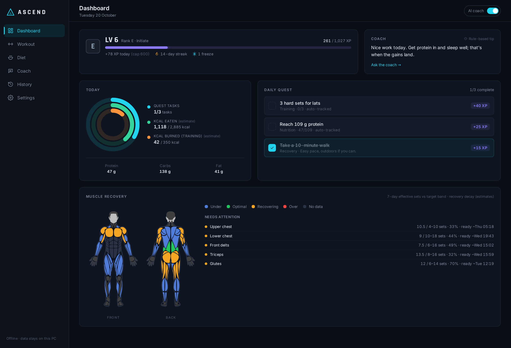
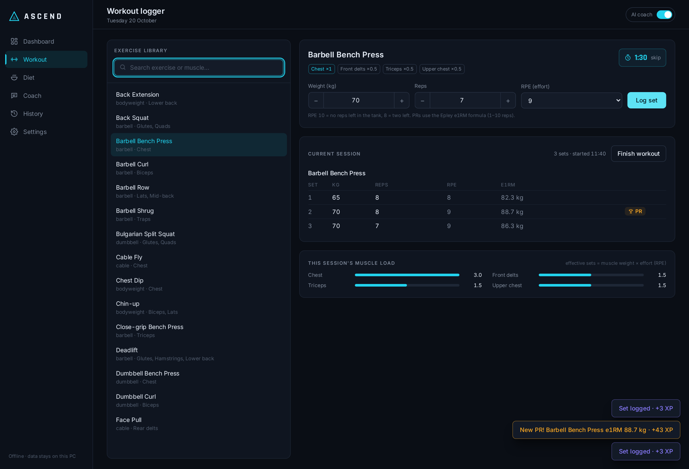
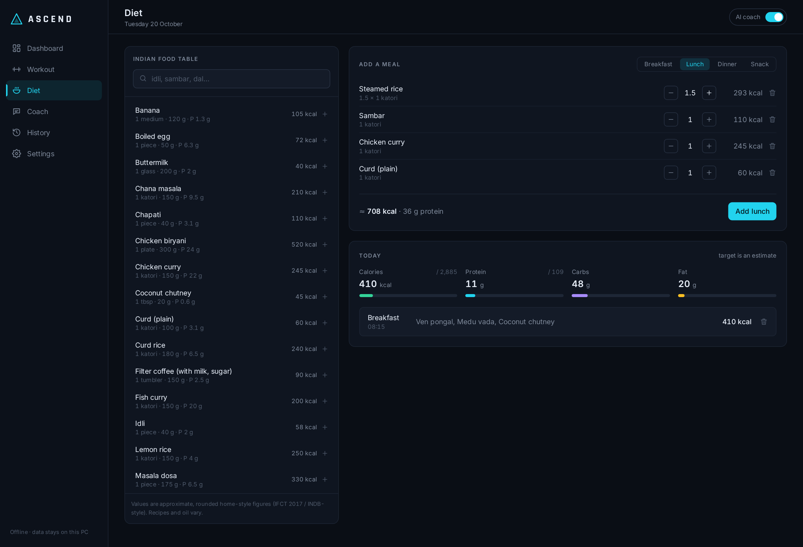

# ASCEND

**An offline Windows desktop fitness RPG.** Log workouts and Indian meals, earn XP, clear daily
quests, keep a streak and rank up from **E to S**, while a muscle map shows which muscles are
under-trained, recovering or overreached. Everything runs and is stored on your own PC; an
optional local AI coach (Ollama + `qwen3:4b`) explains your numbers, and the app works fully
without it.



| Workout logger | Diet log |
|---|---|
|  |  |

> Screens use demo data from `app.devtools.seed_demo`.

## What's in the MVP (v0.1.0)

| Feature | Where |
|---|---|
| Onboarding: age, sex, height, weight, goal, activity → BMR/TDEE (Mifflin-St Jeor), shown as an **estimate** | `progress`, `nutrition/tdee.py` |
| Workout logger: 41 seeded exercises with primary/secondary muscle weights, sets with kg / reps / RPE, **PR detection** (Epley e1RM), rest timer | `workouts` |
| Gamification: XP per set and session, level curve `100 × L^1.3`, ranks E→S, rule-generated **daily quest**, streak with **freezes**; all formulas versioned | `gamification` |
| Muscle recovery: per-muscle effective sets with recovery decay → under / optimal / recovering / over | `progress/muscle_load.py` |
| Dashboard: three rings (quest tasks, kcal eaten, kcal burned), today's quest, XP bar, front/back muscle map | `apps/desktop/src/pages/Dashboard.tsx` |
| Diet log: 31 approximate Indian foods (idli, dosa, sambar, chutneys, rice, chapati, dal, curd...) with katori/piece portions, daily totals | `nutrition` |
| Coach: rule-based tips always; local Ollama `qwen3:4b` if running; **AI on/off toggle** | `coach` |
| History by day (workouts + meals) and export to **JSON / CSV** | `progress/history.py` |

## Architecture

```
┌──────────────── Electron app (apps/desktop) ────────────────┐
│ Renderer: React + TypeScript + Vite + Tailwind (sandboxed)   │
│        │ window.ascend.request()  (typed, contextBridge)     │
│ Preload ──IPC──► Main: validates, adds token, proxies        │
└────────────────────────┬─────────────────────────────────────┘
                         │ HTTP 127.0.0.1:<random port>, Bearer <per-launch token>
┌────────────────────────▼──────── Sidecar (services/sidecar) ─┐
│ FastAPI modular monolith                                      │
│  workouts · nutrition · gamification · progress · coach       │
│  in-process event bus: SetLogged → muscle load + XP + quests  │
│ SQLite (WAL) + Alembic migrations    optional ─► Ollama :11434│
└───────────────────────────────────────────────────────────────┘
```

- Electron main picks a free port, generates a random token, spawns the sidecar (`uv run` in
  dev, the PyInstaller exe when installed), passes the token on **stdin**, polls `/health`,
  and restarts it with backoff if it crashes.
- The renderer never sees the token and has no Node access.
- Engines are pure functions; the coach only explains their output.

Details: [services/sidecar/README.md](services/sidecar/README.md),
[apps/desktop/README.md](apps/desktop/README.md), and the full project docs in [docs/](docs/README.md).

## Repository layout

```
apps/desktop/        Electron + React app
services/sidecar/    FastAPI engine, SQLite, Alembic, tests, PyInstaller spec
packages/shared/     TypeScript types: API + typed IPC contract
ml/                  food-classifier placeholder (DVC + MLflow stubs)
docker/              Dockerfile + compose for sidecar dev/tests
docs/                project docs: architecture, ADRs, contracts, team plan
scripts/             Windows PowerShell helpers
.github/             CI, Windows installer workflow, CODEOWNERS
```

## Quick start (Windows 11)

You need **Git**, **Node.js 20+** (22 LTS recommended; newer works with npm) and **uv**.
The sidecar uses **Python 3.12**; uv installs it *next to* your existing Python 3.14 and never
touches it.

```powershell
# 1. uv (Python version + package manager), once
powershell -ExecutionPolicy ByPass -c "irm https://astral.sh/uv/install.ps1 | iex"
uv python install 3.12

# 2. get the code
git clone https://github.com/<you>/ascend.git      # or unzip ASCEND_repo.zip / clone the bundle
cd ascend

# 3. install everything (or run: powershell -ExecutionPolicy Bypass -File scripts\setup.ps1)
cd services\sidecar; uv sync; uv run alembic upgrade head; cd ..\..
npm install

# 4. run the desktop app (Electron starts the sidecar for you)
npm run dev:electron -w apps/desktop
```

Optional AI coach:

```powershell
# install Ollama from https://ollama.com, then:
ollama pull qwen3:4b        # ~2.5 GB; fits a 4 GB GPU
```

Toggle **AI coach** in the top bar. With it off (or Ollama not running) the coach gives
rule-based tips; nothing else changes.

### Other ways to run

```powershell
# UI in a browser (fast reload), two terminals:
cd services\sidecar; uv run python -m app --dev      # API + docs: http://127.0.0.1:8765/docs
npm run dev -w apps/desktop                          # app: http://localhost:5173

# demo data (wipes your local data first!)
cd services\sidecar; uv run python -m app.devtools.seed_demo --wipe
```

Your data (one SQLite file, `ascend.db`) lives in `%APPDATA%\ASCEND\data`, whether you run the
installed app, the dev Electron app or the sidecar on its own.

### Common commands

`make help` lists them (Git Bash / WSL). Highlights:

| | |
|---|---|
| `make test` | pytest + vitest |
| `make lint typecheck` | ruff, eslint, mypy, tsc |
| `make build-sidecar` | PyInstaller → `services/sidecar/dist/ascend-sidecar/` |
| `make dist-win` | Windows installer → `apps/desktop/release/` (run on Windows) |
| `make docker-test` | lint + tests inside Docker |

## CI/CD

- **`.github/workflows/ci.yml`** (every push/PR): ruff, mypy, pytest + coverage, Alembic upgrade
  on a fresh DB; eslint, tsc, vitest, Vite build; PyInstaller build + smoke test of the binary;
  tests inside the Docker image.
- **`.github/workflows/release.yml`** (tags `v*` or manual): Windows matrix job that builds the
  sidecar exe with PyInstaller and the NSIS installer with electron-builder, uploaded as an
  artifact. **Not yet run on real Windows**; expect small fixes on its first run.

## Status: what is verified

Verified on Linux (CI-equivalent):

- 95 sidecar tests pass (engine unit tests + API tests with `TestClient`); ruff and mypy clean.
- Alembic migrations apply to a fresh SQLite database; WAL mode confirmed via `/health`.
- tsc (renderer, Electron, shared), eslint and 12 vitest tests pass; `vite build` succeeds.
- The renderer was driven end to end against the running sidecar in headless Chromium
  (onboarding data, logging sets with a PR, adding a meal, quest check-off, coach, history).
- The PyInstaller sidecar binary builds, migrates and answers `/health` (Linux build).
- The Docker test image builds and its tests pass.
- Electron (Linux, under a virtual display): the app window opens, spawns the sidecar with the
  stdin token, waits for `/health`, onboarding and the dashboard work over the IPC bridge, the
  renderer has no Node access, and the sidecar exits when the app closes.

Not yet verified:

- Electron on real Windows (paths, `uv` on PATH, window behaviour) has not been run.
- The Windows installer (electron-builder + PyInstaller `.exe`) has not been built.
- The Ollama path is tested with a mocked server only; `qwen3:4b` answers are untested.

## Push to a new GitHub repo

1. On GitHub: **New repository** → name it `ascend` → leave "Add a README" **unchecked** → Create.
2. Then, in this folder:

```powershell
git remote add origin https://github.com/Lucifer-Newstar/ascend.git
git branch -M main
git push -u origin main
```

If you received `ASCEND.bundle` instead of the folder: `git clone ASCEND.bundle ascend`, then
`git remote remove origin` before step 2.

## Team

| | Role | Owns |
|---|---|---|
| Navin ([@Lucifer-Newstar](https://github.com/Lucifer-Newstar)) | Lead · MLOps | architecture, releases, `ml/` |
| Gokul ([@Gokul143-J](https://github.com/Gokul143-J)) | DevOps | CI/CD, Docker, packaging |
| Jegatheesan ([@jegatheesank](https://github.com/jegatheesank)) | Backend | sidecar, engines, database |
| Dhanush ([@dhanush-07-byte](https://github.com/dhanush-07-byte)) | Frontend | Electron + React UI, muscle map |

See [CONTRIBUTING.md](CONTRIBUTING.md) for branches, commit style and PR rules.

## Credits and licences

- Muscle map artwork: [react-muscle-highlighter](https://github.com/soroojshehryar/react-muscle-highlighter)
  1.2.0, **MIT licence**, © 2024 My Muscle Contributors.
- Fonts: Inter and Rajdhani (SIL Open Font License), bundled via `@fontsource`.
- Food values: approximate, rounded home-style figures in the style of IFCT 2017 (NIN) and the
  Indian Nutrient Databank (INDB). Not a substitute for a dietitian.
- Formulas: Mifflin-St Jeor (BMR), Epley (e1RM), MET method (calorie burn) are standard
  estimation formulas; results are estimates.

Parts of this codebase were written with AI assistance.

## Licence

[MIT](LICENSE) © 2026 The ASCEND team.
