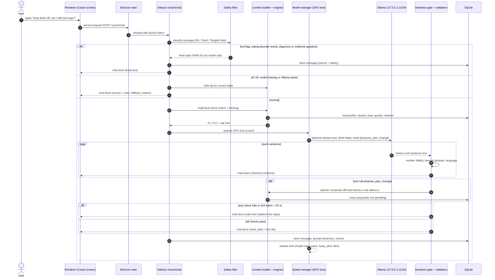

# Coach LLM (ARC)

> How ARC, the on-device coach, turns engine output into words: what context it gets, the
> prompts, structured output, validation, medical-safety rules, hallucination guards,
> streaming, timeouts, the rule-based fallback and the user's controls.
> Owner: **Jegatheesan** (sidecar `coach` + `ai` packages). Reviewer: **Navin** (evaluation,
> prompt changes). Decisions: [ADR-0004](../architecture/adr/0004-ollama-qwen3-local-llm.md),
> [ADR-0005](../architecture/adr/0005-deterministic-engines-llm-explains.md),
> [ADR-0011](../architecture/adr/0011-prompt-contracts-and-output-validation.md).

---

## 1. What exists today and what is planned

| Piece | Status | Where |
|---|---|---|
| Rules tip engine `coach-rules-v1` (onboard, over, under, protein, kcal_high, streak, recovering, good_session, default) | **implemented** | `services/sidecar/app/modules/coach/rules.py` |
| `GET /coach/tip`, `POST /coach/ask`, `GET /coach/status` | **implemented** | `coach/api.py`, [coach.yaml](../contracts/coach.yaml) |
| Ollama call: `/api/chat`, non-streaming, `think: false`, `temperature 0.4`, `num_predict 220`, 20 s timeout, `<think>` blocks stripped | **implemented** | `coach/ollama.py` |
| AI on/off setting; falls back to rules with `fallback_reason` `ai_disabled`, `ollama_unavailable`, `ollama_error: …` | **implemented** | `coach/service.py`, `progress` settings |
| Prompt `P-00 coach.ask` v0 (plain text, "use only the numbers in the facts") | **implemented** | [prompt-library.md §3](prompt-library.md#3-p-00--coachask-v0-implemented) |
| Numbered facts block, intent router, token budget | planned · Phase 2 | `coach/context.py`, `coach/router.py` |
| Safety pre-filter (red flags, eating-disorder words, diagnosis/medicine questions) | planned · Phase 2 | `coach/safety.py` |
| Prompt registry `P-01 … P-11` with JSON-schema output | planned · Phase 2 | `coach/prompts/` |
| Output validators: number fidelity (V3) and banned phrases (V4) | **implemented** (`validate-1.0.0`) | `coach/validate.py`; results in `CoachOut.checks` |
| Output validators: schema (V1), fact ids (V2), language (V5), length (V6) | planned · Phase 2 | `coach/validate.py` (with the JSON prompts) |
| Streaming chat over SSE with sentence gating | planned · Phase 2 | `POST /coach/chat`, `chat.token` / `chat.done` events |
| `propose_plan_change` tool → proposals the user approves | planned · Phase 2 | `coach/tools.py`, `coach/proposals.py` |
| Model tiers and fallback (`qwen3:4b` → `gemma3:4b` → `qwen3:1.7b` → rules) | planned · Phase 2 | `ai/model_manager.py`, [model-manager.md](model-manager.md) |
| Tamil / Tanglish replies (beta) | planned · Phase 4 | [multilingual-tamil.md](multilingual-tamil.md) |

Since PR #23 every model reply goes through V3 (number fidelity) and V4 (banned phrases)
before it is returned. A failure returns the rules tip instead, with
`fallback_reason: "check_failed: numbers"` (or `banned`) and the validator results in
`CoachOut.checks`; only the rule id is logged, never the reply text. The full chain (V1, V2,
V5, V6) arrives with the JSON prompts in Phase 2, and the Phase 2 gate (M10, M11 in
[evaluation.md](../operations/evaluation.md#ai-and-ml)) still applies before the coach is
called "done".

### The one rule

ARC's model **never produces a number the user acts on**. Engines compute loads, sets,
calories, XP, readiness, ETAs and plan diffs. The model receives those numbers as facts and
writes sentences around them. Every reply is checked; a reply that fails is replaced by the
rules text. See [README.md §1](README.md#1-the-principle).

---

## 2. Context building

`coach/context.py` (planned) turns the database into a **facts block**: short numbered
lines, each produced by an engine or a table, never by a model.

### 2.1 Blocks

| Block | Always? | Lines (max) | Source | Content |
|---|---|---|---|---|
| `PROFILE` | yes | 2 | `profile`, `settings` | Age, sex, goal (cut / maintain / lean bulk), experience, training days, session length, equipment, diet type (veg / egg / non-veg), units |
| `SAFETY` | if any | 3 | `injuries`, pause mode | Active injury flags with area, side, pain, start date and paused movement patterns; sick / travel / exam mode |
| `TODAY` | yes | 4 | readiness, quests, plan | Readiness score and band, today's quest and XP, planned session (exercise names, sets × rep range), sets done so far |
| `TRAINING_7D` | by intent | 10 | `muscle_load_daily`, `prs`, `workouts` | Sessions done vs planned, missed sessions, only the **non-optimal** muscles (status, effective sets vs target, readiness %, ready-at), up to 3 recent PRs |
| `NUTRITION` | by intent | 5 | `nutrition` totals, energy engine | kcal target (marked estimate), eaten today, protein target and eaten, last meal's items, 3-day average when asked about trends |
| `RULE` | yes | 2 | `coach/rules.py`, weekly review | The rule tip or finding codes for this state |
| `PROPOSALS` | if any | 2 | `proposals` | Pending proposals (kind and short diff) so ARC does not suggest them twice |

**Intent routing** (rules, not a model): `coach/router.py` matches the message against
keyword lists in English, Tamil script and Tanglish and picks `training`, `nutrition`,
`recovery`, `pain`, `motivation`, `app_help` or `other`. `nutrition` adds the full
`NUTRITION` block and trims `TRAINING_7D` to 3 lines; `training` does the opposite; `pain`
first goes through the safety filter (§6). Unknown intent includes everything within budget.

### 2.2 Example facts block (sample data, as in the mockups)

```text
F1: Profile: 21-year-old male, goal lean bulk, intermediate, 4 training days a week, 60-minute sessions, vegetarian with eggs.
F2: Equipment: barbell, dumbbells, adjustable bench, pull-up bar.
F3: Active injury flag: left knee, dull, pain 3/10, since 2026-10-14. Paused: jumps, lunges, loaded deep knee bends.
F4: Today's readiness: 74 (green). Today's plan is unchanged.
F5: Today's quest: Pull session, 16 working sets, 120 XP.
F6: Hamstrings: recovering, readiness 62%, ready about Wed 6 PM.
F7: Chest: under target, 6 effective sets this week (target 10-20).
F8: Calories today: 1,240 of an estimated 2,650 kcal.
F9: Protein today: 58 g of 130 g.
F10: Last PR: bench press e1RM 88.7 kg on 2026-10-18 (70 kg x 8, Epley formula).
F11: Streak: 12 days.
F12: Rule tip (code protein): You're about 72 g short on protein today.
```

Each line is written by a small formatter per engine (`fmt_muscle()`, `fmt_energy()`, …),
so numbers appear exactly once and in the same format the UI shows. The validator (§7)
extracts the allowed numbers from these same strings.

### 2.3 Token budget

`num_ctx` is **4096** tokens for the coach on the reference laptop: the KV cache grows with
context, and on a 4 GB GPU a larger window pushes layers to the CPU
([model-manager.md §2](model-manager.md#2-vram-and-ram-budget)). Budgets (estimates; tune
from Ollama's `prompt_eval_count`, which every response reports):

| Part | Budget (tokens) | Rule when over |
|---|---|---|
| System prompt `P-01` (+ `P-10` for Tamil) | ≤ 700 | Fixed; a prompt PR that exceeds it fails the eval job |
| Facts block | ≤ 1,000 | Drop lines in this order: older PRs, optimal-muscle lines, 3-day nutrition, proposals |
| History | ≤ 1,200 | Keep the last 6 turns; drop the oldest first. No model-written summaries of old turns |
| User message | ≤ 500 | The API already caps it at 2,000 characters (`ChatIn.text`) |
| Output (`num_predict`) | 400 chat · 300 JSON templates | Generation stops; the sentence gate drops an unfinished last sentence |
| Margin | ≈ 300 | Tokeniser differences (Tamil script uses more tokens per word, amount unverified) |

Counting before the call uses a cheap estimate (characters ÷ 3.5 for English, ÷ 1.5 for
Tamil script; both **estimates** to be replaced by measured ratios from the Phase 2
benchmark). After the call the real `prompt_eval_count` is logged to the dev metrics so the
estimate can be corrected.

---

## 3. System prompt design

Principles behind `P-01`:

1. **Role before rules, rules before style.** The model reads who it is, then the hard
   rules, then tone. Safety rules are numbered so tests can refer to them.
2. **Facts are data, not instructions.** The facts block is introduced as data from formulas.
   The user's message is placed last and labelled `USER:` so text inside it ("ignore the
   rules") is treated as content. The safety filter and validators do not depend on the
   model obeying this; they run regardless.
3. **Say what to do when information is missing** ("say the app can show it"), because small
   models fill gaps with guesses when they are not told otherwise.
4. **Short outputs.** A 4B model drifts in long answers; 4 sentences keeps latency and
   error surface small.
5. **No thinking mode.** `think: false` (Ollama's switch for qwen3) keeps first-token latency
   low; hidden reasoning would also be invisible to the validators. Any stray `<think>…</think>`
   block is stripped (already implemented).
6. **One prompt per job.** Explaining a weekly review and chatting are different templates
   with different schemas, so each can be evaluated alone.

### Main templates (full text)

The complete set, with schemas, is in [prompt-library.md](prompt-library.md). The three that
carry most traffic:

**P-01 · `coach.system` v1** (system message for every coach template; output none (system message)):

```text
You are ARC, the coach inside the ASCEND fitness app. ASCEND runs entirely on this computer.

WHO YOU ARE
- A calm, encouraging training partner. Short sentences. No judgement about missed days, food or body size.
- You explain what the app's engines decided. You do not decide training loads, calories, XP or plan changes yourself.

THE FACTS BLOCK
- Each message from the app contains a FACTS block. Every line starts with an id such as F3.
- The FACTS come from the app's own formulas. Treat them as true and complete.
- Use only numbers that appear in FACTS or in the user's own message. Never calculate, estimate, round to a new value or invent a number, a weight, a rep count, a calorie value or a date.
- If the user asks for a number that is not in FACTS, say the app can show it (name the screen) or that you do not have it. Do not guess.
- Name the fact ids you used in facts_used when a template asks for JSON.

SAFETY RULES (these override everything else)
1. You are not a doctor or physiotherapist. Never diagnose. Never name a condition, injury type or cause ("torn", "sprain", "tendinitis", "disc" and similar). Never suggest medicines, injections or supplements with doses.
2. Pain: if the user mentions sharp pain, swelling, numbness, tingling, chest pain, dizziness, fainting, a fall or pain of 7 or more out of 10, reply only: stop training that area and see a doctor or physiotherapist. The app also handles this before you see the message.
3. Food: never suggest eating below the calorie target in FACTS, skipping meals, fasting to "make up" for food, purging, laxatives or exercising to burn off a meal. If the user talks about any of these, be kind, do not give numbers, and suggest talking to someone they trust or a professional.
4. Never shame. Never use words like "lazy", "cheat meal", "bad food", "fat".
5. Plan changes happen only through the propose_plan_change tool. A proposal is a suggestion the user must approve. Never say a change has been made.

STYLE
- Reply in {{language_name}}. If the user mixes languages, reply in the main language of their message.
- Maximum 4 sentences in chat unless the user asks for more. Plain text. No tables. No markdown headings.
- Use Indian food examples (dal, curd, paneer, eggs, idli, chana) when food comes up.
- Address the user as {{user_name}} at most once per reply.
{{tamil_style}}
```

**P-02 · `coach.chat` v1** (streamed plain text, sentence-gated; optional tool call propose_plan_change; output plain text stream; optional tool call (schema S-TOOL-PROPOSE)):

```text
FACTS (from ASCEND's formulas; today is {{today}}):
{{facts_block}}

RULE HINT (what the rules engine would say; you may build on it, not contradict it):
{{rule_hint}}

DETECTED INTENT: {{intent}}

Answer the user's message below. Follow the system rules. If a change to their plan would help and the RULE HINT or FACTS support it, call propose_plan_change instead of describing numbers yourself; the app will compute the exact change and show it for approval.

USER: {{user_message}}
```

**P-05 · `coach.weekly_summary` v1** (background job (weekly review), non-streaming, JSON schema; output S-WEEKLY):

```text
You are writing the weekly review for the week starting {{week_start}}.

FINDINGS (scored by the rules engine, highest severity first):
{{findings_block}}

PROPOSED CHANGES (computed by the planner; the user will Apply, Edit or Keep each one):
{{proposals_block}}

FACTS:
{{facts_block}}

Write exactly 3 sentences:
1. One genuine positive from this week, using a number from FACTS or FINDINGS.
2. The most important finding, in plain words.
3. What the proposed changes aim to do, without restating their numbers unless they appear above.

Do not invent numbers. Do not say any change has been applied. No guilt about missed sessions.

Return JSON only: {"sentences": [s1, s2, s3], "facts_used": [fact ids], "highlight_code": one finding code from FINDINGS}.
```

Ollama request options per template (planned defaults, tuned by the Phase 2 eval):

| Template | `temperature` | `top_p` | `num_ctx` | `num_predict` | `format` | `stream` | `think` |
|---|---|---|---|---|---|---|---|
| `P-02` chat | 0.5 | 0.9 | 4096 | 400 | — (tools) | true | false |
| `P-03`, `P-04`, `P-07`, `P-09` | 0.2 | 0.9 | 4096 | 300 | schema | false | false |
| `P-05` weekly summary | 0.3 | 0.9 | 4096 | 300 | schema | false | false |
| `P-06` plan explain | 0.3 | 0.9 | 4096 | 500 | schema | false | false |
| `P-08` injury follow-up | 0.3 | 0.9 | 4096 | 250 | schema | false | false |
| `P-11` VLM second opinion | 0 | 1.0 | 4096 | 400 | schema | false | n/a |

`keep_alive` is `30m` for the coach model while the app is open and `0` when the GPU lock
hands over to the VLM ([model-manager.md §4](model-manager.md#4-loadunload-lifecycle)).

---

## 4. A chat request, end to end



The renderer shows each checked sentence as it arrives, the "data ARC used" panel from
`used_data`, and a proposal card if one was created.

---

## 5. Structured output and validation

### 5.1 Two output modes

| Mode | Used by | How it is constrained |
|---|---|---|
| **JSON** | Tip rephrase, "why?", weekly summary, plan explanation, proposal reason, injury follow-up, readiness note, VLM second opinion | The template's JSON Schema is sent as Ollama's `format` (structured outputs) and validated again with `jsonschema` (`additionalProperties: false`) |
| **Streamed text + tool** | Chat (`P-02`) | Plain text streamed and checked sentence by sentence; plan changes only through the `propose_plan_change` tool, whose arguments have their own schema and contain no numbers |

### 5.2 Validator chain

Every model output passes these checks in order. The first failure decides the outcome.

| # | Check | Fails when | Outcome |
|---|---|---|---|
| V1 | Parse + schema | Not valid JSON, wrong types, extra keys, over `maxLength` | Interactive: rules text at once. Background job: one retry at `temperature 0` with the validation error appended, then template |
| V2 | Fact ids | `facts_used` names an id not in the facts block | Treated as V1 failure |
| V3 | **Number fidelity** | Any number not allowed by §7.1 | Rules text replaces the reply; `checks.numbers = fail` stored |
| V4 | Banned phrases | Diagnosis words, medicine or dose patterns (`mg`, `IU`, "tablet"), shame words, "I have changed / updated your plan" | Rules text; logged with the matched rule id (not the text) |
| V5 | Language | Reply language ≠ requested (script ratio test, §7.3) | Shown, flagged `language_mismatch`; "Show in English" opens by default. Counted in the Tamil rubric |
| V6 | Length | Chat over 6 sentences | Truncated at the 6th sentence end |

Validators are pure functions with unit tests and a fixed `VALIDATOR_VERSION`; their results
(`{"schema":"pass","numbers":"pass",…}`) are stored with the message for evaluation.

### 5.3 Sentence-gated streaming

Small models rarely fail on every sentence; they fail on one. The gate buffers tokens until
a sentence end (`.`, `?`, `!`, `।`, newline, or 220 characters), runs V3–V4 on that sentence,
then emits it as one `chat.token` event. If a sentence fails, generation is cancelled and
`chat.done` carries the rules answer with `source: "rules"` and
`fallback_reason: "check_failed"`; the renderer replaces the partial reply in place with a
short note ("ARC's AI answer used a number the app couldn't verify, so here is the rules
answer"). The user never sees an unchecked sentence. Cost: one sentence of extra latency
(≈ 1–2 s at the throughput target, estimate).

---

## 6. Medical-safety rules

ASCEND is not a medical device ([security-privacy.md §8](../architecture/security-privacy.md#8-safety-health)).
Safety is enforced **outside** the model in three layers.

### 6.1 Pre-filter (before any model call)

`coach/safety.py` runs on every chat message, pain report and check-in note. It uses word
lists and patterns, not a model, so it works with AI off and cannot be argued with.

| Category | Examples matched (English · Tamil · Tanglish) | Action |
|---|---|---|
| **Red flag** | sharp / stabbing pain, swelling, numb, tingling, chest pain, can't breathe, dizzy, fainted, fell, "pain 7/10" or higher · நெஞ்சு வலி, மயக்கம், வீக்கம், மரத்துப் போச்சு · nenju vali, mayakkam, veekkam, marathu pochu | `SAFE-01`; injury flag set with `red_flag = true`; area's movement patterns blocked until the user clears it |
| **Eating-disorder risk** | starve, not eating, throw up after eating, purge, laxatives, burn off what I ate, "eat 500 calories", hate my body · சாப்பிடாம இருக்கணும் · saapdaama irukanum | `SAFE-02`; no numbers in the reply; calorie-deficit proposals suppressed for 7 days |
| **Diagnosis request** | is it torn, what injury is this, do I have …, ligament, fracture | `SAFE-03` |
| **Medicine / dose** | painkiller, steroid, injection, how many mg, dose of … | `SAFE-04` |

Word lists live in `coach/safety_lists.yaml` (versioned). The Tamil and Tanglish entries are
written and reviewed by Tamil-speaking team members; they are **not exhaustive**, which is
why the post-filter and the system prompt still carry the same rules. The test suite holds
40 red-flag messages in English, Tamil and mixed text (metric M11 must be 100%).

### 6.2 In the prompt

Rules 1–5 of `P-01` repeat the same limits for the cases the lists miss: no diagnosis, no
medicine, kind handling of food worries, no shame, no claimed plan changes.

### 6.3 Post-filter (after the model)

V3 and V4 (§5.2) catch a model that ignores the prompt. Two extra rules come from the
engines, not from text matching:

- **Calorie floor.** Engines never propose a target under 1,500 kcal (men) / 1,200 kcal
  (women) without a warning (common guideline; estimate). Because the model cannot invent
  numbers (V3), it cannot suggest a lower one either.
- **Blocked patterns.** If a reply names an exercise whose movement pattern is blocked by an
  active injury flag, V4 fails it (the exercise library maps names to patterns).

---

## 7. Hallucination guards

### 7.1 Number fidelity (V3)

1. **Extract** numbers from the reply: digit groups (`2,650`, `88.7`, `3/10`, `6 PM`), English
   number words (`three`, `twenty`), Tamil digits (`௩`) and common Tamil / Tanglish number
   words (`moonu`, `மூணு`). Ordinals ("first") are ignored.
2. **Allowed set** = every number in the facts block ∪ every number in the user's message.
   The words "one" and "two" are also allowed because they occur in normal phrasing
   ("one thing", "two options"); the same values as digits must still be in the set.
3. **Match** each extracted number to the allowed set: exact after removing separators, or a
   **rounded** form of an allowed value (fewer significant digits and within 2%:
   `2,650` → "about 2,600" passes; "2,800" fails).
4. **Units travel with numbers.** If a number matches but its unit differs (`88.7 kg` in facts,
   "88.7 kcal" in the reply), it fails.
5. **Dates and times** must appear in the facts in the same form ("Wed 6 PM").

The same check runs over the AI-off templates in CI, so a template bug is caught the same
way as a model bug.

### 7.2 Other guards

| Guard | How |
|---|---|
| Facts are complete for the question | The intent router includes the block the question needs; if a number is asked for that no block has, `P-01` tells the model to point to the screen instead |
| No numeric tool arguments | `propose_plan_change` takes `kind`, `target`, `reason_code`; the planner computes the diff ([adaptive-planning-ai.md](adaptive-planning-ai.md#4-what-the-ai-may-suggest)) |
| No unsupported proposals | The planner rejects a proposal no rule supports and tells the model `accepted: false` |
| No nutrition from models | Food values come only from INDB / IFCT / Open Food Facts rows ([food-recognition.md §6](food-recognition.md#6-nutrients-always-from-the-database)) |
| Provenance in the UI | Each reply shows "data ARC used" (fact ids → readable lines) and the source (`model` / `rules` / `safety`) |
| Measured | Metric M10 (number fidelity on 100 generated reviews must be 100%) and the coach rubric in [evaluation-ai.md](evaluation-ai.md#3-coach-answer-quality) |

### 7.3 Language check (V5)

Tamil-script share = Tamil code points (U+0B80–U+0BFF) ÷ letters. Requested Tamil script and
share < 30% → mismatch. Tanglish (Latin script) cannot be detected this way, so it is only
checked by the human rubric ([multilingual-tamil.md §5](multilingual-tamil.md#5-test-plan)).

---

## 8. Streaming and timeouts

| Step | Limit | On breach | Status |
|---|---|---|---|
| Ollama reachable (`GET /api/tags`) | 1.5 s | `ollama_unavailable` → rules | **implemented** |
| `/coach/ask` model call (non-streaming) | 20 s total | `ollama_error` → rules | **implemented** |
| Chat first token | 20 s | Cancel, rules answer, note "AI was slow" ([v2 fallback table](../architecture/system-architecture.md)) | planned |
| Chat gap between tokens | 8 s (estimate) | Cancel; the rules answer replaces the reply (§5.3) | planned |
| Chat total | 60 s (estimate) | Stop at the last checked sentence and mark the reply "cut short" | planned |
| JSON template (interactive) | 20 s | Template text | planned |
| Weekly review job | 120 s | Template summary; findings and proposals are unaffected | planned (from the v2 plan) |
| Model load (cold) | 45 s (estimate) | `model_load_timeout` → rules; model manager marks the tier unhealthy for 10 min | planned |

Cancellation closes the HTTP stream to Ollama, which stops generation. The user can also
press **Stop** in the chat; the partial checked reply is kept and labelled "stopped".

Chat is streamed to the renderer through the shared SSE stream (`chat.token`,
`chat.done`; [port-register.md §5](../architecture/port-register.md#5-sse-event-names-sidecar--main--renderer)).
`chat.done.data` carries `source`, `fallback_reason`, `used_data`, `prompt_id`,
`prompt_version` and, when the reply was replaced, `final_text`.

---

## 9. The rule-based fallback

Rules are not a degraded copy of the AI; they are the **primary** coach, and the model is an
optional voice on top ([ADR-0005](../architecture/adr/0005-deterministic-engines-llm-explains.md)).

| `fallback_reason` | Meaning | Status |
|---|---|---|
| `ai_disabled` | User switched AI off | **implemented** |
| `ollama_unavailable` | Ollama not running or the model is not pulled | **implemented** |
| `ollama_error: …` | HTTP error, empty reply or timeout from Ollama | **implemented** |
| `check_failed` | A validator rejected the reply | planned |
| `safety` | The pre-filter answered with a fixed reply | planned |
| `slow` | First-token or total timeout | planned |
| `oom` | Model failed to load for lack of memory; the next tier is tried first | planned |
| `rules_only` | User chose rules-only coach mode | planned |

What the user gets with each feature in rules mode:

| Feature | Rules / template output |
|---|---|
| Tip of the day | `coach-rules-v1` tip text (implemented) |
| Chat | The rule tip for the detected intent plus a link to the relevant screen; for `app_help`, a fixed help answer |
| "Why?" on a card | The formula description stored with the engine (`formula_summary`) and the numbers |
| Weekly review | Three template sentences filled from the top findings |
| Plan explanation | Per-day template ("Day 2 focuses on pull muscles because …") from planner tags |
| Injury follow-up | Fixed text listing paused movements and swaps |

---

## 10. User controls and override

| Control | Where | Effect |
|---|---|---|
| **AI on/off** (master) | Settings → AI, onboarding | No model is called anywhere; scan becomes search-and-pick. **Implemented** for the coach |
| Rules-only coach | Settings → AI | Coach uses templates; photo classifier still runs (it is not a language model) |
| Per-feature switches | Settings → AI | Chat, tip rephrasing, plan explanations, VLM second opinion, Tamil replies |
| Changes need my approval | Settings → AI (on by default) | Proposals wait for Apply / Edit / Keep my plan; "auto-apply small changes" covers only ±1 set and load tweaks |
| Show in English | Under every non-English reply | Shows the English rules/template text for the same state |
| Use rules answer | Under every model reply | Replaces that reply with the rules text and records the preference for evaluation (local) |
| Keep my plan | Every proposal | Rejects it; the planner will not re-propose the same diff for 7 days |
| Import my own plan | Workouts → Plans | The planner switches to suggest-only for that plan |
| Export chat | Settings → Data | JSON / text export of chat history ([ADR-0010](../architecture/adr/0010-import-export-formats.md)) |
| Delete chat history | Settings → Data | Deletes `chat_threads` and `chat_messages` ([data-and-privacy-for-ai.md](data-and-privacy-for-ai.md#5-deletion)) |

---

## 11. Model tiers

| Tier | Model | When | Notes |
|---|---|---|---|
| Full | `qwen3:4b` (2.5 GB, per Ollama tag page) | NVIDIA GPU with ≥ 4 GB VRAM and the speed test passes | Default ([ADR-0004](../architecture/adr/0004-ollama-qwen3-local-llm.md)) |
| Alternate | `gemma3:4b` (3.3 GB, per Ollama tag page) | Only if `qwen3:4b` fails the English rubric in the Phase 2 benchmark, or the user picks it | Likely to spill partly to CPU on 4 GB (estimate); Gemma terms of use must be reviewed |
| Lite | `qwen3:1.7b` (1.4 GB, per Ollama tag page) | < 4 GB VRAM, CPU-only PCs, or after an OOM on the full tier | Lower quality; shorter replies (`num_predict 250`) |
| Off | none | No Ollama, user choice, or Lite slower than the minimum speed | Rules and templates |

The same prompts are used on every tier; the eval harness runs the golden set on each tier
so a tier that breaks a gate is not offered.

---

## 12. Code map (planned layout)

```text
services/sidecar/app/
├── ai/
│   ├── model_manager.py     # tiers, GPU lock, keep_alive, health  → model-manager.md
│   └── ollama_client.py     # streaming /api/chat, cancel, timeouts
└── modules/coach/
    ├── api.py               # /coach/* routes (tip, ask exist today)
    ├── rules.py             # coach-rules-v1 (exists)
    ├── ollama.py            # v0 client (exists; replaced by ai/ollama_client.py)
    ├── service.py           # exists; grows the chat pipeline
    ├── context.py           # facts block + budget
    ├── router.py            # intent keywords
    ├── safety.py            # pre-filter + safety_lists.yaml
    ├── validate.py          # V1–V6
    ├── tools.py             # propose_plan_change schema + handler
    └── prompts/             # P-01…P-11 text files + registry.yaml
```

Tests: `tests/coach/` with a fake Ollama server (canned streams, slow streams, OOM error),
golden facts blocks, and the safety message suite. Evaluation: [evaluation-ai.md](evaluation-ai.md).
