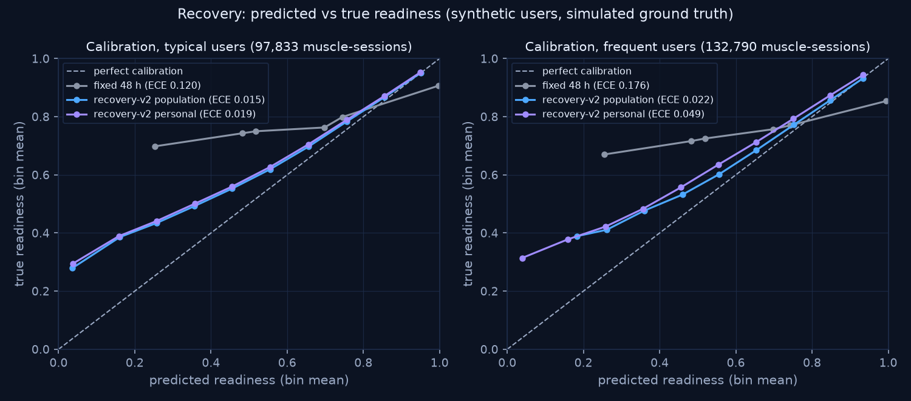
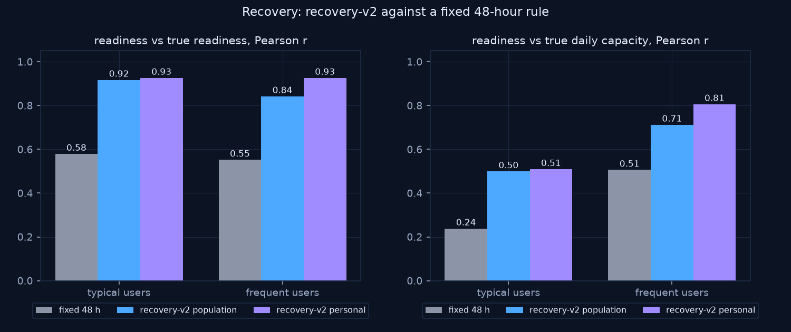
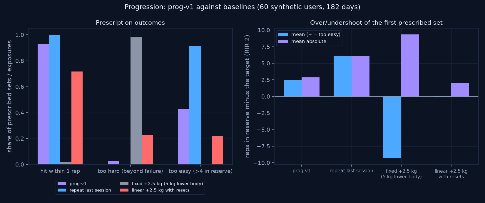

# Evaluation of the intelligence layer (recovery-v2, prog-v1)

Status: results of the build on 2026-10-21, produced by the scripts in
`services/sidecar/eval/` with fixed seeds. Every number below is in
`services/sidecar/eval/results/*.json`; rerun with the commands at the end.

**Read this first.** Everything here runs on **synthetic users**, not real people. The
simulator (`eval/synth.py`) gives each user hidden ground truth (true recovery speed, true
fatigue sensitivity, true strength curves, sleep effect, RPE habits). The engines never see
it. Some of the simulator's structure (exponential fatigue decay, a capacity per muscle) is
the same kind of model the engine uses, so these results show that **the estimation
machinery works under those assumptions**, not that real people recover or progress like
this. The truth deliberately differs from the engine in several places to keep the test
honest:

- true intensity is `1 - 0.08 RIR`, where the engine assumes `1 - 0.1 (RIR - 2)`;
- the sleep effect is per user, where the engine uses one constant;
- RPE is logged with noise (sd 0.3-1.0), by some users never;
- a quarter of the recovery users have a delayed, DOMS-like fatigue kernel.

Validating on real training logs is future work (docs/ai/ai-roadmap.md).

## 1. Recovery (recovery-v2 vs a fixed 48-hour rule)

**Setup** (`eval/recovery_eval.py`, seed 2026, 40 users per cohort, 365 days each):

- **Typical users** follow a random split with 1-4 day gaps.
- **Frequent users** train full body most days and log RPE on every set.
- **Evaluation points:** every session start after an 8-week warm-up. For each muscle trained in the previous 7 days, the predicted readiness is compared with the simulator's true readiness.
- **Personal factors** are refitted every 28 days on data before that block only (no look-ahead).
- **Baseline:** the common "48 hours per muscle" rule. Readiness is 0 right after training and rises linearly to 1 at 48 h.

| Cohort | Method | Pearson r | Spearman rho | MAE | ECE | r with true daily capacity |
|---|---|---|---|---|---|---|
| typical | fixed 48 h | 0.579 | 0.603 | 0.127 | 0.1202 | 0.293 |
| typical | recovery-v2 population | 0.907 | 0.911 | 0.0395 | 0.0147 | 0.453 |
| typical | recovery-v2 personal | 0.915 | 0.917 | 0.039 | 0.0193 | 0.463 |
| frequent | fixed 48 h | 0.520 | 0.535 | 0.1932 | 0.1765 | 0.460 |
| frequent | recovery-v2 population | 0.848 | 0.857 | 0.058 | 0.0218 | 0.675 |
| frequent | recovery-v2 personal | 0.946 | 0.949 | 0.0546 | 0.0485 | 0.845 |

Muscle-sessions evaluated: typical 97,833, frequent 132,790.
Exercise exposures for the capacity column: 26,790 and 37,940.

**What it shows**

- **recovery-v2 tracks true readiness far better than a fixed 48 h rule** in both cohorts: Pearson r 0.848-0.946 against 0.520-0.579, and MAE 0.039-0.058 against 0.127-0.1932. Dose matters: three easy sets and eight hard sets do not need the same 48 hours.
- **Personal factors help most where they can be learned.**
  - For frequent users, r rises from 0.848 to 0.946. The correlation with true daily capacity rises from 0.675 to 0.845.
  - For typical users the gain is small (0.907 to 0.915). With 2-4 day gaps, most fatigue is gone by the next session, so the data says little about recovery speed.
- **Error in the recovery factor k** (absolute error after 365 days):
  - typical: 0.221 with the fit vs 0.235 with the population value;
  - frequent: 0.138 vs 0.211;
  - groups that left the population value: 174/240 (typical), 200/240 (frequent).
- **Calibration is good where most predictions are, and pessimistic at the low end.**
  - Below about 0.4 predicted readiness the engine says "more tired" than the truth. For frequent users (population factors), predictions in the 0.2-0.3 bin averaged 0.261 against a true 0.411.
  - This is the deliberate mismatch above: the engine counts a set at RIR 2 as a full set (I = 1), while the simulated truth counts it as 0.84.
  - Personal factors improve ranking (r) but make calibration slightly worse for frequent users (ECE 0.0218 to 0.0485). A faster or slower `k` stretches the spread of predictions, and the intensity mismatch then shows more.
  - We report this rather than tune it away, because tuning the engine to the simulator would only fit our own assumptions.





**Development finding.** The first prototype of the personal fit compared each session with a centred median of nearby sessions. It was biased: in a block of hard training the median itself is depressed by chronic fatigue, so fatigue looked smaller than it was. The final fit removes a per-exercise piecewise-linear trend instead (Frisch-Waugh-Lovell, knots every 6 weeks).

## 2. Progression (prog-v1 vs baselines)

**Setup** (`eval/progression_eval.py`, seed 2026, 60 users, 182 days, half of the exercises with an injected plateau). Each policy runs closed-loop:

- the user does the prescribed reps when they can and stops there; otherwise they grind out what they can;
- the user logs RPE with their own noise and habits;
- every policy sees the same users and the same random draws;
- the first exposure of each exercise is the user's own cautious pick (about 3 in reserve at 8 reps) and is not scored.

**Metrics** (per prescribed exposure; "realised RIR" is the true reps possible on the first set minus the prescribed reps; target RIR 2):

- **hit within 1 rep / exact:** share of prescribed sets where the user got at least target - 1 / the target;
- **RIR error:** realised RIR - 2. Positive means too easy (undershoot), negative means too hard (overshoot);
- **too hard:** realised RIR below 0 (the prescription needed more than failure);
- **too easy:** realised RIR above 4;
- **load error:** prescribed load vs the load that would leave exactly 2 in reserve that day.

| Policy | Hit within 1 rep | Hit exact | RIR error (mean) | RIR error (MAE) | Too hard | Too easy | Load error |
|---|---|---|---|---|---|---|---|
| prog-v1 | 93.1% | 87.8% | +2.43 | 2.89 | 2.7% | 42.9% | -5.0% |
| repeat last session | 99.8% | 99.6% | +6.09 | 6.10 | 0.0% | 91.2% | -13.1% |
| fixed +2.5 kg (5 kg lower body) | 1.7% | 1.1% | -9.32 | 9.33 | 98.1% | 0.0% | +141.2% |
| linear +2.5 kg with resets | 71.8% | 62.0% | -0.11 | 2.08 | 22.4% | 22.0% | +0.7% |

By RPE habit (hit within 1 rep / mean RIR error):

| Policy | Users who log RPE (90-100 %) | Users who never log RPE |
|---|---|---|
| prog-v1 | 92.1% / +2.11 | 96.1% / +3.21 |
| repeat last session | 99.8% / +6.34 | 99.8% / +6.04 |
| fixed +2.5 kg (5 kg lower body) | 1.7% / -9.34 | 1.6% / -9.40 |
| linear +2.5 kg with resets | 72.2% / -0.10 | 71.7% / -0.09 |



**What it shows**

- **prog-v1 is the only policy that is both reliable and not too easy.** Repeating last session always "hits" but leaves users 6.09 reps more in reserve than the target (about 8 in reserve). A fixed +2.5 kg every session fails almost every set within weeks. The classic linear progression with resets is the closest competitor: it is centred (mean error near 0) but too hard on 22.4% of exposures, against 2.7% for prog-v1.
- **prog-v1 errs on the easy side**: on average 2.43 reps more in reserve than the target, and too easy on 42.9% of exposures. This is the price of never asking for more than the user showed, and it is largest when no RPE is logged (3.21 reps over the target). Without RPE the engine cannot see reserve and climbs one rep at a time. Logging RPE is the single biggest improvement a user can make.
- **The recovery hold did not change these numbers.** A run without recovery input gave identical results: in this simulation no primary muscle was under 40 % at a session start. In development, a 60 % threshold held so often that users who never log RPE ended up more than 10 reps above the target reserve, so 40 % was kept.

**Stall detection** (event level). A true stall episode starts when the true 4-week strength gain drops under 1 %, from an injected plateau or natural saturation. It counts as detected if prog-v1 flags it within 8 exposures. A flag while true gain is 2 % or more per 4 weeks is a false alarm. Between 1 and 2 % is grey and counts neither way.

| True stalls | Detected | Missed | Recall | False alarms | Precision | Median delay | False alarms per 100 progressing exposures |
|---|---|---|---|---|---|---|---|
| 166 | 103 | 63 | 0.62 | 811 | 0.11 | 3 exposures | 5.46 |

**Stall precision is low, and we say so.**

- **Why:** true stalls are rare compared with progressing exposures, and "no rep record in 3 sessions" cannot separate a lifter gaining 0.5 % a month from noise.
- **What a false alarm costs:** one 10 % reset of that lift. The deload check only uses stalls when two or more lifts stall at once.
- **What we changed:** the first rule (median e1RM of the last 3 sessions vs the 3 before) was worse. Without RPE an e1RM from sets stopped short of failure follows the prescription and falls whenever reps reset after a load step. In the 12-user development runs, switching to rep-at-load records cut false alarms from about 9 to about 5.5 per 100 exposures, and the undershoot for users who never log RPE fell from +10.6 to +3.3 reps over the target, because fewer spurious resets happened. These development figures were not committed to `eval/results`; the final run's numbers are the ones in the table above (5.46 false alarms per 100 progressing exposures, +3.21 without RPE).

## 3. Explanations

**Not measured here.** The local model (qwen3:4b) is not installed on the build machine.

- The tests use a stub model to check the guard: a sentence with only fact numbers is shown; an invented number, a banned phrase, a timeout, a missing model or AI off all fall back to the template.
- The guard pass rate and the quality of real model phrasing are open items for a machine with Ollama.

## 4. Latency on a one-year history

`eval/latency.py`, seed 2026: one frequent lifter, 293 sessions and 3,478 sets over 365 days. Measured through the real FastAPI app (SQLite, migrations, event bus) on the 4-CPU build machine, 30 runs after a warm-up (10 for the fit and for finishing a workout).

| Operation | p50 ms | p95 ms |
|---|---|---|
| recovery states, 28-day window (19 muscles) | 0.7 | 0.7 |
| personal factor fit, 365 days (6 groups) | 166.4 | 232.4 |
| progression target, 120 days of bench | 0.6 | 0.6 |
| GET /muscles | 12.5 | 24.0 |
| GET /intelligence/recovery | 13.1 | 18.7 |
| GET /intelligence/progression/{bench} | 20.2 | 36.4 |
| GET /deload (stall check over every lift) | 72.4 | 127.4 |
| GET /intelligence/notices | 129.6 | 215.3 |
| finish a workout (doses, refit, skills, quests) | 394.2 | 557.2 |

- Reading screens takes tens of milliseconds.
- Finishing a workout takes p50 394.2 ms, p95 557.2 ms. That includes the doses, the personal-factor refit over 365 days (p50 166.4 ms), skill-tree checks, quests and XP.
- The notices endpoint (p50 129.6 ms) recomputes the deload check, the latest targets and today's quest. It is called once per app refresh.
- These are single-machine timings; a slower laptop will be slower.

## 5. Tests behind the engines

- **Unit tests with hand-computed fixtures:** `tests/unit/test_recovery_v2.py`, `test_progression.py`, `test_recovery_personal.py`, `test_eval_metrics.py` (the evaluation's own metric code).
- **Property tests (hypothesis):**
  - `test_recovery_properties.py`: outputs bounded and finite; another set never raises readiness; waiting never lowers it; harder sets dose more; slower recovery means lower readiness; worse sleep never raises it.
  - `test_progression_properties.py`: targets finite and non-negative; no jump over 10 % or one plate; deterministic; more reps never lower the next load; lower readiness never raises the target.
- **API tests:** `tests/api/test_intelligence_*.py`.

## 6. Reproduce

```bash
cd services/sidecar
uv run python -m eval.recovery_eval --users 40 --seed 2026 --out eval/results/recovery.json
uv run python -m eval.progression_eval --users 60 --seed 2026 --out eval/results/progression.json
uv run python -m eval.latency --runs 30 --seed 2026 --out eval/results/latency.json
MPLBACKEND=Agg uv run --group eval python -m eval.charts   # writes docs/ai/img/eval_*.png
```

On the build machine the three runs took about 3, 2 and 1 minutes.

## 7. Limitations, in one place

- **Synthetic users only.** No result here comes from real people. Real training logs with consent are needed before any claim about real users.
- **Recovery r is partly circular.** recovery-v2 reaches Pearson r 0.907-0.946 against the simulator's ground truth, but the simulator uses the same model family (exponential decay, capacity per muscle). Agreement of about 0.9 shows the estimation works under those assumptions; it does not show that people recover this way. The deliberate mismatches listed at the top reduce, but do not remove, that circularity.
- **Stall detection is weak.** Precision 0.113 and recall 0.62 on synthetic stalls (103 of 166 found, 811 false alarms). A stall flag is a hint, not a diagnosis; one false alarm costs one 10 % reset of that lift.
- **Real local-model phrasing is unverified.** No Ollama was available on the build machine, so no qwen3:4b sentence was produced or checked. Only the guard logic is tested, with a stub model. The app shows the template text whenever the model is missing.
- **Latency is from one machine** (the 4-CPU build machine, Linux), not the target Windows laptop.
- **Reproducibility checked.** On 2026-10-21 the recovery and progression commands below were rerun on the current main and produced JSON identical to `eval/results/recovery.json` and `eval/results/progression.json`.
