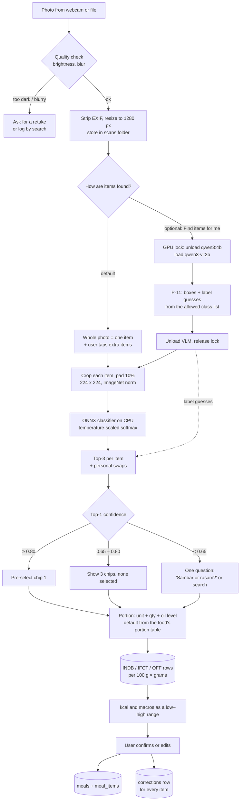

# Food Recognition

> How a meal photo becomes a logged meal: the Indian-food classifier, portions, the optional
> vision-model second opinion, the database lookup and the correction loop.
> Owners: **Navin** (dataset, classifier, evaluation), **Jegatheesan** (scan pipeline in the
> sidecar), **Dhanush** (scan review UI). Decisions:
> [ADR-0006](../architecture/adr/0006-own-food-classifier-indb-ifct.md) (own classifier,
> nutrients from INDB/IFCT) and [ADR-0012](../architecture/adr/0012-classifier-first-meal-scan.md)
> (classifier first, VLM optional). Training and shipping: [mlops-lifecycle.md](mlops-lifecycle.md).

---

## 1. Status

| Piece | Status |
|---|---|
| Diet log by **search** over a seeded table of about 30 Indian foods with katori / piece portions (values approximate, source noted) | **implemented** (v0.1) |
| `ml/` skeleton: `dvc.yaml` stages, `params.yaml`, `MLproject`, placeholder scripts | **implemented as stubs** (scripts exit with "not implemented yet") |
| INDB / IFCT / Open Food Facts India import with a licence column | planned · Phase 1 |
| Classifier v0 (ONNX, CPU) and the scan pipeline | planned · Phase 2 |
| VLM second opinion (`qwen3-vl:2b`) | planned · Phase 2, optional feature |
| Personal swaps from corrections | planned · Phase 2 |
| Retraining from exported corrections | planned · Phase 5 |

No accuracy figure in this file is measured. Every number marked **target** is a goal for the
evaluation in [evaluation-ai.md](evaluation-ai.md#2-food-classifier-and-portions).

---

## 2. Pipeline



Timeouts and fallbacks: the whole scan job has 60 s (from the v2 plan); AI off, models
missing or a timeout → **search-and-pick** with the photo kept on screen, so logging never
depends on a model. Contract: `POST /scans`, `GET /scans/{id}`, `POST /scans/{id}/confirm`
and the planned additions in [nutrition.yaml](../contracts/nutrition.yaml).

### Image quality checks

| Check | Rule (starting values, tune on the team photo set) | `failure_reason` |
|---|---|---|
| Too dark | Mean luminance < 40 / 255 | `too_dark` |
| Blurry | Variance of the Laplacian < 60 on the 1280 px image | `blurry` |
| No food | Top-1 class is `not_food` with confidence ≥ 0.6, or no item left after VLM | `no_food_found` |

---

## 3. Dataset

### 3.1 Sources (all licences unverified until checked and recorded)

| Source | Size (per its listing) | Use | Licence status |
|---|---|---|---|
| Indian Food Images Dataset (Kaggle) | 4,000 images, 80 classes | Main training set | **Unverified** — read the listing's licence before training; record it in `ml/data/SOURCES.md` |
| Food-101 (ETH Zürich) | 101,000 images, 101 classes; includes a few Indian dishes (e.g. samosa, chicken curry) | Intermediate fine-tuning (transfer) | **Unverified** for redistribution of derived weights; research-use terms |
| IndianFoodNet and other published Indian food sets | Varies by paper | Candidate extra classes | **Unverified** availability, size and licence |
| Khana (Indian cuisine dataset, 2025 paper) | Reported as large, about 80 classes | Candidate | **Unverified** size, availability and licence |
| Team meal photos | Target 300 by end of Phase 1 (estimate) | **Test set only**, never trained on | Consent from each photographer; EXIF stripped |
| `not_food` images | ≈ 500 household photos taken by the team (estimate) | Teaches "this is not food" | Team-owned |
| App corrections | Grows with use | Phase 5 retraining | User exports them explicitly ([data-and-privacy-for-ai.md](data-and-privacy-for-ai.md#4-consent-for-training-photos)) |

A model trained on a dataset inherits its terms. Before a public release, Navin records each
dataset's licence and whether redistributing **trained weights** is allowed; if a source does
not allow it, the released model is trained without that source. Tracked as risk R6 in
[ai-risks.md](ai-risks.md#2-risk-register).

### 3.2 Class list strategy

1. **Start from what people here eat.** For two weeks each team member logs every dish they
   eat (a shared sheet). The most frequent dishes define the v0 list.
2. **Intersect with data.** A class needs at least 40 training images (estimate) from the
   sources above or it waits for v1 (team photos are not training data).
3. **Every class maps to a database food.** `ml/labels.json` holds `class → INDB/IFCT food id,
   English name, Tamil name, default unit`. A CI test fails if a label has no food row.
4. **Group look-alikes.** Dishes a photo cannot tell apart become a group with a variant
   pick, e.g. `red_gravy_curry` → paneer butter masala / chicken curry / egg curry. The chip
   shows the group; the variant is one tap.
5. **`not_food` class** so a keyboard photo does not become "idli".
6. **Version the list.** Adding or merging classes is a new dataset version (DVC) and a new
   model version ([mlops-lifecycle.md §3](mlops-lifecycle.md#3-step-1-version-the-data-with-dvc)).

v0 candidate list (about 45 classes; final list comes from steps 1–2):

| Group | Classes |
|---|---|
| Tiffin | idli, plain dosa, masala dosa, rava dosa, uttapam, ven pongal, medu vada, upma, poori, appam, idiyappam |
| Breads | chapati, parotta |
| Rice | plain rice, curd rice, lemon rice, tamarind rice, veg biryani, chicken biryani |
| Gravies | sambar, rasam, dal, kootu, chana masala, rajma, `red_gravy_curry` group, palak paneer, fish curry |
| Sides | coconut chutney, tomato chutney, mint chutney, poriyal (vegetable stir-fry), avial, curd, boiled egg, omelette |
| Snacks and sweets | samosa, bajji / pakora, banana, payasam, gulab jamun |
| Drinks | filter coffee, tea |
| Other | `not_food` |

---

## 4. Model and training

### 4.1 Model choice

| Candidate | Params (approx.) | Why consider it | Role |
|---|---|---|---|
| MobileNetV3-Large (`mobilenetv3_large_100`, timm) | ≈ 5.5 M | Fast on CPU, exports cleanly to ONNX | **Baseline** |
| EfficientNet-Lite0 (`tf_efficientnet_lite0`, timm) | ≈ 4.7 M | Designed for mobile: ReLU6, no squeeze-excite, quantises well | Challenger |
| EfficientNet-B0 (`efficientnet_b0`, timm) | ≈ 5.3 M | Usually more accurate, slower | Challenger |

The winner is picked by the benchmark (top-3 on team photos, CPU latency, size), recorded in
MLflow and in the model card. Parameter counts are the published architecture sizes; file
sizes below are **estimates**: ≈ 20–22 MB as FP32 ONNX, ≈ 6 MB after INT8 quantisation.
Target CPU latency ≤ 150 ms per crop on the Ryzen 7 7435HS (target from
[ml-pipeline.md §5](../architecture/ml-pipeline.md#5-evaluation-and-gate)). The classifier
runs on **CPU** so it never competes with the language model for the 4 GB of VRAM.

The v0.1 stub `ml/params.yaml` says `mobilenet_v3_small`, 15 epochs, `lr 0.0005`; those are
smoke-test defaults. The recipe below replaces them in Phase 2.

### 4.2 Augmentation (training only)

| Augmentation | Setting | Why |
|---|---|---|
| RandomResizedCrop | 224, scale 0.6–1.0 | Different framings and distances |
| Horizontal + vertical flip | p = 0.5 each | Top-down plate photos have no "up" |
| Rotation | ± 15° | Phone and webcam angles |
| Colour jitter | brightness 0.3, contrast 0.3, saturation 0.2, **hue 0.03** | Lighting varies; colour separates sambar from rasam, so hue stays small |
| Gamma / low light | gamma 0.6–1.4 | Evening kitchen light |
| Gaussian blur | p = 0.2, σ 0.1–1.5 | Webcam focus |
| JPEG re-compression | quality 40–95 | Messaging-app photos |
| MixUp / CutMix | α = 0.2, p = 0.3 | Regularisation; also mimics mixed plates |

Validation and test use only resize-256 → centre-crop-224 → normalise (the shared
preprocessing contract in [ml-pipeline.md §4](../architecture/ml-pipeline.md#4-preprocessing-contract-shared-with-the-sidecar)).

### 4.3 Training recipe (planned v0)

1. ImageNet-pretrained backbone from timm.
2. **Stage A — Food-101 transfer:** 5 epochs, all layers, AdamW `lr 3e-4`, cosine schedule.
3. **Stage B — Indian classes:** new head; 3 epochs with the backbone frozen (`lr 1e-3`), then
   up to 25 epochs unfrozen (`lr 3e-4` head, `1e-4` backbone), 1 warm-up epoch, cosine decay,
   weight decay 0.05, label smoothing 0.1, batch 32 with mixed precision (fits 4 GB VRAM at
   224 px — estimate, confirm in the first run).
4. **Imbalance:** class-balanced sampler (inverse square-root frequency).
5. **Early stopping** on validation macro-F1, patience 5.
6. **Calibration:** temperature scaling fitted on the validation split, so 0.80 means roughly
   "right 80% of the time". Expected calibration error (ECE) is logged.
7. **Seeds fixed** (`seed: 42`), every hyper-parameter in `params.yaml`, every run in MLflow.

Training runs in Gokul's CUDA training image on WSL2 on the RTX 3050; ONNX export, INT8
quantisation and the parity test follow ([mlops-lifecycle.md §6](mlops-lifecycle.md#6-step-4-export-to-onnx-and-quantise)).

---

## 5. Output, confidence and portions

### 5.1 Top-3 and thresholds

Each item returns the top-3 classes with temperature-scaled probabilities, mapped to food ids
through `labels.json`.

| Top-1 probability | UI behaviour | `ScanItem` field |
|---|---|---|
| ≥ 0.80 | Chip 1 pre-selected; user can change | `preselected = food_id` |
| 0.65 – 0.80 | Three chips, none selected | `preselected = null` |
| < 0.65 | One question: the top two as a choice when together ≥ 0.80, otherwise "What is this?" with search | `question` set |

Thresholds are the starting values in the contract; Navin re-tunes them on the validation
split after calibration so that pre-selected chips are wrong ≤ 10% of the time (**target**).

**Personal swaps (deterministic, no retraining):** if a user has corrected class A to food B
three or more times, B is inserted into A's chips (replacing chip 3) from then on. Stored
locally, cleared with the corrections.

### 5.2 Portions

ASCEND v1 does **not** estimate grams from pixels. Small single-photo volume estimation is
unreliable, and a confident wrong number is worse than a quick question.

| Step | How |
|---|---|
| Unit | The food's default unit from its portion table: `katori`, `ladle`, `cup`, `piece`, `tbsp` or `g` (e.g. idli → piece, sambar → ladle, rice → cup) |
| Grams per unit | From the `portions` table **per food**, with a `source` column: INDB serving size where it exists, otherwise a team-measured value (weighed three times, averaged), marked as such |
| Quantity | Pre-filled with 1 (or the user's usual quantity for that food, from history); steppers of 0.5 |
| Oil level | 0 dry · 1 normal · 2 oily; changes the added fat by the recipe's oil grams in the DB |
| Range | kcal_low / kcal_high from ± 25% portion uncertainty and the oil level (± 25% is an **estimate**, re-set after the weighed-meal test) |

`plate_cm` in the scan request is kept for a later experiment (area ratio of a crop to a known
plate size → suggested quantity). It stays off unless it beats "pre-fill 1 and ask" on the 30
weighed reference meals (metric M4).

---

## 6. Nutrients always from the database

- Every kcal, protein, carb and fat value comes from a food row: INDB (recipes), IFCT 2017
  (raw ingredients) or Open Food Facts India (packaged). Each row keeps its source and
  licence ([data-model.md §6](../architecture/data-model.md#6-seed-data-and-licences)).
- The classifier outputs only class probabilities. The VLM schema (`S-VLM`) has no field for
  weight or nutrients, and `P-11` tells it not to estimate them; anything extra fails
  schema validation (`additionalProperties: false`).
- The coach may talk about a meal only through facts built from these rows
  ([coach-llm.md §7](coach-llm.md#7-hallucination-guards)).
- The UI shows the source of each item's values ("INDB · per katori, approximate").

---

## 7. VLM second opinion (`qwen3-vl:2b`, optional)

| Item | Rule |
|---|---|
| When | User taps **Find items for me** on a multi-item plate, or **Second opinion** on an uncertain item. Never automatic in v1.0 |
| Requires | AI on, the VLM downloaded (1.9 GB per Ollama tag page), an NVIDIA GPU with ≥ 4 GB or patience on CPU |
| GPU | One GPU model at a time: the job takes the GPU lock, **unloads the chat model** (`keep_alive: 0`), loads the VLM, runs `P-11`, unloads the VLM, releases the lock ([model-manager.md §4](model-manager.md#4-loadunload-lifecycle)) |
| Input | The photo (downscaled to 1,024 px on the long side, estimate) + the allowed class names + the classifier's top-3 |
| Output | Boxes and labels from the allowed list (`S-VLM`); no portions, no nutrients |
| Merge | Boxes → classifier re-runs on each crop. If the VLM's label is in the classifier's top-3, it moves to chip 1 but is pre-selected only if the classifier gave it ≥ 0.65. If it is outside the top-3, it is added as a fourth chip "Second opinion: …". The VLM never sets a confidence |
| Time | Counts against the 60 s scan budget; model swap adds seconds before the next chat reply (estimate; measured in the Phase 2 benchmark) |
| Measured | Did it list every item? Are boxes usable? (30 team photos, [evaluation-ai.md §2](evaluation-ai.md#2-food-classifier-and-portions)). VLM quality on Indian plates is **unverified** |

---

## 8. The correction loop

```text
scan → chips → user picks / edits → confirm
                    │
                    ├─ meal + meal_items saved (nutrients from DB rows)
                    └─ corrections row per item:
                         predicted_label, predicted_conf, top3,
                         chosen_food_id, chosen_unit, qty, oil_level,
                         keep_for_training (consent), model_version
```

1. **Every** confirmed item writes a correction row, including agreements; an agreement is a
   free, high-quality label.
2. **Immediately:** personal swaps (§5.1) and the "usual quantity" pre-fill use these rows.
3. **Locally measured:** correction rate per class and mean confidence feed the Model health
   page and the drift report (metric M13).
4. **Retraining (Phase 5, opt-in):** the user exports corrections (with photos only where
   `keep_for_training` is true) as a zip; Navin's pipeline ingests it into a new DVC dataset
   version, retrains, gates and ships a model-only update
   ([mlops-lifecycle.md §10](mlops-lifecycle.md#10-step-8-the-retraining-loop-opt-in)).
5. Corrections never leave the PC on their own ([ADR-0009](../architecture/adr/0009-offline-first-no-cloud.md)).

---

## 9. Failure modes

| Situation | What the user sees |
|---|---|
| AI off | Photo stays on screen; search box opens with "log by search" |
| Classifier file missing or corrupt (checksum) | Same as AI off, plus a Model health warning with "Repair" (re-copies the bundled model) |
| VLM missing | "Find items for me" shows the download card; tap-to-add still works |
| VLM out of memory | Job retried once on CPU if RAM allows, else "Second opinion unavailable"; classifier result kept |
| Timeout (60 s) | Whatever items are ready are shown; the rest fall back to search |
| Low confidence everywhere | One question per item at most; never a quiz |
