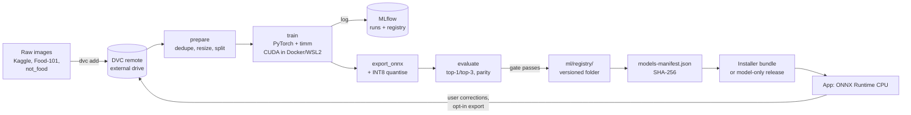

# MLOps Lifecycle: a Walkthrough

> The food classifier's whole life, step by step: data → experiment → ONNX → registry →
> manifest → installer or download → rollback → retraining from user corrections.
> Owner: **Navin**. This file is written as a learning path: each step says what to run,
> what file it creates, and what you should be able to explain afterwards.
> Architecture summary: [ml-pipeline.md](../architecture/ml-pipeline.md). Release mechanics:
> [release-process.md](../operations/release-process.md). Study plan:
> [study-path.md](../members/navin-lead/study-path.md).

---

## 1. The big picture



Nothing in this loop uses the cloud: the DVC remote is an external drive, MLflow runs in
Docker on `127.0.0.1:5000` ([port-register.md](../architecture/port-register.md)), and releases
are GitHub Releases that the app reads only if updates are enabled.

### What exists today

The v0.1 repo has the skeleton only: `ml/dvc.yaml` (stages prepare → train → export →
evaluate), `ml/params.yaml`, `ml/MLproject`, `ml/requirements.txt` and four placeholder
scripts in `ml/src/` that exit with "not implemented yet". Everything below is the plan for
Phases 1, 2 and 5; each step lists its commit in [ai-roadmap.md](ai-roadmap.md).

---

## 2. Words you need

| Term | Meaning here |
|---|---|
| Dataset version | A DVC hash of the data folders; tagged in git as `data-vN` |
| Stage | One step of `dvc.yaml` with declared inputs, outputs and parameters |
| Run | One training execution recorded in MLflow: parameters, metrics, artefacts |
| Model version | A semantic version of the classifier (`0.3.0`), tied to one run, one dataset version and one git SHA |
| Registry | Where promoted models live: MLflow's model registry (aliases `@candidate`, `@production`) plus the `ml/registry/` folder the release reads |
| Gate | The rules a candidate must pass to be promoted ([evaluation-ai.md §2.2](evaluation-ai.md#22-metrics-and-targets)) |
| Manifest | `models-manifest.json`: what the app should load, with checksums |
| Drift | The live data no longer looks like the training data (signals: falling confidence, rising correction rate) |
| Shadow mode | A new model runs beside production; its answers are logged, not shown |

---

## 3. Step 1: version the data with DVC

**Why:** git cannot hold thousands of images, but you still need "which exact data trained
model 0.3.0?" to have an answer.

```bash
cd ml
uv venv --python 3.12 && uv pip install -r requirements.txt --index-strategy unsafe-best-match  # pin versions first
dvc init --subdir
dvc remote add -d localdrive E:/ascend-dvc                     # external drive, no cloud
# put the downloaded sets under data/raw/<source>/<class>/*.jpg
dvc add data/raw/indian_food_images data/raw/food101_subset data/raw/not_food
dvc add data/test_own                                          # team photos, test only
git add data/raw/*.dvc data/test_own.dvc .dvc/config .gitignore
git commit -m "feat(ml): DVC remote on external drive + first dataset import"
dvc push
git tag data-v1
```

What you get: small `.dvc` files in git that point to content hashes on the drive. Anyone
with the drive runs `dvc pull` and gets the identical bytes.

Rules:

- `data/test_own` is **never** an input of the train stage. `prepare.py` writes a
  `split.csv`, and `train.py` refuses any row whose source is `test_own` (unit test
  `test(ml): training refuses rows tagged test-own`).
- Each source's licence is written in `ml/data/SOURCES.md` before its first `dvc add`
  (**unverified** until done; [food-recognition.md §3.1](food-recognition.md#31-sources-all-licences-unverified-until-checked-and-recorded)).

**Explain afterwards:** what a `.dvc` file contains, why the remote is not git, how you would
get the data that trained an old model.

---

## 4. Step 2: make the pipeline reproducible

`ml/dvc.yaml` already declares the four stages. Fill in the scripts so that:

| Stage | Reads | Writes | Parameters (`params.yaml`) |
|---|---|---|---|
| `prepare` | `data/raw` | `data/processed`, `split.csv`, `labels.json` | `image_size`, `val_split`, `seed` |
| `train` | `data/processed` | `models/food_clf.pt`, `train_metrics.json` | `backbone`, `epochs`, `batch_size`, `lr`, augmentation settings |
| `export` | `models/food_clf.pt` | `models/food_clf.onnx`, `models/food_clf.int8.onnx` | `opset`, quantisation settings |
| `evaluate` | ONNX files, `data/test_own` | `metrics.json`, `confusion.png` | thresholds |

```bash
dvc repro                 # runs only the stages whose inputs changed
dvc params diff           # what changed since the last commit
dvc metrics diff          # did the metrics move?
git add dvc.lock params.yaml metrics.json && git commit -m "feat(ml): ..."
```

`dvc.lock` records the hash of every input and output, so a commit fully describes a model.

**Explain afterwards:** why `dvc repro` skipped a stage; what `dvc.lock` is for.

---

## 5. Step 3: track experiments with MLflow

Start the tracking server from Gokul's Compose file (`infra/compose/mlflow.yml`, planned),
then in `train.py`:

```python
import mlflow

mlflow.set_tracking_uri("http://127.0.0.1:5000")
mlflow.set_experiment("food-classifier")
with mlflow.start_run(run_name=f"{cfg.backbone}-{cfg.seed}"):
    mlflow.log_params(cfg.as_dict())                 # everything from params.yaml
    mlflow.set_tags({"git_sha": git_sha(), "dvc_data": dvc_hash("data/processed")})
    for epoch in range(cfg.epochs):
        train_loss, val = run_epoch(...)
        mlflow.log_metrics({"train_loss": train_loss, "val_top1": val.top1,
                            "val_top3": val.top3, "val_macro_f1": val.f1}, step=epoch)
    mlflow.log_artifact("confusion.png")
    mlflow.log_artifact("labels.json")
    mlflow.pytorch.log_model(model, "model")
```

Compare runs in the UI (`http://127.0.0.1:5000`): sort by `val_top3`, open two runs side by
side, look at the confusion matrices. Write down why the winner won in the run's description.

**Explain afterwards:** the difference between a parameter, a metric and an artefact; how
you would find the run that produced the model users have.

---

## 6. Step 4: export to ONNX and quantise

```python
import torch, onnx

model.eval()
dummy = torch.randn(1, 3, 224, 224)
torch.onnx.export(model, dummy, "models/food_clf.onnx",
                  input_names=["image"], output_names=["logits"],
                  dynamic_axes={"image": {0: "batch"}, "logits": {0: "batch"}},
                  opset_version=17)
onnx.checker.check_model("models/food_clf.onnx")
```

Then **static INT8 quantisation** with ONNX Runtime (convolutional networks need
calibration data; dynamic quantisation mainly helps linear layers):

```python
from onnxruntime.quantization import quantize_static, QuantFormat, QuantType

quantize_static("models/food_clf.onnx", "models/food_clf.int8.onnx",
                calibration_data_reader=CalibReader(val_images[:200]),  # your class
                quant_format=QuantFormat.QDQ, per_channel=True,
                weight_type=QuantType.QInt8, activation_type=QuantType.QUInt8)
```

Checks before going further (all automated in `evaluate`):

| Check | Target |
|---|---|
| FP32 ONNX vs PyTorch top-1 on 200 images | 200 / 200 identical (M5) |
| INT8 vs FP32 top-1 agreement | ≥ 99% |
| INT8 top-3 accuracy drop | ≤ 1 point |
| Shared preprocessing test vector (`ml/tests/vector.npy`) | Same logits within 1e-3 in `ml` tests **and** sidecar tests |
| Size | ≈ 6 MB INT8 (estimate) |

If INT8 fails a check, ship the FP32 file (≈ 21 MB, estimate) and note it in the model card.

**Explain afterwards:** what ONNX is and why PyTorch is not shipped; why static quantisation
needs calibration images; what the test vector protects against.

---

## 7. Step 5: register the model

1. **MLflow registry:** register the winning run as `ascend-food-cls`, version N, alias
   `@candidate`. MLflow's aliases replace the older "stages" feature; after the gate passes,
   move `@production` to it.
2. **Registry folder** (what releases read; contents tracked by DVC, the small text files
   by git):

```text
ml/registry/ascend-food-cls/0.3.0/
├── ascend-food-cls-0.3.0-int8.onnx     # DVC
├── labels-0.3.0.json                   # git (class → food id, names, default unit)
├── model_card.md                       # git: data versions, metrics, limits, licences
├── metrics.json                        # git: the gate numbers
└── sha256sums.txt                      # git: checksums of every file above
```

**Versioning rule (semver):** MAJOR when classes are removed or renamed (old labels break),
MINOR when classes are added, PATCH when retrained on the same classes. A version number is
never reused, even for a broken build.

**Model card** (one page): intended use ("suggests dishes; the user confirms"), training data
and their licences, the class list, metrics overall and per cuisine group, known weak pairs
(for example sambar vs rasam), and what the model must not be used for (calories).

**Explain afterwards:** why both an MLflow registry and a folder; what makes a version MAJOR.

---

## 8. Step 6: ship it (installer vs first-run download)

| Artefact | How it reaches users | Why |
|---|---|---|
| Food classifier + labels | **Inside the installer** (electron-builder `extraResources`), copied to `%APPDATA%\ASCEND\models\` on first run | A few MB; scan works offline from minute one |
| Coach and VLM models | **First-run download** through Ollama, opt-in ([model-manager.md §7](model-manager.md#7-first-run-and-model-download-ux)) | Gigabytes; separate licences; Ollama manages its own store |
| IndicTrans2 (Tamil Path B) | Optional download from the Tamil settings, if Path B is chosen | Only some users need it |
| A newer classifier between app releases | **Model-only release** (Phase 5): `model-release.yml` attaches the ONNX file, labels and `sha256sums.txt` to a GitHub Release tagged `model-ascend-food-cls-v0.4.0` and publishes a new manifest | No app reinstall for a better model |

The manifest (`models-manifest.json`, format in
[model-manager.md §6](model-manager.md#6-the-model-manifest)) carries every file's SHA-256 and
the minimum app version. The app's update check (when enabled) reads the newest manifest,
downloads files to a temporary folder, verifies each SHA-256, renames atomically, and
switches on the next start. A file that fails verification is deleted and never loaded.

**Explain afterwards:** what happens if someone swaps the ONNX file on disk (the checksum
fails on load and scan is disabled).

---

## 9. Step 7: rollback

| Situation | Rollback |
|---|---|
| New model fails SHA-256 or the parity test vector on load | Automatic: the app keeps the previous version (N-1) on disk and loads it; Model health shows why |
| New model loads but users correct it more | User: *Use previous model* on Model health. Team: publish manifest `manifest_version + 1` pointing back to the previous model version |
| Bad model in a full app release | Roll forward with a patch release ([release-process.md §5](../operations/release-process.md#5-rollback)); the app also keeps N-1 |
| Registry | Move the MLflow `@production` alias back; the folder of the bad version stays (never deleted, never reused) |

The rollback drill before v1.0 includes one model rollback: publish a deliberately broken
model manifest to the beta channel, confirm the app refuses it, record the timings.

---

## 10. Step 8: the retraining loop (opt-in)

Phase 5 closes the loop with corrections that users choose to export
([data-and-privacy-for-ai.md §4](data-and-privacy-for-ai.md#4-consent-for-training-photos)).

1. **Collect:** testers export a corrections zip (crops by default) and send it with a consent
   note.
2. **Ingest** with `ml/src/ingest_corrections.py` (planned): validate the zip schema, keep
   only rows with `keep_for_training = true`, drop duplicates by perceptual hash, map food ids
   back to classes through `labels.json`, put chosen labels on images, record the contributor
   id in `consent.csv`.
3. **Version:** `dvc add data/raw/corrections_YYYYMMDD`, commit, tag `data-v2`.
4. **Hold out:** 20% of the new corrections become `corrections-holdout`, never trained on.
5. **Retrain** with the same recipe (or a deliberate change, recorded) → new MLflow run.
6. **Gate** on `test-own` **and** `corrections-holdout`: beats production on top-1 by ≥ 2
   points, macro-F1 not lower, no class below 0.50 recall, parity passes.
7. **Shadow:** ship as a hidden second model; it predicts on new scans and its answers are
   logged locally, not shown (Jegatheesan's shadow-mode switch). Promote when its agreement
   with users' final picks beats production over at least 100 scans (target).
8. **Release** as a model-only update (Step 6) and update the model card.

**When to retrain:** the weekly local drift report (mean confidence, correction rate, class
histogram vs training) shows the correction rate rising three weeks in a row (M13), or a new
batch of at least 300 consented corrections (estimate) has arrived.

**Explain afterwards:** why corrections need a separate hold-out; what shadow mode protects
against; why consent is recorded per contributor.

---

## 11. Talking points for interviews

You should be able to explain, with the repo open:

1. How a dataset version, a git commit and an MLflow run identify one model.
2. Why the model runs on CPU via ONNX in a desktop app with a 4 GB GPU.
3. What the eval gate checks and why team photos are test-only.
4. How a model reaches users, how it is verified and how it is rolled back.
5. How user corrections become training data without the app ever uploading anything.
6. One honest limitation: photo portions are not estimated by the model, and why.

---

## 12. Cheat sheet

```bash
dvc pull                         # get the data for this commit
dvc repro                        # rebuild what changed
dvc metrics diff main            # compare with main
mlflow ui --backend-store-uri ./mlruns        # if the Compose server is not running
python ml/src/evaluate.py --model ml/registry/ascend-food-cls/0.3.0/ascend-food-cls-0.3.0-int8.onnx
sha256sum ml/registry/ascend-food-cls/0.3.0/*  # Git Bash / WSL
git tag model-ascend-food-cls-v0.3.0 && git push --tags   # triggers model-release.yml (Phase 5)
```
