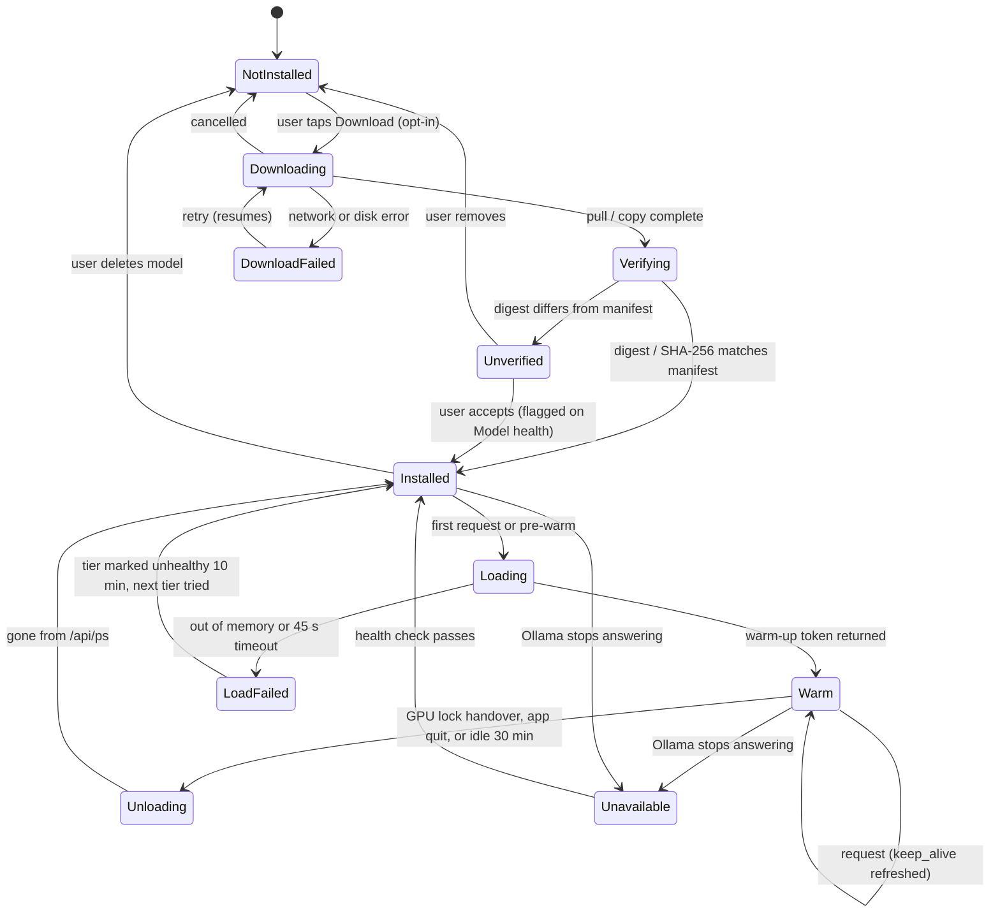

# Model Manager

> How ASCEND keeps local models installed, verified, loaded and out of each other's way on a
> 4 GB laptop GPU. Owner: **Jegatheesan** (`ai/model_manager.py`); manifest and model releases:
> **Navin**; onboarding UI: **Dhanush**. Related: [system-architecture.md](../architecture/system-architecture.md),
> [ADR-0004](../architecture/adr/0004-ollama-qwen3-local-llm.md),
> [mlops-lifecycle.md](mlops-lifecycle.md).

---

## 1. Status

| Piece | Status |
|---|---|
| Ollama availability check (`GET /api/tags`, 1.5 s timeout, model name match) | **implemented** (`coach/ollama.py`) |
| Coach model from `ASCEND_COACH_MODEL` (default `qwen3:4b`) | **implemented** |
| Manifest, tiers, GPU lock, load/unload, downloads, health page | planned · Phase 2 |
| `GET /models`, `POST /models/{name}/download`, `model.status` SSE | planned ([system.yaml](../contracts/system.yaml)) |

---

## 2. VRAM and RAM budget

Reference laptop: RTX 3050 Laptop GPU with **4 GB VRAM**, Ryzen 7 7435HS, **12 GB RAM**,
Windows 11 ([local-setup.md §1](../development/local-setup.md#1-hardware-and-os)). All numbers
below are **estimates** unless marked; the Phase 2 benchmark replaces them with
`nvidia-smi` and `ollama ps` readings.

### 2.1 GPU (4 GB)

| Consumer | Estimate | Basis |
|---|---|---|
| Windows desktop + Electron compositing, when the display uses the NVIDIA GPU | 0.3–0.6 GB | Typical; depends on the laptop's graphics mode |
| `qwen3:4b` weights (Q4_K_M) | ≈ 2.5 GB | Ollama tag page size |
| `qwen3:4b` KV cache at `num_ctx 4096` (FP16) | ≈ 0.6 GB | Computed from the published config: 36 layers × 8 KV heads × 128 dims × 2 (K,V) × 2 bytes ≈ 144 KB per token |
| Compute buffers | 0.2–0.4 GB | Typical for llama.cpp-based runners |
| **Total for the coach** | **≈ 3.3–3.9 GB** | Right at the limit |

Consequences:

1. **Only one GPU model at a time.** `qwen3-vl:2b` (≈ 1.9 GB weights plus vision encoder
   buffers) cannot sit beside the coach.
2. **The classifier runs on CPU** (ONNX Runtime), always.
3. **Partial offload is normal, not an error.** If the coach does not fit, Ollama puts some
   layers on the CPU; `ollama ps` shows a split such as "15%/85% CPU/GPU". The AI status card
   shows "partly on CPU (slower)".
4. Levers, in order, if the benchmark shows a split: `num_ctx 3072`; Ollama's flash
   attention with an 8-bit KV cache (`OLLAMA_FLASH_ATTENTION=1`, `OLLAMA_KV_CACHE_TYPE=q8_0`,
   roughly halves the KV cache); the Lite tier.

### 2.2 System RAM (12 GB)

| Consumer | Estimate |
|---|---|
| Windows 11 + background apps | 3.5–4.5 GB |
| Electron (main + renderer) | 0.3–0.5 GB |
| Sidecar (Python, FastAPI, ONNX Runtime + classifier) | 0.2–0.4 GB |
| Ollama runner host memory (more when layers are offloaded) | 0.5–2.0 GB |
| IndicTrans2, only with Tamil Path B, per loaded direction | 0.3–0.5 GB (**unverified**) |
| **Headroom** | ≥ 3 GB |

Developer note: Docker Desktop's WSL2 VM can take a large share of RAM by default. On the
12 GB laptop, cap it in `%UserProfile%\.wslconfig` (`memory=4GB`) while training is not
running, or the app and the IDE start swapping.

---

## 3. Models and disk sizes

| Role | Model | Runtime | Download size | In installer? | Min VRAM | Licence |
|---|---|---|---|---|---|---|
| Coach (Full) | `qwen3:4b` | Ollama | 2.5 GB (Ollama tag page) | No, first-run download | 4 GB | Apache-2.0 |
| Coach (Alternate) | `gemma3:4b` | Ollama | 3.3 GB (Ollama tag page) | No | 4 GB (partly CPU, estimate) | Gemma terms (review before offering) |
| Coach (Lite) | `qwen3:1.7b` | Ollama | 1.4 GB (Ollama tag page) | No | 2 GB or CPU (estimate) | Apache-2.0 |
| Meal second opinion | `qwen3-vl:2b` | Ollama | 1.9 GB (Ollama tag page) | No, optional | 4 GB | Per model card (check before release) |
| Food classifier | `ascend-food-cls` vN | ONNX Runtime CPU | ≈ 6 MB INT8 (estimate) | **Yes** | none | Ours; depends on dataset terms ([food-recognition.md §3](food-recognition.md#3-dataset)) |
| Tamil Path B | IndicTrans2 en→indic + indic→en, distilled | CTranslate2 / ONNX CPU | ≈ 0.25 GB each (estimate, **unverified**) | No, optional | none | MIT (per repository) |
| Runtime | Ollama | Installed by the user | Size **unverified** (includes GPU libraries) | No | — | MIT |

Ollama tag sizes are as recorded in ADR-0004 on 2026-10-20; Navin re-checks them before each
release. Installed models live in Ollama's own model folder; ASCEND's own files live in
`%APPDATA%\ASCEND\models\` (classifier, labels, manifest copy).

**Disk check:** a download starts only if free space ≥ size × 1.2 on the target drive.

---

## 4. Load/unload lifecycle

### 4.1 Per-model state machine



`model.status` events carry the state (`missing` / `downloading` / `ready` / `error` in the
contract's coarse enum; the fine states above are in `GET /models` as a planned extension of
`ModelOut.state`'s description, not a contract change).

### 4.2 The GPU lock

One `asyncio.Lock` in the sidecar plus the jobs table's single GPU worker
([system-architecture.md](../architecture/system-architecture.md)).

| Holder | Priority | Behaviour |
|---|---|---|
| Chat (streaming) | 1 (highest) | Holds the lock for the stream only; the model stays warm (`keep_alive: 30m`) |
| Meal scan VLM job | 2 | Waits for a running chat to finish; then unloads the coach (`keep_alive: 0`), polls `GET /api/ps` until it is gone (max 10 s), runs the VLM, unloads it, releases |
| Plan explanation job | 3 | Uses the coach model |
| Weekly review summary job | 4 | Uses the coach model; runs when the app is idle |

After a VLM job the coach is reloaded **lazily** on the next chat, or pre-warmed at once if
the Coach screen is open. On app quit the sidecar sends `keep_alive: 0` for any loaded model
so the GPU is free for other programs.

### 4.3 Tier selection and fallback

```text
onboarding speed test → tier stored in settings
request → tier healthy? ──no──► next tier (Full → Lite) ──none──► rules (fallback_reason)
            │yes
            ▼
         load / use ──OOM──► mark tier unhealthy 10 min, retry once on next tier
```

The alternate `gemma3:4b` is never chosen automatically; a user can pick it in Settings → AI
if the team offers it after the benchmark.

---

## 5. Health checks

| Check | Call | When | Failure → |
|---|---|---|---|
| Ollama up | `GET /api/version` (1.5 s) | Startup, when an AI screen opens, every 60 s while the Coach screen is open | 3 misses → try to start Ollama once; else banner "Local AI is not running" + rules mode |
| Model present | `GET /api/tags`: name and digest vs manifest | Startup, after a download | `missing` or `Unverified` on Model health |
| Loaded and where | `GET /api/ps`: `size` vs `size_vram` | After each load | Status card shows "on GPU" / "partly on CPU" |
| Warm-up | 1-token generation | After each load | `LoadFailed` |
| Speed | 64-token generation, tokens/s | Onboarding, after model change, "Re-test" button | Below 8 tokens/s (threshold estimate) → suggest Lite; below 3 → suggest AI off |
| Classifier integrity | SHA-256 of the ONNX file vs manifest | Each load | Scan disabled, "Repair" re-copies the bundled model |
| Classifier parity | Run the shared test vector, compare logits (tolerance 1e-3) | Each load | Scan disabled; logged as `preprocessing_mismatch` |

Results feed `GET /coach/status` (implemented: `ai_enabled`, `ollama_available`, `model`) and
the planned `GET /models` list (with `tokens_per_s`).

---

## 6. The model manifest

`models-manifest.json` ships inside the app and can be replaced by a model-only update
([mlops-lifecycle.md §8](mlops-lifecycle.md#8-step-6-ship-it-installer-vs-first-run-download)).

```json
{
  "manifest_version": 3,
  "min_app_version": "1.0.0",
  "models": [
    {
      "name": "qwen3:4b",
      "role": "coach",
      "tier": "full",
      "runtime": "ollama",
      "source": "ollama://qwen3:4b",
      "digest": "<sha256 digest reported by /api/tags at release time>",
      "size_bytes": 2500000000,
      "min_vram_gb": 4,
      "licence": "Apache-2.0",
      "eval_report": "operations/reports/<date>-model-benchmark.md"
    },
    {
      "name": "ascend-food-cls",
      "version": "0.3.0",
      "role": "food_classifier",
      "runtime": "onnx",
      "file": "models/ascend-food-cls-0.3.0-int8.onnx",
      "sha256": "<sha256 of the file>",
      "labels": "models/labels-0.3.0.json",
      "labels_sha256": "<sha256>",
      "input": {"size": 224, "mean": [0.485, 0.456, 0.406], "std": [0.229, 0.224, 0.225]},
      "temperature": 1.0,
      "thresholds": {"preselect": 0.80, "ask": 0.65},
      "licence": "see model card",
      "mlflow_run": "<run id>",
      "git_sha": "<commit>",
      "dvc_data": "<dvc hash>"
    }
  ]
}
```

Values in angle brackets are filled by the release workflow; the size shown for `qwen3:4b` is
the tag-page figure. Ollama manages its own layer downloads; ASCEND pins the **digest** it
expects and flags a different one as `Unverified` (the upstream tag may have moved) instead of
silently trusting it.

---

## 7. First-run and model download UX

Onboarding step "Hardware check" (part of X1 in [features.md](../planning/features.md)):

1. **Detect:** NVIDIA GPU and VRAM (`nvidia-smi --query-gpu=name,memory.total`), RAM, free
   disk, and whether Ollama answers on `127.0.0.1:11434`.
2. **Recommend one tier** with a plain card:

   | Card | Shows |
   |---|---|
   | Full (recommended for this PC) | "Coach replies in a few seconds; downloads 2.5 GB" |
   | Lite | "Slower, simpler replies; downloads 1.4 GB" |
   | Off | "Everything works with rules and search; nothing to download" |

3. **No Ollama?** "ASCEND's coach uses Ollama, a free local AI runtime. Everything else works
   without it." Buttons: *Open download page* (opens ollama.com in the system browser, the
   only external link in onboarding) and *Skip for now*.
4. **Download** in the background with a progress bar fed by Ollama's streamed pull status
   (`completed` / `total`), *Pause* and *Cancel*. The app is fully usable meanwhile.
   Warnings: metered connection (Windows reports it) and low disk.
5. **Verify and speed-test**, then show "Coach ready · 14 tokens/s · on GPU" (sample text).
6. The VLM and IndicTrans2 are **not** offered at onboarding; they appear as download cards
   where they are used (meal scan, Tamil settings).

Downloads are the only network traffic the AI side ever makes, and each one is a user tap
([security-privacy.md §4](../architecture/security-privacy.md#4-privacy-commitments)).

---

## 8. Model health page (Settings → AI → Model health)

| Section | Content |
|---|---|
| Runtime | Ollama version, reachable or not, last check |
| Models | Each model: state, size, digest status, on GPU / partly CPU, tokens/s, last used, Remove |
| Classifier | Version, SHA-256 status, mean confidence (last 30 days), correction rate per week |
| Actions | Re-test speed, Repair classifier, Export corrections (opt-in, [data-and-privacy-for-ai.md](data-and-privacy-for-ai.md#4-consent-for-training-photos)), Open logs |
