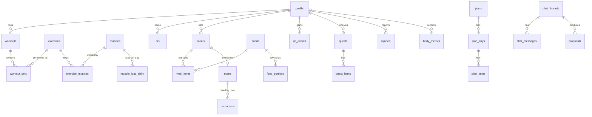

# Data Model

> The SQLite schema of ASCEND: tables by module, key columns, derived data and
> migration rules. Owner: Jegatheesan (backend); formulas reviewed by Navin.
> Class view: [uml/class-diagram.md](uml/class-diagram.md). Decision: [ADR-0003](adr/0003-sqlite-local-only.md).
>
> **As built (checked 2026-10-27, fresh database at migration `0035`).** This page is the
> original design; the tables that exist are: `profile`, `settings`, `body_metrics`,
> `measurements`, `checkins`, `exercises`, `exercise_muscles`, `exercise_muscles_v7`,
> `workouts`, `workout_sets`, `muscle_load_events`, `recovery_params`, `progression_decisions`,
> `plan_enrollments`, `custom_programs`, `custom_skills`, `skill_unlocks`, `foods`, `meals`,
> `meal_items`, `diet_plans`, `xp_events`, `quest_items`, `boss_raids`, `streak_reasons`,
> `unlock_events`, `trainer_messages`, `selector_picks`, `action_log`, `progress_photos`,
> `online_lookup_log`, `events_outbox`, `processed_events` (plus `alembic_version`). Tables
> named below that are not in this list (for example `chat_threads`, `proposals`, `jobs`,
> `models_installed`, `scans`, `corrections`) are not built. A fresh database seeds 1,024 exercises
> (814 from free-exercise-db, 210 of ASCEND's own) and 203 foods. Migrations live in
> `services/sidecar/alembic/versions/` (`0034` adds the gap-fill moves, `0035` the 15 South
> Indian dishes).

---

## 1. Database settings

| Setting | Value | Why |
|---|---|---|
| Journal | `PRAGMA journal_mode=WAL` | Readers don't block the writer; crash-safe |
| Sync | `PRAGMA synchronous=NORMAL` | Safe with WAL, much faster than FULL |
| Foreign keys | `PRAGMA foreign_keys=ON` | Integrity |
| Busy timeout | `PRAGMA busy_timeout=5000` | Two workers + API share one file |
| ORM | SQLAlchemy 2 (sync engine, one writer) | Simple, typed |
| Migrations | Alembic, `render_as_batch=True` | SQLite cannot `ALTER` most things; batch mode rebuilds tables |
| Units | SI only (kg, cm, seconds, kcal); conversion at the edges | One source of truth |
| Time | UTC ISO-8601 in storage; `day_key` computed with the user's reset hour (default 04:00 local) | Quests and rings agree on "today" |
| IDs | `INTEGER PRIMARY KEY` internally; `uuid` (TEXT) on rows that are exported | Stable ids across export/import |

## 2. Today vs target

The v0.1 code skeleton (`services/sidecar/alembic/versions/0001_initial_schema.py`,
2026-10-20) creates 12 tables. The rest of this document is the **v1.0 target**; each new
table arrives as its own Alembic revision in the phase listed.

| v0.1 table (exists) | v1.0 target | Change |
|---|---|---|
| `profile` | `profile` | add diet type, region, language, target weight, pace |
| `settings` | `settings` | — |
| `exercises`, `exercise_muscles` | same | add section, pattern, joint_stress, met, media |
| `workouts`, `workout_sets` | same | add uuid, set kind, duration/distance, `source` |
| `muscle_load_events` | `muscle_load_daily` (projection) | daily roll-up with `algo_version` (Phase 1) |
| `foods`, `meals`, `meal_items` | same + `food_portions`, `recipes` | INDB/IFCT import, portion units, oil level |
| `quest_items`, `xp_events` | same + `quests`, `streaks`, `ranks`, `trials` | Phase 1 / 4 |
| — | `prs`, `injuries`, `pain_logs`, `checkins`, `plans*`, `scans`, `corrections`, `body_metrics`, `measurements`, `photos`, `chat_*`, `proposals`, `events_outbox`, `processed_events`, `jobs`, `models_installed`, `notifications`, `app_meta` | Phases 1–4 |

## 3. Entity overview

## 4. Tables by module

### Profile and system

| Table | Key columns |
|---|---|
| `profile` | id (single row), name, sex, birth_date, height_cm, goal (`lean_bulk`/`cut`/`maintain`/`strength`/`endurance`), target_weight_kg, pace, experience, days_per_week, session_min, diet_type (`veg`/`egg`/`nonveg`/`jain`), region, language |
| `settings` | key, value (JSON) — units, reset_hour, ai_mode (`off`/`rules_only`/`on`), tier, notifications, quiet hours |
| `injuries` | id, area (muscle/joint), side, type (`dull`/`sharp`/`tingling`), severity, status (`active`/`returning`/`cleared`), blocked_patterns (JSON), started_at, cleared_at |
| `pain_logs` | id, injury_id, score 0–10, context, logged_at |
| `checkins` | id, day, sleep, energy, soreness (none/some/a_lot), mood, readiness, band, algo_version, quest_note (what the check-in did to the quest; migration 0007) |
| `app_meta` | key, value — schema version, install id (local only), last backup |

### Training

| Table | Key columns |
|---|---|
| `exercises` | id, uuid, name, section (`gym`/`calisthenics`/`cardio`/`martial_arts`/`flexibility`/`meditation`), equipment, pattern, joint_stress, met, source (`free-exercise-db`/`custom`), media_path |
| `muscles` | id, code (e.g. `chest_upper`), name, group, side_shown (`front`/`back`/`both`), half_life_h, weekly_low, weekly_high, capacity_es |
| `exercise_muscles` | exercise_id, muscle_id, weight (1.0 / 0.5 / 0.25) |
| `plans` / `plan_days` / `plan_items` | plan (source `planner`/`imported`/`manual`), day (weekday, focus), item (exercise_id, sets, rep_low, rep_high, target_rpe, rest_s) |
| `workouts` | id, uuid, section, started_at, ended_at, session_rpe, minutes, session_load (= RPE × minutes), notes, source (`app`/`strong`/`hevy`) |
| `workout_sets` | id, uuid, workout_id, exercise_id, set_order, kind (`warmup`/`working`/`drop`/`failure`), weight_kg, reps, rpe, duration_s, distance_m, avg_hr, completed, created_at |
| `prs` | id, exercise_id, set_id, type (`e1rm`/`rm_n`/`volume`/`reps`/`hold`/`time`/`distance`), value, formula, algo_version, achieved_at |

### Derived load

| Table | Key columns |
|---|---|
| `muscle_load_daily` | day_key, muscle_id, eff_sets, fatigue_end, algo_version — rebuilt by the projector on `SetLogged`/`SetUpdated` |

### Nutrition

| Table | Key columns |
|---|---|
| `foods` | id, source (`INDB`/`IFCT`/`OFF`/`custom`), source_id, name, name_ta, kcal_100g, protein_g, fat_g, carbs_g, fibre_g, licence |
| `food_portions` | food_id, unit (`katori`/`ladle`/`cup`/`piece`/`tbsp`/`g`), grams |
| `recipes` | id, name, yield_g; ingredients in `recipe_items` |
| `meals` | id, uuid, eaten_at, slot (`breakfast`/`lunch`/`snack`/`dinner`), source (`search`/`scan`/`saved`), kcal_total |
| `meal_items` | id, meal_id, food_id, unit, qty, oil_level (0/1/2), grams, kcal, protein_g, fat_g, carbs_g, kcal_low, kcal_high |
| `scans` | id, meal_id, photo_path, model_versions (JSON), items_json, status, duration_ms |
| `corrections` | id, scan_id, item_index, predicted_label, predicted_conf, top3 (JSON), chosen_food_id, chosen_unit, qty, oil_level, item_source (`whole_photo`/`tap`/`vlm`, as `ScanItem.source`), keep_for_training (consent), model_version, created_at — **the MLOps feedback source** ([ai/food-recognition.md §8](../ai/food-recognition.md#8-the-correction-loop)) |

### Progress

| Table | Key columns |
|---|---|
| `body_metrics` | id, measured_at, weight_kg, body_fat_pct (estimate), resting_hr |
| `measurements` | id, measured_at, site (`waist`/`chest`/`arm`/`thigh`), cm |
| `photos` | id, taken_at, pose (`front`/`side`/`back`), path, encrypted |

### Game

| Table | Key columns |
|---|---|
| `xp_events` | id, source_event_id, kind, amount, multiplier, algo_version, created_at |
| `quests` / `quest_items` | quest (day_key, type `daily`/`weekly`/`recovery`/`trial`), item (kind, target, progress, xp, done) |
| `streaks` | kind (`training`/`calm`), current, best, freezes_held, last_day_key |
| `ranks` | rank (`E`…`S`), reached_at |
| `trials` | id, rank_target, requirements (JSON), status |

### Coach

| Table | Key columns |
|---|---|
| `chat_threads` | id, title, language, created_at |
| `chat_messages` | id, thread_id, role, content, language, model, model_digest, source (`model`/`rules`/`safety`), fallback_reason, prompt_id, prompt_version, checks (JSON), tokens, used_data (JSON), created_at ([ai/coach-llm.md](../ai/coach-llm.md)) |
| `proposals` | id, thread_id, kind (`plan_change`/`deload`/`kcal_target`), diff (JSON), status (`pending`/`applied`/`edited`/`kept`), created_at |

### Infrastructure tables

| Table | Key columns |
|---|---|
| `events_outbox` | id, type, payload (JSON), created_at, dispatched_at |
| `processed_events` | handler, event_id (PK pair) |
| `jobs` | id, type, payload, priority, status, attempts, run_after, progress, result, error, worker (`gpu`/`cpu`) |
| `models_installed` | name, version, sha256, size, path, tier, tokens_per_s, installed_at |
| `notifications` | id, type, scheduled_for, sent_at, snoozed_until |

## 5. Migration rules

1. Every schema change is an Alembic revision in `services/sidecar/alembic/versions/`, named
   `NNNN_<what>.py`; one revision per PR.
2. Before running migrations the app takes an automatic backup; on failure it restores
   and shows the error.
3. CI keeps a **fixture database for every released schema** and tests upgrade from each
   to head, plus one-step downgrade.
4. Formula changes that alter derived data bump `ALGO_VERSION` and include a data
   migration that replays history.
5. The app refuses to open a database whose schema is newer than it knows and offers a
   restore.

## 6. Seed data and licences

| Data | Source | Licence | Notes |
|---|---|---|---|
| Exercises (~800) | yuhonas/free-exercise-db | Public domain (per repo) | Muscle names mapped onto 54 muscles and heads by muscle-map-v1 (v8; 19 regions up to v7) |
| Indian recipes (1,014) | INDB (Vijayakumar et al., 2024) | Check terms before redistribution — **unverified** | Per 100 g and per serving |
| Raw foods (528 key foods) | IFCT 2017, National Institute of Nutrition | Check terms — **unverified** | Raw ingredients |
| Packaged foods | Open Food Facts India subset | ODbL (attribution) | Barcode later |
| Muscle map artwork | ASCEND original (v8; react-muscle-highlighter 1.2.0 up to v7) | MIT | About page, README credits |
