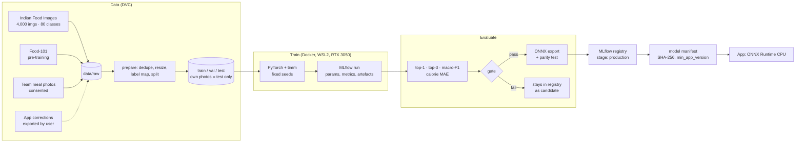

# ML Pipeline

> How the Indian-food classifier is built, evaluated, packaged and improved — and how
> the LLM/VLM models are chosen. Owner: **Navin** (MLOps pipeline + classifier);
> integration in the sidecar: Jegatheesan. Decision: [ADR-0006](adr/0006-own-food-classifier-indb-ifct.md).

---

## 1. Overview

## 2. Tools

| Tool | Use | Where |
|---|---|---|
| **DVC** | Version datasets and pipeline stages (`dvc.yaml`: prepare → train → evaluate → export) | `ml/`; remote on a local/external drive (no cloud) |
| **MLflow** | Experiment tracking + model registry | Docker Compose (`infra/compose/mlflow.yml`), `127.0.0.1:5000` |
| **PyTorch + timm** | Training (EfficientNet-B0 / MobileNetV3 class backbones; final choice by benchmark) | `infra/docker/ml-train` image, CUDA on WSL2 |
| **ONNX + ONNX Runtime** | Export and CPU inference in the app | `ml/src/export.py`; sidecar `ai/onnx_runtime.py` |
| **GitHub Actions** | `ml-eval.yml`: data checks + eval gate on tagged models (CPU, small test set) | `.github/workflows/` |

PyTorch never ships in the app; the sidecar depends only on ONNX Runtime.

## 3. Datasets

| Dataset | Size (per listing) | Use | Licence |
|---|---|---|---|
| Indian Food Images Dataset (Kaggle, iamsouravbanerjee) | 4,000 images, 80 classes | Main training data | Check listing — **unverified** |
| Food-101 (ETH Zürich) | 101,000 images, 101 classes | Pre-training / transfer | Research use — check before redistribution |
| Team meal photos | Target 300 by Phase 1 end (estimate) | **Test set only** — never trained on | Consent from each photographer, EXIF stripped |
| App corrections | Grows with use | Phase 5 retraining | Exported by the user explicitly; nothing leaves a PC automatically |

**Label map:** `labels.json` maps each class to an INDB/IFCT food id, display names
(English, Tamil) and a default portion unit. CI checks every label resolves to a food row.

## 4. Preprocessing contract (shared with the sidecar)

| Step | Value |
|---|---|
| Input | RGB crop from the VLM box, padded 10% |
| Resize | Shorter side 256, centre crop 224 × 224 |
| Normalise | ImageNet mean/std |
| Output | Softmax over N classes; app takes top-3 |
| Test vector | `ml/tests/vector.npy` + expected logits; both ML and sidecar tests assert it |

## 5. Evaluation and gate

| Metric | Why | Gate (estimates, tune after v0) |
|---|---|---|
| Top-1 accuracy | Is the dish named right? | ≥ production + 2 points |
| Top-3 accuracy | Is the right dish in the chips? | ≥ 0.85 on own-photo test set (target, estimate) |
| Macro-F1 | Rare dishes count as much as common ones | Not lower than production |
| Calorie MAE per meal (kcal) | What the user actually cares about | Lower or equal |
| ONNX parity | Export didn't break the model | Same top-1 on 200 test images |
| CPU latency per crop | Fits the scan budget | ≤ 150 ms on reference laptop (estimate) |

Metrics definitions and reporting: [evaluation.md](../operations/evaluation.md).

## 6. LLM / VLM selection (no training)

The coach and the item finder are **off-the-shelf models served by Ollama**; we do not
fine-tune them. Selection is a benchmark, not a training run:

1. Candidate list (qwen3:4b, gemma3:4b, qwen3:1.7b, llama3.2:3b for English-only Lite).
2. On the reference laptop record tokens/s, first-token latency, VRAM peak (`nvidia-smi`).
3. 30 English + 30 Tamil coach questions scored by two team members (1–5) blind.
4. 30 own meal photos for qwen3-vl:2b item finding (did it list every item? box usable?).
5. Results in `docs/operations/` as a dated benchmark table; decision updates ADR-0004.

Tamil quality and VLM box quality are **unverified until step 3–4 runs**.

## 7. MLOps loop (Phase 5)

1. App logs prediction + confidence per scan (local).
2. User exports corrections (Settings → Model health → Export) as a zip.
3. `dvc add` → dataset v2; training refuses rows tagged `test-own`.
4. Weekly drift report: mean confidence, correction rate, class histogram vs training.
   **Signal:** correction rate rising 3 weeks in a row → retrain.
5. Retrain → MLflow compare → gate → promote.
6. **Shadow mode:** the new model runs beside production on new scans; its predictions
   are logged, not shown; promote after it beats production on agreement with user picks.
7. Model-only update: new manifest entry published with a release; app downloads,
   verifies SHA-256, switches on next start.

## 8. Reproducibility rules

- Fixed seeds; `params.yaml` holds every hyper-parameter; `dvc.lock` committed.
- Every registered model links to its git SHA, DVC data hash and MLflow run id.
- Training image pinned by digest; CUDA/PyTorch versions recorded in the run.
