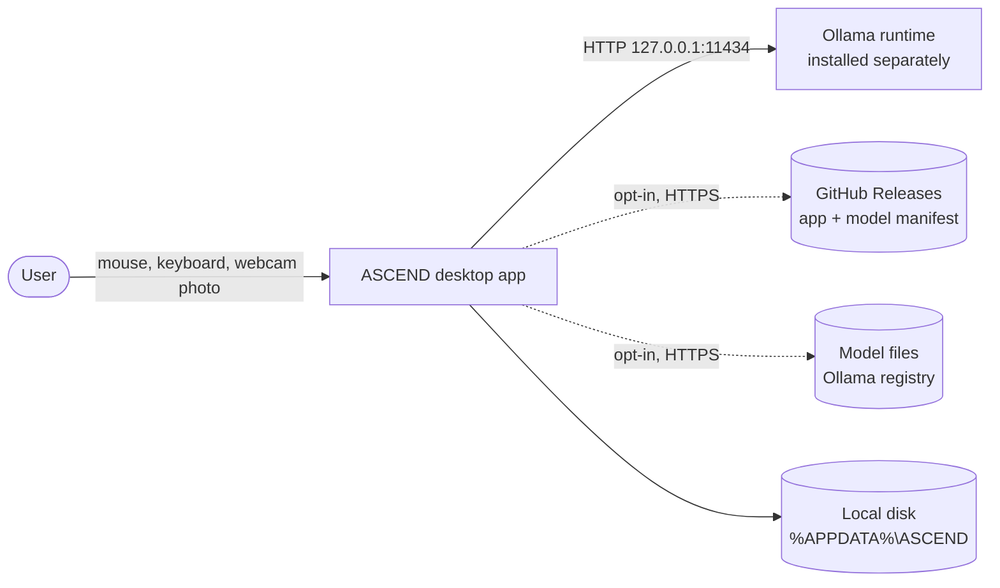
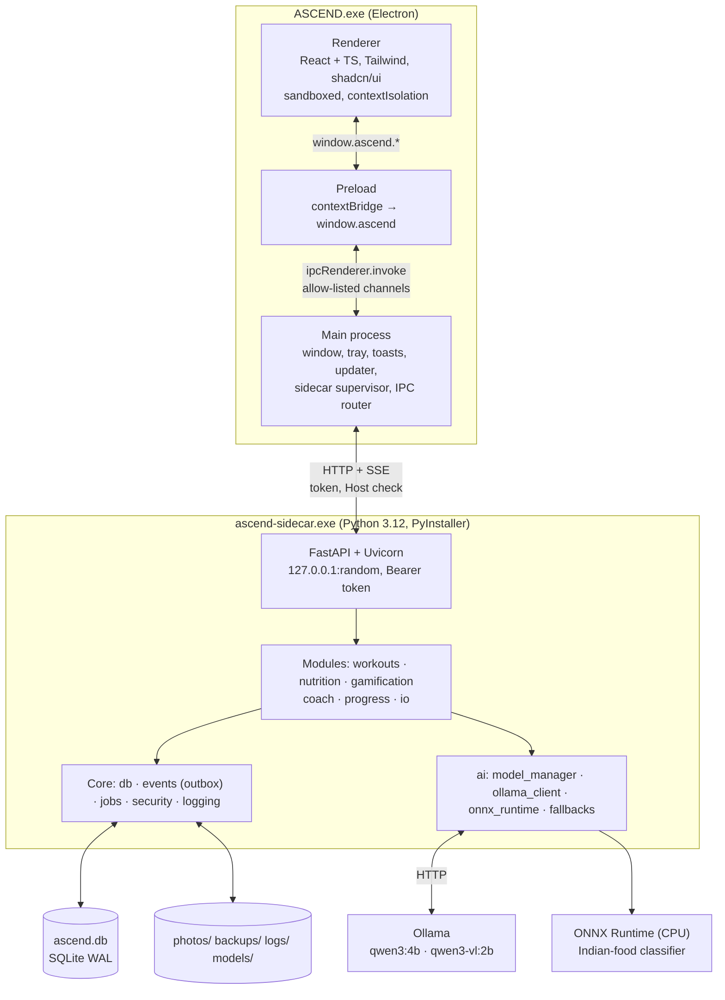
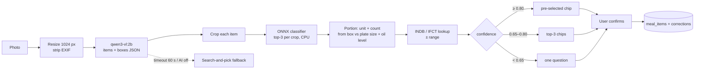

# System Architecture

This document describes the architecture of ASCEND: its processes, modules and data
flows, and the responsibilities of each part. It is the source of truth that
implementation must follow; deviations are recorded as ADRs ([adr/](adr/adr-template.md)).

---

## 1. Design Principles

| Principle | Meaning |
|---|---|
| **Offline by default** | Everything runs on the user's PC. The only network calls are opt-in model downloads and the update check ([ADR-0009](adr/0009-offline-first-no-cloud.md)). |
| **Rules decide, AI explains** | Deterministic, versioned engines produce every number and plan change; language models only explain and converse ([ADR-0005](adr/0005-deterministic-engines-llm-explains.md)). |
| **AI is optional** | Every feature has a rules/template or search-and-pick fallback. AI off is a supported mode, not an error. |
| **Least privilege UI** | The renderer is sandboxed and only sees a small typed API; main validates every call. |
| **One process per job** | Electron for UI and OS integration, one Python sidecar for domain logic, Ollama for LLM/VLM inference. No more. |
| **Crash-safe data** | SQLite WAL, transactional outbox, backups before migrations. |
| **Explainable by its builders** | Small modules, ADRs for every big choice, golden tests for every formula. |

## 2. Context



No ASCEND server exists. Dotted lines are optional and can be switched off in Settings.

## 3. Processes



| Process | Language | Responsibility | Owner |
|---|---|---|---|
| **Renderer** | TypeScript, React, `apps/desktop/src/` | All screens, charts, muscle map, chat UI. No Node, no network, no filesystem | Dhanush |
| **Preload** | TypeScript | Exposes `window.ascend` (typed, minimal) via `contextBridge` | Dhanush |
| **Main** | TypeScript (Node), `apps/desktop/electron/` | Window + Windows integration (title bar overlay, tray, toasts, `AppUserModelID`), sidecar supervisor, IPC router, auto-updater, safeStorage | Dhanush (Gokul: updater) |
| **Sidecar** | Python 3.12, `services/sidecar/` | REST + SSE API, domain engines, SQLite, event bus, job queue, model manager | Jegatheesan |
| **Ollama** | (external) | LLM and VLM inference on the GPU; installed by the user | — |

## 4. Renderer ↔ Main: the typed IPC contract

- `BrowserWindow` with `contextIsolation: true`, `nodeIntegration: false`, `sandbox: true`,
  strict CSP (`default-src 'self'`), navigation and `window.open` blocked.
- Preload exposes one object, `window.ascend` (`AscendBridge` in `packages/shared`):
  `request`, `sidecarStatus`, `saveExport`, `appInfo` in v0.1, plus the v1.0 additions
  (event subscription, notifications, updates, file pickers). No raw `ipcRenderer` reaches the page.
- Main only handles the channels in the `IPC` constant, validates the payload (zod from
  Phase 1), adds the launch token and forwards to the sidecar.
- Full channel list and payloads: [contracts/ipc-contract.md](../contracts/ipc-contract.md).
  Registered ports and channels: [port-register.md](port-register.md).

**Type flow:** Pydantic models (sidecar) → FastAPI OpenAPI → `openapi-typescript` →
`packages/shared/src/api-types.gen.ts` → zod schemas in main. CI fails if the generated
file is stale or the OpenAPI differs from `docs/contracts/` ("contract drift").

## 5. Sidecar lifecycle

| Step | v1.0 target behaviour |
|---|---|
| **Spawn** | Main binds `127.0.0.1:0` to find a free port, creates a 32-byte random token, starts `ascend-sidecar.exe` (dev: `uv run python -m app` in `services/sidecar`) with `ASCEND_PORT` and `ASCEND_DATA_DIR` in env and the token as the first line on **stdin** (never argv, so it is not visible in Task Manager) |
| **Ready** | Sidecar runs migrations, prints `ASCEND_SIDECAR_READY port=<n>`; main polls `GET /health` until healthy; the splash shows "Starting engine…" |
| **Live** | Health every 5 s; 3 misses or an unexpected exit → restart with exponential backoff; too many restarts → `failed` with an error screen, logs link and "Restart engine" |
| **Auth** | Every request needs `Authorization: Bearer <token>` (constant-time compare); `Host` must be `127.0.0.1`/`localhost` (blocks DNS rebinding); CORS only with `--dev` for the Vite origin |
| **Stop** | `POST /shutdown` → finish or park jobs, checkpoint WAL, exit; hard kill after a grace period |
| **Ollama** | Detected at onboarding. Health = `GET /api/tags` + a 1-token warm-up. `keep_alive` keeps the chat model loaded while the app is open |

**Where the code is today vs the target** (v0.1 skeleton, 2026-10-20):

| Behaviour | v0.1 skeleton (`apps/desktop/electron/sidecar.ts`) | v1.0 target | Owner / phase |
|---|---|---|---|
| Ready timeout | 30 s | 20 s + second attempt at 40 s on first run | Dhanush, Phase 0 |
| Periodic health check | none (restart on process exit only) | every 5 s, 3 misses → restart | Dhanush, Phase 0 |
| Restart policy | max 3 restarts, backoff 1 s, 2 s, 4 s | 1, 2, 4, 8, 16 s; 5 restarts in 10 min → `failed` | Dhanush, Phase 0 |
| Shutdown grace | 3 s, then kill | 5 s, then `taskkill /T /F` | Dhanush, Phase 0 |
| States | `starting`, `ready`, `restarting`, `failed`, `stopped` | same five, pushed on `sidecar:state-changed` | Dhanush, Phase 0 |

State machine: [uml/state-machine-diagram.md](uml/state-machine-diagram.md).

## 6. Modular monolith

Layout of `services/sidecar/app/`. Files marked `(v0.1)` exist in the code skeleton;
the rest are the planned v1.0 additions.

```text
services/sidecar/app/
├── __main__.py              entry point: --dev, token on stdin, ready line   (v0.1)
├── main.py                  app factory, router registration, event wiring   (v0.1)
├── models.py                shared SQLAlchemy base                           (v0.1)
├── core/
│   ├── config.py            settings from env (port, data dir, Ollama host)  (v0.1)
│   ├── db.py                engine, WAL pragmas, session                     (v0.1)
│   ├── deps.py              FastAPI dependencies                             (v0.1)
│   ├── events.py            typed events + in-process bus                    (v0.1)
│   ├── migrate.py           Alembic runner at start-up                       (v0.1)
│   ├── security.py          token + Host check middleware                    (v0.1)
│   ├── outbox.py            transactional outbox + dispatcher                (Phase 1)
│   ├── jobs.py              jobs table, GPU + CPU workers, SSE progress      (Phase 2)
│   └── logging.py           structlog JSON, correlation ids                  (Phase 1)
├── modules/
│   ├── workouts/            api · schemas · models · service · pr · seed     (v0.1)  + progression (Phase 1)
│   ├── nutrition/           api · schemas · models · service · tdee · seed   (v0.1)  + portions, scan_pipeline (Phase 1–2)
│   ├── gamification/        api · schemas · models · service · formulas · quests · streaks (v0.1) + ranks (Phase 1)
│   ├── coach/               api · service · rules · ollama                   (v0.1)  + planner, injury, weekly_review, safety (Phase 2)
│   ├── progress/            api · schemas · models · service · muscle_load · taxonomy · energy · history (v0.1) + eta, readiness (Phase 1/4)
│   └── io/                  strong_csv · hevy_csv · export · backup          (Phase 3; export currently in progress/)
└── ai/                                                                       (Phase 2)
    ├── model_manager.py     manifest, download, verify, tiers, GPU lock
    ├── ollama_client.py     chat/generate with timeouts + streaming (moves from coach/ollama.py)
    ├── onnx_runtime.py      classifier session (CPU) + preprocessing
    └── fallbacks.py         templates, rules-only answers
```

- Each module has `api` (FastAPI router), `schemas` (Pydantic), `service` (logic),
  `repo` (SQLAlchemy queries) and `models` (tables).
- **Modules talk only through another module's `service` interface or through events.**
  `import-linter` enforces the layering in CI.
- One process is simpler to package, debug and explain than microservices
  ([ADR-0007](adr/0007-modular-monolith-event-bus.md)).

## 7. Deterministic engines with versioned formulas

| Engine | Module | Inputs → output | Spec |
|---|---|---|---|
| Effective sets + status | progress.muscle_load | sets × exercise→muscle weights × effort(RPE) → ES per muscle per window, status | v2 plan §07 |
| Recovery / readiness per muscle | progress.muscle_load | fatigue decay `2^(−Δt/half_life)` → readiness %, "ready at" | v2 §07 |
| Progression + deloads | workouts.progression | last exposures → next load/reps; deload triggers | v2 §08 |
| PR detection | workouts.pr | completed sets → e1RM (Epley/Brzycki), rep PRs | v2 §08 |
| XP, levels, streaks | gamification | events → XP rows, level curve `round(100 × L^1.3)` | v2 §12 |
| Quest generation | gamification.quests | plan + readiness + completion rate → daily quest | v2 §12 |
| Energy targets | nutrition | Mifflin-St Jeor + logged burn; adaptive TDEE (v1.1) | v2 §10 |
| ETA to goal | progress.eta | 7-day-average slope ± SE → date range + confidence | v2 §11 |

Every engine is a **pure function** with an `ALGO_VERSION` constant. Each derived row
stores the version it was computed with; a formula change ships as a migration that
replays history; golden-file tests pin each version. None of them depends on a model,
which is why the app works fully with AI off.

## 8. Event bus (transactional outbox)

**v0.1 (today):** `core/events.py` is a small synchronous bus. `workouts` publishes
`SetLogged` / `WorkoutLogged`, `nutrition` publishes `MealLogged`, `gamification`
publishes `QuestCompleted`; `progress` and `gamification` subscribe. Handlers run inline
**inside the same database transaction** as the request, so XP and muscle load cannot
drift from the sets that caused them.

**Phase 1 target:** once slow work (scans, reviews) exists, events must survive a crash
between commit and side effect:

- Typed events: `SetLogged`, `SetUpdated`, `WorkoutLogged`, `MealLogged`,
  `BodyMetricLogged`, `PRAchieved`, `QuestCompleted`, `LevelUp`, `InjuryReported`,
  `CorrectionSaved`.
- The event row is written to `events_outbox` **in the same transaction** as the data. A
  dispatcher runs after commit and replays undelivered events at start-up.
- Fast handlers (muscle load, PR check, XP, quest progress) stay inline; slow ones
  enqueue jobs. Handlers are idempotent (`processed_events`).
- Example chain: `SetLogged` → muscle load updated → PR check → XP → quest progress →
  SSE `dashboard.changed`.

Sequence: [uml/sequence-diagram.md](uml/sequence-diagram.md).

## 9. Background job queue

- SQLite `jobs` table: type, payload, priority, status, attempts, run_after, progress,
  result, error.
- **Two workers:** one **GPU worker** (4 GB VRAM cannot run two models at once) and one
  **CPU worker** (classifier, exports, backups).
- Priority: chat (streams directly, holds the GPU lock) > meal scan > plan generation >
  weekly review.
- Timeouts (scan 60 s, review 120 s), 2 retries with backoff, cancel from the UI,
  progress over SSE. Jobs running at shutdown resume or fail cleanly on next start.

## 10. Model manager

| Model | Purpose | Runtime | Size (per Ollama tag page) |
|---|---|---|---|
| `qwen3:4b` | ARC coach: explanations, chat (English; Tamil **beta, unverified quality**) | Ollama, GPU | 2.5 GB |
| `qwen3-vl:2b` | Meal photo: item list + rough boxes (JSON) | Ollama, GPU | 1.9 GB |
| `qwen3:1.7b` | Lite tier / out-of-memory fallback | Ollama, GPU or CPU | 1.4 GB |
| `ascend-food-cls` | Indian-food classifier, 80+ classes, re-ranks crops | ONNX Runtime, **CPU** | not trained yet; measured after Phase 2 |

- **One GPU model at a time.** Before a scan the GPU worker unloads the chat model
  (`keep_alive: 0`), runs the VLM, then reloads chat. The classifier never uses the GPU.
- Models are listed in a **manifest** (name, version, URL, SHA-256, size, licence,
  min VRAM, `min_app_version`). Downloads resume, are verified, then renamed atomically.
- The onboarding speed test picks a tier and stores tokens/s.

| Situation | What happens |
|---|---|
| AI switched off | Rules engine + templates everywhere; scan becomes search-and-pick |
| Model not downloaded | Feature shows a download card (size, licence); others unaffected |
| First token slower than 20 s | Cancel, answer from rules, note "AI was slow" |
| Out of GPU memory | Retry on CPU or the lite tier |
| Ollama not running | Try to start it; else rules mode + status banner |

Pipeline and training side: [ml-pipeline.md](ml-pipeline.md). Decision: [ADR-0004](adr/0004-ollama-qwen3-local-llm.md), [ADR-0006](adr/0006-own-food-classifier-indb-ifct.md).

## 11. Meal scan data flow



Nutrients always come from the database, never from a model.

## 12. Storage

| What | Where (`%APPDATA%\ASCEND\`) | Notes |
|---|---|---|
| Database | `ascend.db` (+ `-wal`, `-shm`) | SQLite WAL, Alembic migrations ([data-model.md](data-model.md)) |
| Photos | `photos/{meals,progress}/` | EXIF stripped; AES-256-GCM when encryption is on (v1.1) |
| Backups | `backups/` | Online-backup API daily; keep 7 daily + 4 weekly |
| Models | `models/` (classifier); Ollama keeps its own store | Verified by SHA-256 |
| Logs, crashes | `logs/`, `crashes/` | Local only ([telemetry-model.md](telemetry-model.md)) |

## 13. Packaging and updates

- Sidecar: **PyInstaller one-folder** build (faster start, fewer antivirus false alarms
  than one-file). The sidecar ships ONNX Runtime only — PyTorch stays in `ml/`.
- App: **electron-builder NSIS** per-user installer, sidecar in `extraResources`;
  **electron-updater** against GitHub Releases with blockmap differential updates,
  `stable` and `beta` channels.
- Details: [ADR-0008](adr/0008-electron-builder-pyinstaller-packaging.md),
  [release-process.md](../operations/release-process.md). Deployment view:
  [uml/deployment-diagram.md](uml/deployment-diagram.md).

## 14. Repository layout

npm workspaces for TypeScript, `uv` for Python. Folders marked `(v0.1)` exist in the
code skeleton today.

```text
ascend/
├── apps/desktop/            Electron app                                     (v0.1)
│   ├── electron/            main.ts · preload.ts · sidecar.ts · channels.ts
│   ├── src/                 React renderer (screens, components, muscle map)
│   └── tests/               Vitest + Playwright (Phase 1+)
├── packages/shared/         TS types shared by main, preload, renderer       (v0.1)
│   └── src/                 ipc.ts · api.ts (· api-types.gen.ts from OpenAPI, Phase 1)
├── services/sidecar/        Python 3.12 FastAPI sidecar                      (v0.1)
│   ├── app/                 see §6
│   ├── alembic/             migrations (0001 initial schema, 0002 seed data)
│   ├── packaging/           ascend-sidecar.spec + entry.py (PyInstaller)
│   └── tests/               unit/ + api/
├── ml/                      dvc.yaml, params.yaml, src/ (prepare, train, export, evaluate)   (Phase 1)
├── infra/                   docker/ (devcontainer, ml-train), compose/ (mlflow, observability) (Phase 1)
├── build/                   electron-builder config, icons, fuses (PyInstaller spec lives in services/sidecar/packaging/) (Phase 0)
├── scripts/                 check_contract_drift.py, release helpers                          (Phase 1)
├── docs/                    this folder
└── .github/workflows/       ci.yml, release.yml, ml-eval.yml, docs.yml                         (Phase 0+)
```

## 15. Quality attributes

| Attribute | Target (estimate until measured) | How |
|---|---|---|
| Cold start | < 4 s to dashboard | One-folder sidecar, lazy model load |
| Interaction latency | Set → map update < 150 ms | Inline fast handlers, SSE push |
| Resilience | Sidecar crash recovers without data loss | Supervisor + outbox + WAL |
| Privacy | No egress except opt-in | Egress test in CI ([security-privacy.md](security-privacy.md)) |
| Maintainability | Rules modules ≥ 80% coverage | CI gate ([evaluation.md](../operations/evaluation.md)) |
