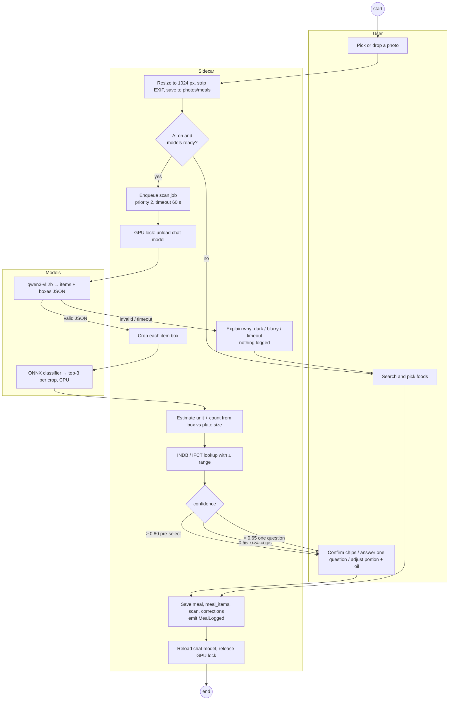

# Activity Diagram — Scan a Meal Photo

> **Diagram 9 (UML 2.5 — Behavioural).** The meal-scan activity from photo to logged
> meal, with every fallback. Swimlanes are shown as subgraphs (User, Sidecar, Models).

| Guard | Value | Source |
|---|---|---|
| Pre-select threshold | ≥ 0.80 | v2 plan §10 (estimate, tune after v0) |
| Ask-one-question threshold | < 0.65 | v2 plan §10 (estimate) |
| Scan timeout | 60 s | Job queue config |
