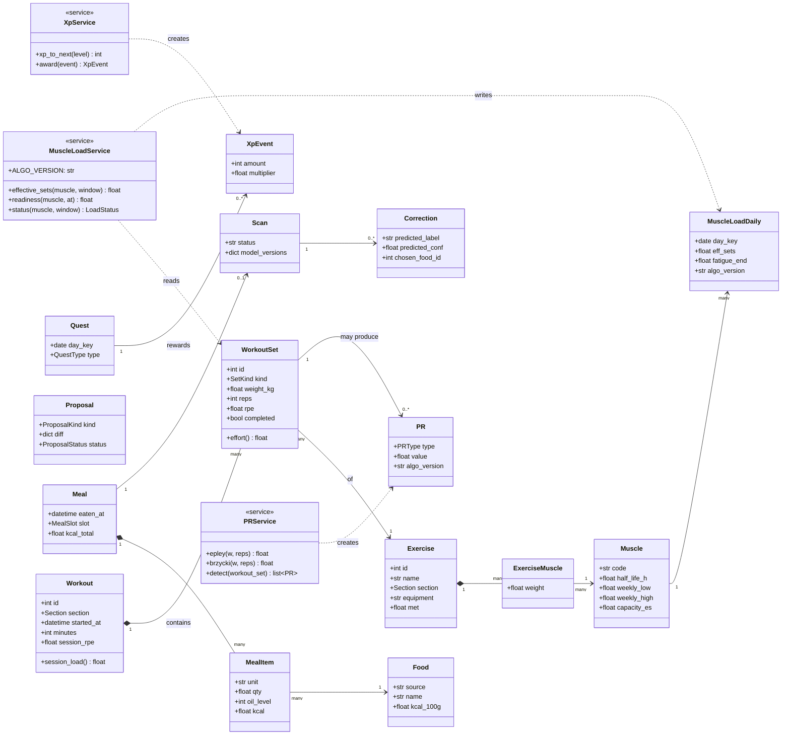

# Class Diagram — Core Domain

> **Diagram 2 (UML 2.5 — Structural).** The main domain classes in the sidecar and their
> relationships. Class names follow the code (`Workout`, `WorkoutSet`, `MealItem`…); attributes are the
> important ones only; full columns are in [data-model.md](../data-model.md). Services are shown where they own a formula.

## Formulas owned by the services

| Service | Formula (v2 plan) |
|---|---|
| `WorkoutSet.effort()` | 1.0 if RPE ≥ 7 · 0.5 if 5–6.5 · 0.25 below · warm-ups 0 · no RPE → 1.0 |
| `MuscleLoadService.effective_sets` | Σ weight(exercise, muscle) × effort |
| `MuscleLoadService.readiness` | 1 − min(1, F/C), F = Σ w × effort × 2^(−Δt/half_life) |
| `PRService.epley` / `brzycki` | w × (1 + reps/30) · w × 36 / (37 − reps) |
| `XpService.xp_to_next` | round(100 × L^1.3) |
