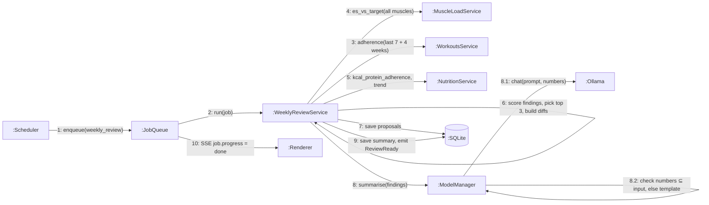

# Communication Diagram — Weekly Review

> **Diagram 12 (UML 2.5 — Behavioural).** The same objects that cooperate on the Sunday
> weekly review, with numbered messages instead of a timeline. Mermaid has no
> communication notation; numbered edge labels carry the sequence.

| Step | Rule (v2 plan §09) |
|---|---|
| 6 | Examples: adherence < 70% two weeks → shorten sessions; muscle under target 2 weeks → +2–4 sets; lean-bulk gain > 0.5% BW/week → −150 kcal |
| 8.2 | Any number in the model's text that is not in its input → template summary instead |
