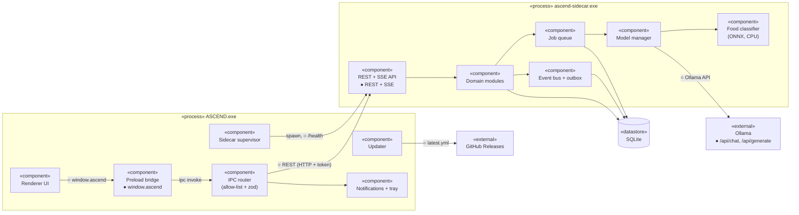

# Component Diagram — Runtime Components and Interfaces

> **Diagram 5 (UML 2.5 — Structural).** Components with their provided (`●`) and
> required (`○`) interfaces. Matches [system-architecture.md §3](../system-architecture.md#3-processes).

| Interface | Provided by | Contract |
|---|---|---|
| `window.ascend` | Preload | [ipc-contract.md](../../contracts/ipc-contract.md) |
| REST paths + SSE | Sidecar API | [contracts/](../../contracts/README.md) |
| `/health`, `/shutdown` | Sidecar API | [system.yaml](../../contracts/system.yaml) |
| Ollama API | Ollama | Ollama docs (external) |
