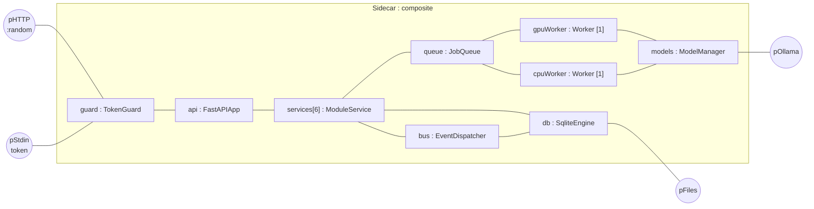

# Composite Structure Diagram — Inside the Sidecar

> **Diagram 6 (UML 2.5 — Structural).** The internal parts of the `Sidecar` composite,
> its ports, and the connectors between parts. Mermaid has no composite-structure
> notation; ports are drawn as small round nodes on the boundary.

| Part | Multiplicity | Note |
|---|---|---|
| `services` | 6 | workouts, nutrition, gamification, coach, progress, io |
| `gpuWorker` | exactly 1 | 4 GB VRAM holds one model at a time |
| `cpuWorker` | exactly 1 | classifier, exports, backups |
| `guard` | 1 | checks Bearer token and `Host` on every request |
