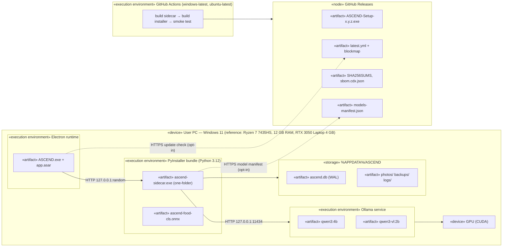

# Deployment Diagram — User PC and Release Pipeline

> **Diagram 7 (UML 2.5 — Structural).** Where artefacts run. The left side is the only
> runtime environment; the right side is how artefacts are built and delivered.

