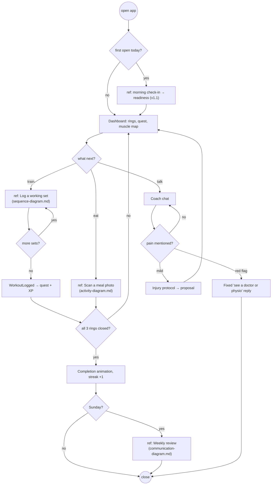

# Interaction Overview Diagram — A Training Day

> **Diagram 14 (UML 2.5 — Behavioural).** The day-level flow that ties the other
> interactions together. Each `ref` box points to the diagram that details it.

