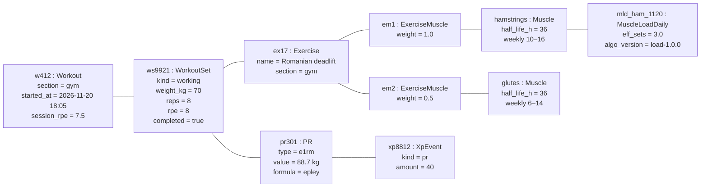

# Object Diagram — One Logged Set, One Moment

> **Diagram 3 (UML 2.5 — Structural).** A snapshot of real instances right after the
> user logs a working set of Romanian deadlifts (sample data, consistent with the v2
> mockups). Mermaid has no object notation, so instances are boxes named
> `instance : Class` with their slot values.

## Checks on the values

| Value | Derivation |
|---|---|
| e1RM 88.7 kg | Epley: 70 × (1 + 8/30) = 88.67 |
| Effort 1.0 | RPE 8 ≥ 7 |
| Hamstrings +1.0 ES, glutes +0.5 ES for this set | primary 1.0, secondary 0.5 |
| eff_sets = 3.0 | three such working sets today |
| XP 40 | "New PR" row of the XP table |
