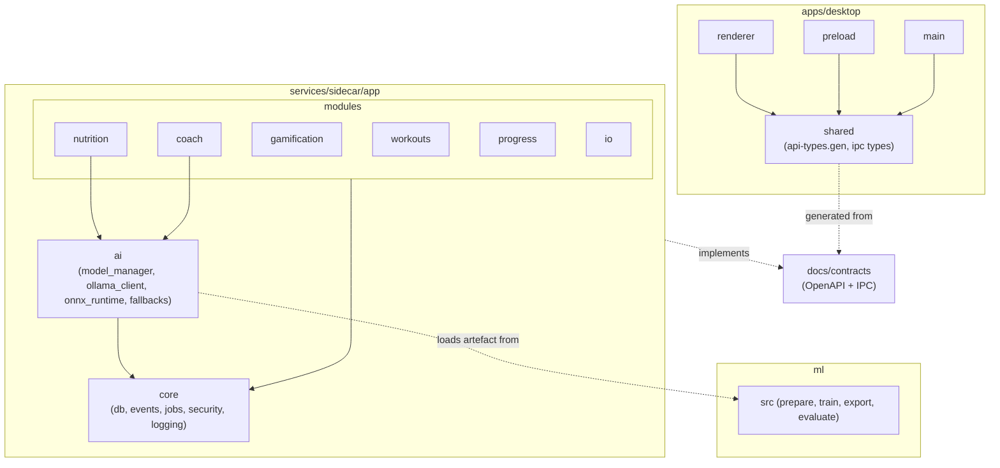

# Package Diagram — Repository and Sidecar Modules

> **Diagram 4 (UML 2.5 — Structural).** How the code is packaged and which packages may
> depend on which. Arrows are `<<import>>` dependencies. Rules are enforced by
> `import-linter` (Python) and ESLint `no-restricted-imports` (TypeScript).

## Dependency rules

| Rule | Enforced by |
|---|---|
| `renderer` imports nothing from `main` or Node built-ins | ESLint + Vite renderer config |
| `modules.*` never import another module's `repo` or `models` — only its `service` or events | import-linter `independence` + `layers` contracts |
| `core` imports no module | import-linter `layers` |
| `ai` imports `core` only | import-linter |
| `ml` is never imported by the sidecar; only its exported ONNX file + `labels.json` cross over | Packaging (`ml/` excluded from PyInstaller) |
