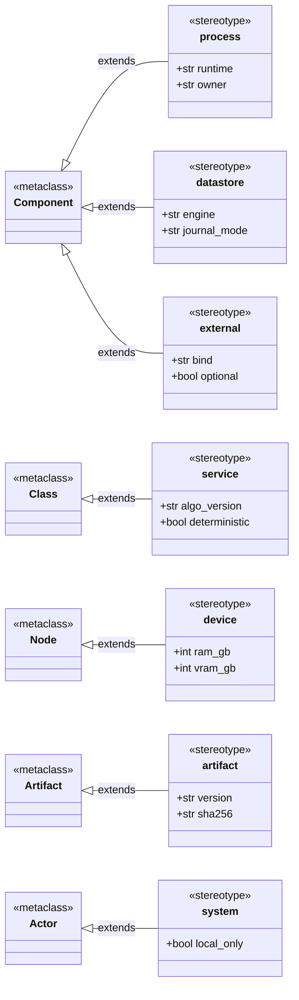

# Profile Diagram — ASCEND UML Stereotypes

> **Diagram 8 (UML 2.5 — Structural).** The stereotypes used in this UML set, the UML
> metaclass each extends, and their tagged values. Only these stereotypes appear in
> diagrams 1–14.

## Constraints

| Stereotype | Constraint |
|---|---|
| `<<service>>` | `deterministic = true` for every engine (ADR-0005); `algo_version` follows semver |
| `<<external>>` | `bind` must be `127.0.0.1` unless `optional = true` and HTTPS |
| `<<artifact>>` | Released artefacts carry a SHA-256 in `SHA256SUMS` or the model manifest |
| `<<system>>` actor | Local software only; no remote service acts on user data |
