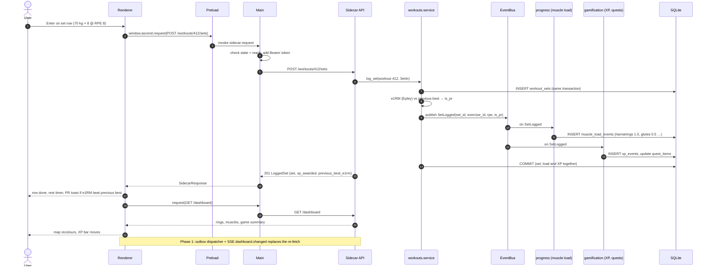

# Sequence Diagram — Log a Working Set

> **Diagram 11 (UML 2.5 — Behavioural).** What happens between pressing Enter on a set
> and the muscle map changing colour, as implemented in the v0.1 skeleton (handlers run
> inline in the request's transaction), with the Phase 1 push step shown at the end.
> Target: < 150 ms end to end (estimate).

## Alternative: sidecar not ready

If the supervisor is not `ready` at step 4, `request` rejects (`sidecar is restarting`);
the renderer keeps the row as "unsaved" and retries once `ready` returns. From Phase 1 the
request carries an idempotency key (the set's uuid) so a retry can never log the set twice.
