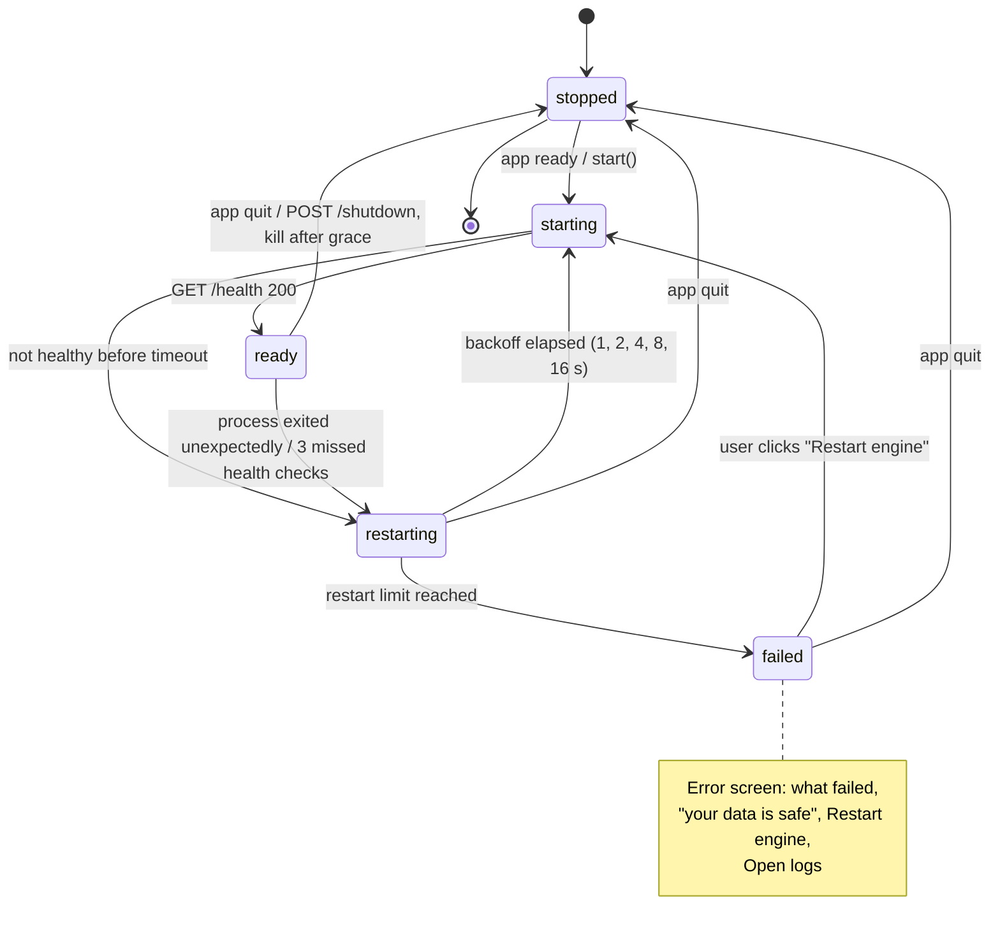
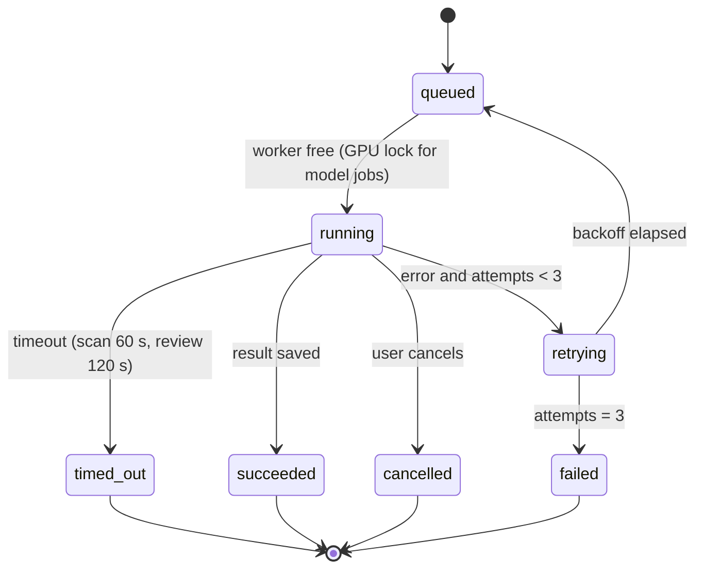

# State Machine Diagram — Sidecar Supervisor

> **Diagram 10 (UML 2.5 — Behavioural).** The supervisor in Electron main
> (`apps/desktop/electron/sidecar.ts`) that owns the sidecar process. The five states are
> the `SidecarState` values in `packages/shared/src/ipc.ts`; the renderer reads them with
> `sidecarStatus()` and, from Phase 0, receives them on `sidecar:state-changed`.
> Guards show the **v1.0 target**; v0.1 differences are in
> [system-architecture.md §5](../system-architecture.md#5-sidecar-lifecycle).

| State | Renderer shows | `request()` behaviour |
|---|---|---|
| `starting` | Splash "Starting engine…" | rejects (`sidecar is starting`) |
| `ready` | App | forwarded with token |
| `restarting` | Banner "Reconnecting…", unsaved rows kept | rejects; UI retries after `ready` |
| `failed` | Error screen | rejects |
| `stopped` | — (app quitting) | rejects |

## Second machine: a background job (Phase 2)

