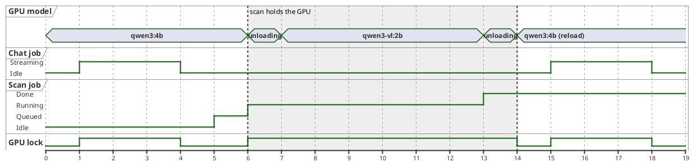

# Timing Diagram — Chat Reply Around a Meal Scan

> **Diagram 13 (UML 2.5 — Behavioural).** How the single 4 GB GPU is shared over time
> when the user starts a meal scan while chatting. Mermaid has no timing diagram, so
> this is PlantUML. Times are **illustrative estimates**, not measurements.

| Interval (s, est.) | What happens |
|---|---|
| 1–4 | Chat reply streams (holds the GPU lock) |
| 5 | User drops a photo; scan job queued behind chat |
| 6–7 | Chat model unloaded (`keep_alive: 0`), VLM loaded |
| 7–13 | VLM finds items; classifier runs on CPU in parallel per crop |
| 13–14 | VLM unloaded, chat model reloaded |
| 15 | Next chat reply starts — a few seconds later than without the scan |
