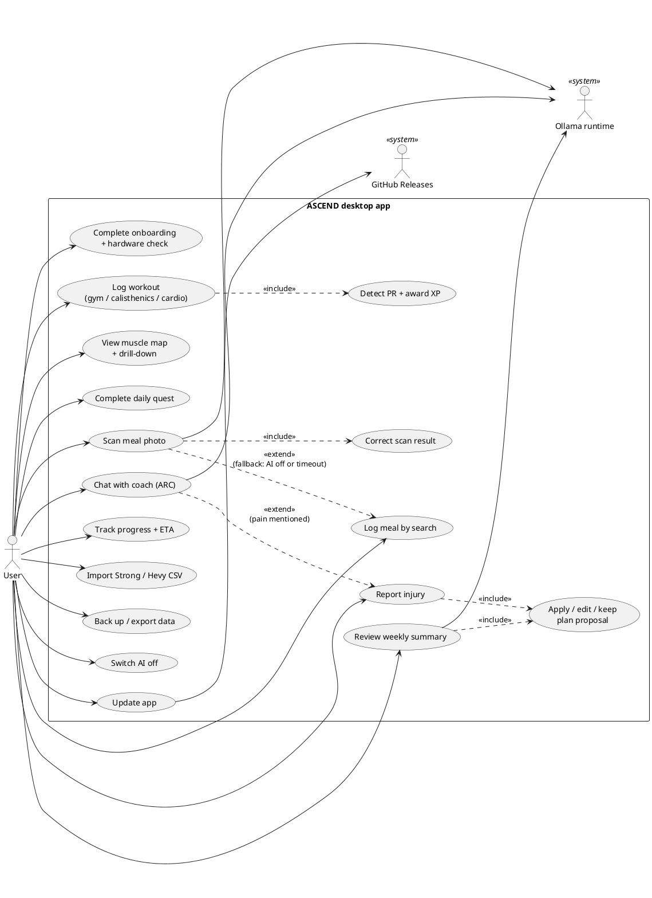

# Use Case Diagram — ASCEND

> **Diagram 1 (UML 2.5 — Behavioural).** What the user can do with ASCEND and which
> secondary actors take part. Mermaid has no use-case notation, so this is PlantUML.
> Secondary actors are local software, not people or servers.

## Notes

| Use case | Works with AI off? | Feature id ([features.md](../../planning/features.md)) |
|---|---|---|
| Scan meal photo | No → falls back to *Log meal by search* | N2 |
| Chat with coach | Templates and rules answers only | C4 |
| Review weekly summary | Yes (template summary) | C3 |
| All others | Yes | — |
