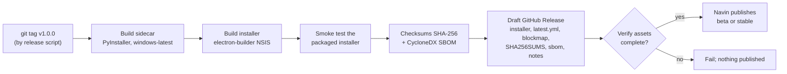

# Release Process

> How ASCEND goes from `main` to a user's PC, and back if something is wrong.
> **Navin** decides (version, go/no-go, promotion, rollback); **Gokul** owns the
> automation (workflows, updater, assets). Packaging decision: [ADR-0008](../architecture/adr/0008-electron-builder-pyinstaller-packaging.md).

---

## 0. As built (1.0.0)

Sections 1–7 below are the plan from the design phase. This is how a release is actually cut
at 1.0.0:

1. **Bump the version** in one commit (`chore(release): bump version to x.y.z`): the root,
   `apps/desktop` and `packages/shared` `package.json` files (and the `@ascend/shared`
   dependency), `package-lock.json`, `services/sidecar/pyproject.toml`, `app/__init__.py`,
   `uv.lock`, and the version placeholder in `.github/ISSUE_TEMPLATE/bug_report.yml`.
   `git grep` the old version to be sure. The installer name comes from the desktop
   `package.json`: `ASCEND-Setup-x.y.z.exe`.
2. **Write the notes:** a `## [x.y.z] - date` section in `CHANGELOG.md` and the user-facing
   notes in `docs/releases/vx.y.z.md` (highlights, install, requirements, known limitations).
3. **Push to `main`** and wait until CI, ML and the Windows installer workflow are green.
4. **Tag it:** `git tag vx.y.z` on that commit, then `git push origin vx.y.z`.
5. **`release.yml` runs:** job `windows-installer` builds the PyInstaller sidecar and smoke-tests
   it, builds the NSIS installer and checks the Electron fuses; job `publish` creates the GitHub
   Release `ASCEND vx.y.z` with the installer, `SHA256SUMS.txt` and the notes from
   `docs/releases/vx.y.z.md` (generated notes if that file is missing). A release drafted by hand
   first is updated, not duplicated.
6. **Check the release page:** the `.exe` name carries the new version and `SHA256SUMS.txt` is
   attached.

Not built from the plan (yet): the beta channel and electron-updater (`latest.yml`,
blockmaps), the release script and its version-consistency check, the silent-install smoke test,
the SBOM, the protected `release` environment and model-only releases. Users update by
downloading the new installer; their data in `%APPDATA%\ASCEND` is kept.

## 1. Versioning

- **App:** SemVer `MAJOR.MINOR.PATCH`. Pre-1.0 milestones: `0.1` (hello installer),
  `0.3` (core loop), `0.6` (local AI), then `1.0.0`. Betas: `1.1.0-beta.1`.
- **Schema:** Alembic head revision; recorded in release notes. A release that adds a
  migration bumps at least MINOR.
- **Formulas:** each engine's `ALGO_VERSION` (e.g. `load-1.1.0`); changes listed in notes.
- **Models:** independent versions in `models-manifest.json` (`ascend-food-cls@1.2.0`),
  each with `min_app_version`.
- Version source of truth: `apps/desktop/package.json` and `services/sidecar/pyproject.toml`
  bumped together by the release script (CI fails if they differ).

## 2. Channels

| Channel | Who gets it | electron-updater setting |
|---|---|---|
| `beta` | The team + opted-in testers | `allowPrerelease: true`, channel `beta` |
| `stable` | Everyone | default |

Every stable release spends **≥ 3 days in beta** with no new crash (R1) before promotion.

## 3. Release workflow (plan; see §0 for what `release.yml` does today)

| Step | Detail |
|---|---|
| Trigger | Tag `v*.*.*` pushed by `scripts/release.ps1` from an up-to-date `main` |
| Build | Same commands as [local-setup §9](../development/local-setup.md#9-build-an-installer-locally-gokuls-lane-anyone-can-run-it), with caches |
| Smoke test | Silent install into a temp user profile, launch, wait for `/health`, log one set through the UI (Playwright), uninstall |
| Assets | `ASCEND-Setup-x.y.z.exe`, `.blockmap`, `latest.yml` (or `beta.yml`), `SHA256SUMS.txt`, `sbom.cdx.json`, release notes |
| Verification | Script checks every asset exists and `latest.yml` hashes match the installer before the draft can be published |
| Publish | Manual click by Navin (protected environment `release` with required reviewer) |

## 4. Release checklist (Navin)

- [ ] All gate metrics for this milestone met or explicitly waived in the notes ([evaluation.md §3](evaluation.md#3-gate-usage))
- [ ] `CHANGELOG.md` updated (Conventional Commits → grouped notes; user-facing language)
- [ ] Migrations listed; backup-before-migrate verified on a copy of a real (team) DB
- [ ] Known issues + SmartScreen note (unsigned build) in the notes
- [ ] Model manifest compatible (`min_app_version`)
- [ ] Beta for ≥ 3 days with no new crash → promote to stable

## 5. Rollback

Electron auto-update cannot downgrade by itself, and the database may have migrated.
So rollback means **roll forward**:

1. Unpublish (mark as draft) the bad release so no new user updates to it.
2. Revert the faulty commit(s) on `main`; release `x.y.(z+1)` with the fix.
3. If a migration is at fault: the new patch includes a corrective migration; users who
   need it can restore the automatic pre-migration backup (Settings → Backups).
4. Post a short incident note in `docs/operations/reports/`.

**Rollback drill** (Phase 3, required before v1.0): publish a deliberately broken beta,
detect it with the smoke test on a second machine, roll forward, record timings.

## 6. Model-only releases (Phase 5)

1. Promote a model in the MLflow registry after the gate ([ml-pipeline.md §5](../architecture/ml-pipeline.md#5-evaluation-and-gate)).
2. Workflow `model-release.yml` uploads the ONNX file + `labels.json` to a GitHub Release
   tagged `model-ascend-food-cls-v1.2.0` and updates `models-manifest.json`.
3. The app checks the manifest (opt-in), downloads, verifies SHA-256, switches on next
   start; the previous model is kept for one-click revert.

## 7. Signing

Unsigned builds show a SmartScreen warning until they earn reputation. Options are tracked
in [ADR-0008](../architecture/adr/0008-electron-builder-pyinstaller-packaging.md); until
decided, every release publishes SHA-256 checksums and the notes explain the warning.
