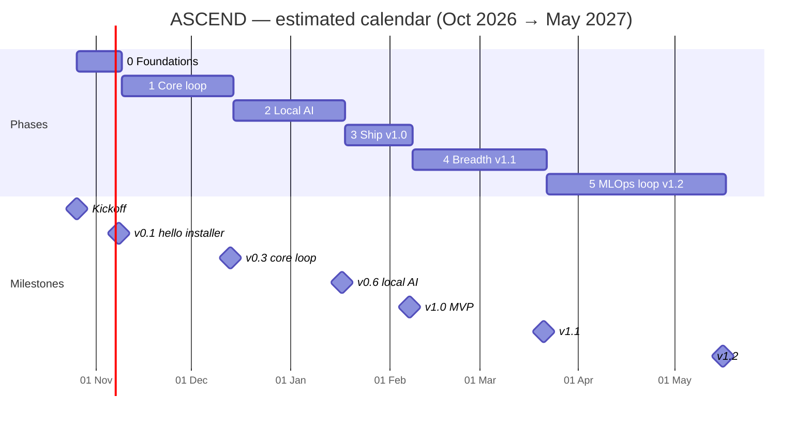

# Timeline

> **Design record, not a description of the shipped app.** Written to plan the build; where it
> differs from the code, the [README](../../README.md) and the [CHANGELOG](../../CHANGELOG.md) describe what
> ASCEND 1.1.0 actually does.

> **All dates are estimates**, assuming each member gives ~8–10 hours a week (estimate)
> around final-year coursework. Exam weeks are not yet known — the lead adjusts this
> page once the semester calendar is out. Phases: [phases.md](phases.md).

---

## 1. Calendar

## 2. Week by week to v1.0

| Week of | Phase | Focus (all lanes) |
|---|---|---|
| 26 Oct | 0 | Kickoff, repo, rules, contracts draft, machine setup |
| 2 Nov | 0 | Shell + sidecar + migration; CI; first installer artefact (v0.1) |
| 9 Nov | 1 | Freeze core contracts; logger API + UI; event bus |
| 16 Nov | 1 | PRs, History; muscle-load projector; DVC + MLflow up |
| 23 Nov | 1 | Muscle map component; XP/levels; coverage + drift gates |
| 30 Nov | 1 | Quests, streaks, freezes; food DB import; photo collection |
| 7 Dec | 1 | Rings, onboarding; baseline classifier; gate demo (v0.3) |
| 14 Dec | 2 | Job queue, model manager; model benchmarks |
| 21 Dec | 2 | Ollama client + fallbacks; coach planner; classifier training |
| 28 Dec | 2 | Injury flow; chat UI with streaming; ONNX export + parity |
| 4 Jan | 2 | Scan pipeline + chips UI; eval gate job |
| 11 Jan | 2 | Weekly review; Tamil 30-question test; gate demo (v0.6) |
| 18 Jan | 3 | Release workflow; backup/restore; states pass |
| 25 Jan | 3 | Auto-update channels; Strong/Hevy import; diagnostics |
| 1 Feb | 3 | Packaged smoke tests, rollback drill, release notes → **v1.0 (~7 Feb)** |

## 3. Expected hours per member (estimate)

| Phase | Weeks | Dhanush | Jegatheesan | Gokul | Navin |
|---|---|---|---|---|---|
| 0 | 2 | 16 | 16 | 20 | 20 |
| 1 | 5 | 45 | 50 | 35 | 40 |
| 2 | 5 | 40 | 50 | 30 | 45 |
| 3 | 3 | 25 | 25 | 30 | 30 |
| **To v1.0** | **15** | **~126** | **~141** | **~115** | **~135** |

The backend lane is the heaviest; if it slips, Navin takes the `io` adapters and Gokul
takes diagnostics bundling (decision-log row required).

## 4. After v1.0

Phases 4–5 overlap placement interviews (Feb–Apr 2027). Hours drop to ~5–6 a week each
(estimate); the cut order in [phases.md §6](phases.md#6-cut-order) applies first to v1.1 items.
